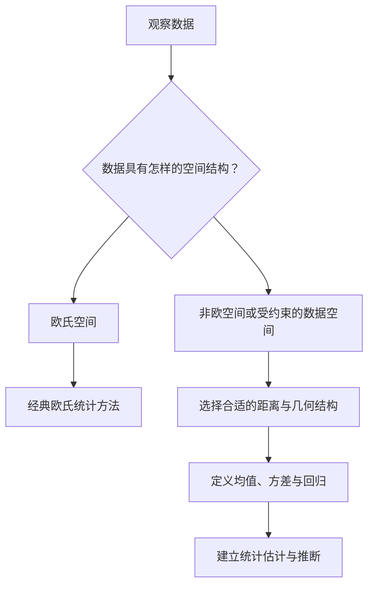
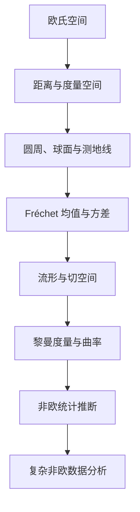

# 第 001 讲｜为什么需要非欧统计？

> **Non-Euclidean Statistics**
>
> **Lecture 001 — Introduction to Non-Euclidean Statistics**
>
> 难度：入门
>
> 前置知识：基本代数、平均值与距离

---

## 1. 本讲学习目标

在正式学习非欧统计学之前，我们首先需要理解：

1. 传统统计学通常处理什么样的数据？
2. 什么是欧氏空间（Euclidean Space）？
3. 为什么有些数据不能直接使用普通的统计方法？
4. 什么是数据的几何结构？
5. 非欧统计学究竟研究什么？

本讲不要求微分几何知识，重点是建立直观认识。

---

## 2. 从传统统计学开始

### 2.1 传统统计学中的数据

考虑一些常见的统计数据：

- 一个人的身高
- 一个人的体重
- 某天的温度
- 一家公司的收入

这些数据通常可以表示为实数：

```math
x\in\mathbb R
```

其中 $\mathbb R$ 表示实数集合。

例如：

```math
x=175
```

表示一个人的身高为 175 cm。

如果我们同时记录一个人的身高和体重，就可以使用二维向量：

```math
x=(175,65)
```

数学上写作：

```math
x\in\mathbb R^2
```

如果记录 $p$ 个特征，则可以写成：

```math
x=(x_1,x_2,\ldots,x_p)\in\mathbb R^p
```

其中：

- $x_j$：第 $j$ 个特征
- $p$：特征的数量
- $\mathbb R^p$：$p$ 维欧氏空间

因此，传统多元统计学中的许多方法都建立在欧氏空间之上。

### 2.2 欧氏空间是什么？

简单来说：

**欧氏空间（Euclidean Space）是普通几何空间在高维情况下的推广。**

例如：

| 空间 | 几何解释 |
|---|---|
| $\mathbb R$ | 一条实数直线 |
| $\mathbb R^2$ | 一个二维平面 |
| $\mathbb R^3$ | 三维空间 |
| $\mathbb R^p$ | $p$ 维欧氏空间 |

在欧氏空间中，我们可以自然地进行：

1. 向量加法
2. 数乘
3. 距离计算
4. 平均值计算

例如，对两个二维向量：

```math
x=(1,2),\qquad y=(3,4)
```

它们的加法为：

```math
x+y=(4,6)
```

它们的算术平均为：

```math
\frac{x+y}{2}=(2,3)
```

这个结果依然属于 $\mathbb R^2$。

这一点非常重要：

**在欧氏空间中，两个点的算术平均仍然位于同一个空间。**

---

## 3. 统计学为什么需要距离？

统计分析经常需要判断两个观测对象是否接近。

例如，我们可能希望回答：

- 两个人的特征是否相似？
- 哪些观测值属于同一个聚类？
- 一个样本距离总体中心有多远？
- 一个预测值与真实值相差多少？

这些问题都与距离有关。

### 3.1 欧氏距离

在二维空间中，假设：

```math
x=(0,0),\qquad y=(3,4)
```

根据勾股定理，它们之间的距离为：

```math
d(x,y)=\sqrt{(3-0)^2+(4-0)^2}=5
```

在一般的 $p$ 维欧氏空间中，欧氏距离定义为：

```math
d(x,y)=\sqrt{\sum_{j=1}^{p}(x_j-y_j)^2}
```

这里：

- $d(x,y)$：点 $x$ 与点 $y$ 之间的距离
- $x_j$：向量 $x$ 的第 $j$ 个分量
- $y_j$：向量 $y$ 的第 $j$ 个分量

欧氏距离是传统统计中最常见的距离之一。

### 3.2 为什么距离重要？

假设有三个观测值：

```math
X_1=2,\quad X_2=4,\quad X_3=6
```

它们的样本均值为：

```math
\bar X=\frac{2+4+6}{3}=4
```

我们还可以从另一个角度理解这个均值。

考虑下面的函数：

```math
F(\mu)=\sum_{i=1}^{3}(X_i-\mu)^2
```

它表示三个观测值到某个候选中心 $\mu$ 的平方距离之和。

将数据代入：

```math
F(\mu)=(2-\mu)^2+(4-\mu)^2+(6-\mu)^2
```

展开并配方：

```math
F(\mu)=3(\mu-4)^2+8
```

因此，当 $\mu=4$ 时，函数取得最小值。

也就是说：

```math
F(4)=\min_{\mu\in\mathbb R}F(\mu)
```

我们发现：

**普通样本均值不仅是观测值的算术平均，也是使总平方距离最小的点。**

这为以后推广非欧空间中的均值提供了重要思路。

---

## 4. 一个普通统计方法失效的例子

现在考虑一种不同的数据：方向。

### 4.1 方向数据

假设两次观测得到的方向分别是：

```math
\theta_1=10^\circ
```

```math
\theta_2=350^\circ
```

如果使用普通算术平均：

```math
\bar\theta=\frac{10^\circ+350^\circ}{2}=180^\circ
```

结果为 $180^\circ$。

但是，这个结果合理吗？

如果我们规定：

- $0^\circ$：正北
- $90^\circ$：正东
- $180^\circ$：正南
- $270^\circ$：正西

那么：

- $10^\circ$ 位于正北偏东
- $350^\circ$ 位于正北偏西

两个方向都非常接近正北。

它们的平均方向却变成正南，显然不符合直觉。

### 4.2 问题出在哪里？

问题在于：

**方向数据并不是普通的实数数据。**

在方向的意义下：

```math
0^\circ\sim360^\circ
```

其中 $\sim$ 表示两个角度对应相同的方向。

类似地：

```math
10^\circ\sim370^\circ
```

因为旋转一整圈以后，我们仍然回到同一个方向。

因此，方向数据具有周期性（Periodicity）。

这种结构与普通实数直线不同。

### 4.3 方向数据生活在什么空间？

方向可以表示为单位圆上的点：

```math
S^1=\{(x,y)\in\mathbb R^2:x^2+y^2=1\}
```

其中：

- $S^1$：单位圆
- $(x,y)$：圆周上的点
- $x^2+y^2=1$：单位圆的方程

角度 $\theta$ 可以对应为：

```math
(\cos\theta,\sin\theta)
```

因此，一个角度不仅是一个数字，也对应单位圆上的一个位置。

这里的关键区别是：

**我们关心的是圆周上的位置，而不是角度数值本身。**

---

## 5. 不同的空间意味着不同的距离

### 5.1 普通实数距离

如果把两个角度当作普通实数：

```math
d(10,350)=|10-350|=340
```

得到的距离为 $340$。

但两个方向显然非常接近。

### 5.2 圆周距离

对于取值在 $[0,360)$ 的角度，可以考虑圆周上的最短角距离：

```math
d_C(a,b)=\min\{|a-b|,\ 360-|a-b|\}
```

其中：

- $a,b$：以度为单位的角度
- $d_C$：两个方向之间的最短角距离

代入数据：

```math
d_C(10,350)=\min\{340,20\}=20
```

因此，两个方向之间实际只相隔 $20^\circ$。

这比普通实数距离更加符合方向数据的结构。

注意：这里计算的是最短角度差。对于单位圆，使用弧度时，它也对应最短圆弧的长度。

### 5.3 一个重要结论

对于同一组数据：

- 使用普通实数距离，得到 $340^\circ$
- 使用圆周最短角距离，得到 $20^\circ$

为什么结果差别如此之大？

因为我们使用了不同的距离定义。

这说明：

**距离并不只是一个计算公式，它反映了我们如何理解数据所在空间。**

---

## 6. 什么是非欧数据？

非欧数据（Non-Euclidean Data）通常指那些自然结构不能被普通欧氏向量运算和欧氏距离充分描述的数据对象。

常见的例子包括：

| 数据类型 | 自然空间或结构 | 统计问题 |
|---|---|---|
| 方向数据 | 圆周 | 如何计算平均方向？ |
| 地球表面的位置 | 球面 | 如何计算平均位置？ |
| 形状数据 | 形状空间 | 如何比较两个形状？ |
| 正定协方差矩阵 | 正定矩阵空间 | 如何计算平均矩阵？ |
| 概率分布 | 概率分布空间 | 如何定义分布间的距离？ |
| 图和网络 | 图空间 | 如何比较网络结构？ |

这里需要特别注意：

非欧数据并不意味着它们完全不能用数字表示。

例如，圆周上的点可以用两个实数坐标表示。

但是，我们不能因此忽略它必须满足的约束：

```math
x^2+y^2=1
```

普通欧氏平均可能得到圆周内部的点，而不是圆周上的点。

所以：

**能够使用欧氏坐标表示，不意味着适合直接使用所有欧氏统计方法。**

---

## 7. 非欧统计学研究什么？

非欧统计学（Non-Euclidean Statistics）的一个重要目标是：

在尊重数据几何结构的前提下，推广经典统计学的方法。

例如，传统统计学中有：

- 均值
- 方差
- 回归
- 假设检验
- 统计推断

当数据不再是普通欧氏向量时，我们需要重新思考这些概念。



**图 1：不同的数据结构可能需要不同的统计方法。**

需要强调的是：

非欧统计学并不是要完全替代经典统计学，而是将经典统计学推广到更一般的数据对象。

---

## 8. 我们未来会学习什么？

本课程将逐步建立以下知识体系：



**图 2：非欧统计学的基础学习路线。**

其中，最重要的几个概念包括：

**Metric Space（度量空间）**

在一个集合上定义满足特定公理的距离。

**Geodesic（测地线）**

在适当的几何空间中，描述局部最短路径的曲线。

**Fréchet Mean（Fréchet 均值）**

通过最小化期望平方距离来定义数据的中心。

**Manifold（流形）**

局部看起来像欧氏空间的几何空间。

**Riemannian Geometry（黎曼几何）**

研究光滑流形上的长度、角度、距离和曲率等几何性质。

这些概念目前不需要完全理解，之后会逐一介绍。

---

## 9. 常见误区

### 误区 1：非欧数据不能用数字表示

错误。

许多非欧数据可以通过欧氏坐标或矩阵表示，但表示方式不等于数据的内在几何结构。

### 误区 2：非欧空间一定是弯曲的流形

错误。

非欧统计所研究的对象非常广泛，一般度量空间、图空间和某些复杂对象空间不一定具有光滑流形结构。

### 误区 3：欧氏距离永远不适合非欧数据

也不完全正确。

对于某些嵌入在欧氏空间中的非欧数据，欧氏距离仍然可以作为有意义的距离。

关键在于研究问题和所选择的几何结构。

---

## 10. 本讲总结

本讲最重要的三个结论是：

### 结论一

传统统计学中的许多方法以欧氏空间中的向量运算和距离为基础。

### 结论二

有些数据具有特殊的几何结构，例如方向数据的周期性。

如果忽略这些结构，普通统计方法可能产生不合理的结果。

### 结论三

非欧统计学的核心思想是：

> Statistics should respect the geometry of data.

即：

**统计方法应当尊重数据的几何结构。**

---

## 11. 课后练习

### 练习 1：欧氏距离

给定二维空间中的两个点：

```math
x=(1,2),\qquad y=(4,6)
```

计算它们之间的欧氏距离。

### 练习 2：方向数据

假设两个观测方向分别为：

```math
5^\circ,\qquad355^\circ
```

回答：

1. 如果直接使用算术平均，结果是多少？
2. 两个方向之间的最短角距离是多少？
3. 你认为它们合理的平均方向是什么？

### 练习 3：概念理解

思考下面的问题：

为什么一个数据对象能够用欧氏坐标表示，并不意味着我们可以直接使用所有欧氏统计方法？


<details>
<summary>点击查看参考答案</summary>

### 练习 1

两点之间的欧氏距离：

$d(x,y)=\sqrt{(4-1)^2+(6-2)^2}$

因此：

$d(x,y)=5$

### 练习 2

普通算术平均：

$\frac{5+355}{2}=180$

最短角距离：

$d_C(5,355)=\min\{350,10\}=10$

合理的平均方向为 $0^\circ$。

### 练习 3

因为数据可能受到几何约束。

例如，单位圆中的点必须满足：

$x^2+y^2=1$

普通向量平均可能不满足这一条件，从而离开原来的数据空间。

因此，需要根据数据结构选择合适的统计方法。

</details>

---

## 12. 下一讲预告

### 第 002 讲｜什么是度量空间（Metric Space）？

我们已经知道，距离的选择会影响统计分析。

下一讲将正式学习：

- 什么是集合？
- 什么是距离函数？
- 度量需要满足哪些基本公理？
- 为什么欧氏距离是一个合法的度量？
- 是否所有看起来像距离的函数都是度量？

度量空间是理解非欧统计学的重要数学基础。

---

**End of Lecture 001**
