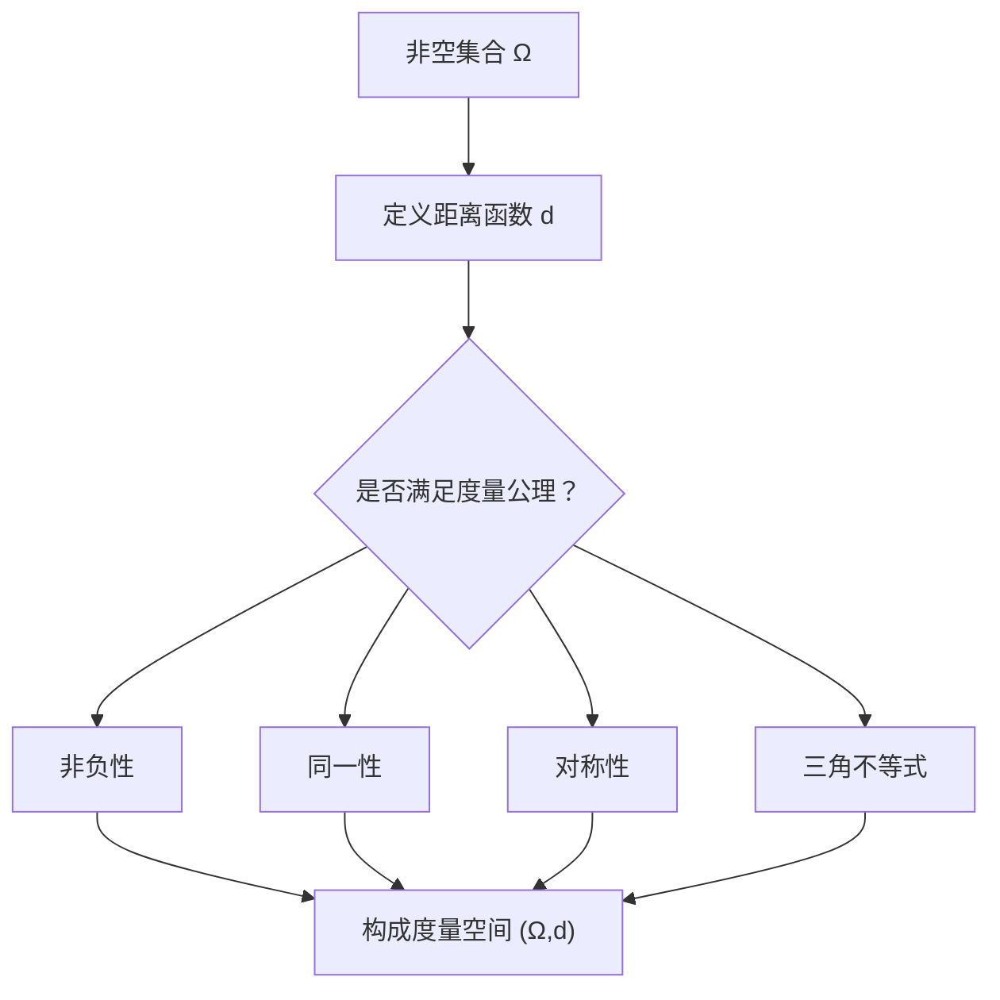

# 第 002 讲｜什么是度量空间（Metric Space）？

> **Non-Euclidean Statistics**
>
> **Lecture 002 — Introduction to Metric Spaces**
>
> 难度：入门
>
> 前置知识：集合、实数、绝对值、欧氏距离

---

## 1. 本讲学习目标

上一讲我们发现：

**不同的数据空间可能需要不同的距离定义。**

例如，普通实数与圆周方向的数据具有不同的几何结构。

这引出了一个重要问题：

> 一个函数需要满足什么条件，才能在数学上被称为距离？

本讲将学习：

1. 什么是集合与空间？
2. 什么是度量（Metric）？
3. 度量必须满足哪些数学公理？
4. 什么是度量空间（Metric Space）？
5. 为什么度量空间是非欧统计学的重要基础？

---

## 2. 从集合开始

### 2.1 什么是集合？

集合（Set）是由一些对象组成的整体。

例如：

```math
\Omega=\{1,2,3,4,5\}
```

这是一个包含五个元素的集合。

符号：

```math
x\in\Omega
```

表示 $x$ 是集合 $\Omega$ 中的元素。

例如：

```math
3\in\Omega
```

而：

```math
7\notin\Omega
```

表示 7 不属于这个集合。

在统计学中，我们可以用一个集合来描述数据所有可能的取值。

例如：

- 实数数据：$\Omega=\mathbb R$
- 二维向量数据：$\Omega=\mathbb R^2$
- 三维向量数据：$\Omega=\mathbb R^3$
- 方向数据：$\Omega=S^1$

其中 $S^1$ 表示单位圆。

需要注意，集合本身只告诉我们有哪些元素，并没有规定元素之间的距离。

### 2.2 集合并不自动具有距离

考虑集合：

```math
\Omega=\{A,B,C\}
```

我们知道其中有三个对象。

但是，仅仅知道这些对象属于同一个集合，并不能回答：

- A 与 B 相距多远？
- A 与 C 是否比 A 与 B 更接近？
- 如何寻找最接近 A 的对象？

要回答这些问题，我们需要额外定义一种距离规则。

这就引出了度量。

---

## 3. 什么是度量（Metric）？

### 3.1 数学定义

设 $\Omega$ 是一个非空集合。

考虑函数：

```math
d:\Omega\times\Omega\rightarrow[0,\infty)
```

这里：

- $\Omega$：所有可能对象组成的集合
- $\Omega\times\Omega$：所有有序对象对 $(x,y)$ 的集合
- $d$：接受两个对象并返回一个非负实数的函数
- $d(x,y)$：对象 $x$ 与 $y$ 之间的距离

但是，一个函数输出非负数，并不意味着它一定是度量。

为了称为度量，它还必须满足一些数学性质。

### 3.2 度量的四条基本公理

对于任意 $x,y,z\in\Omega$，度量 $d$ 必须满足以下条件。

#### 公理一：非负性（Non-negativity）

```math
d(x,y)\geq 0
```

距离不能为负数。

这符合我们对距离的基本理解。

#### 公理二：同一性（Identity of Indiscernibles）

```math
d(x,y)=0\iff x=y
```

这里 $\iff$ 表示当且仅当。

这个条件意味着：

1. 一个对象到自身的距离为零。
2. 如果两个对象之间的距离为零，那么它们必须是同一个对象。

需要注意，两个不同对象不能具有零距离。

#### 公理三：对称性（Symmetry）

```math
d(x,y)=d(y,x)
```

从 $x$ 到 $y$ 的距离，应当等于从 $y$ 到 $x$ 的距离。

例如：

```math
|3-7|=|7-3|=4
```

交换两个对象的位置不会改变距离。

#### 公理四：三角不等式（Triangle Inequality）

```math
d(x,z)\leq d(x,y)+d(y,z)
```

这是最值得深入理解的一条公理。

它的直观含义是：

**直接从一个点到另一个点的距离，不会超过经过第三个点的两段距离之和。**

例如，在实数直线上：

```math
x=1,\qquad y=4,\qquad z=8
```

则：

```math
d(1,8)=7
```

而：

```math
d(1,4)+d(4,8)=3+4=7
```

因此：

```math
7\leq 3+4
```

三角不等式成立。

注意，这个例子中取了等号，但一般情况下也可能是严格小于。

---

## 4. 什么是度量空间（Metric Space）？

现在我们可以给出正式定义。

**定义：度量空间**

如果集合 $\Omega$ 配备了满足上述四条公理的度量函数 $d$，那么二元组：

```math
(\Omega,d)
```

称为一个度量空间。

其中：

- $\Omega$ 决定研究的对象有哪些。
- $d$ 决定这些对象之间如何测量距离。

需要特别强调：

**度量空间不是只有一个集合，还必须指定一个度量。**

即使两个空间具有完全相同的元素，只要采用不同的距离，它们也可能具有不同的度量结构。

### 4.1 度量空间的基本结构



**图 1：度量空间的组成与四条基本公理。**

---

## 5. 第一个例子：实数上的通常距离

考虑：

```math
\Omega=\mathbb R
```

定义：

```math
d(x,y)=|x-y|
```

我们来验证它是否满足度量公理。

### 5.1 非负性

绝对值始终非负，因此：

```math
|x-y|\geq 0
```

成立。

### 5.2 同一性

绝对值等于零当且仅当内部表达式等于零：

```math
|x-y|=0\iff x=y
```

成立。

### 5.3 对称性

由于绝对值满足：

```math
|x-y|=|y-x|
```

所以对称性成立。

### 5.4 三角不等式

绝对值具有以下性质：

```math
|a+b|\leq |a|+|b|
```

注意：

```math
x-z=(x-y)+(y-z)
```

因此：

```math
|x-z|
\leq
|x-y|+|y-z|
```

三角不等式成立。

所以：

```math
(\mathbb R,|\cdot-\cdot|)
```

是一个度量空间。

这里的记号表示：实数集合配备通常的绝对值距离。

---

## 6. 第二个例子：欧氏空间

对于：

```math
\Omega=\mathbb R^p
```

定义欧氏距离：

```math
d(x,y)
=
\sqrt{\sum_{j=1}^{p}(x_j-y_j)^2}
```

其中：

```math
x=(x_1,\ldots,x_p)
```

```math
y=(y_1,\ldots,y_p)
```

这个距离满足：

1. 非负性
2. 同一性
3. 对称性
4. 三角不等式

因此：

```math
(\mathbb R^p,d)
```

是一个度量空间。

这里暂时不证明高维欧氏距离的三角不等式。它可以由范数的三角不等式得到，后面学习范数时会进一步解释。

这一例子说明：

**我们熟悉的欧氏空间，本身就是度量空间的一个重要例子。**

但是，度量空间的范围远远大于欧氏空间。

---

## 7. 第三个例子：离散度量（Discrete Metric）

考虑任意非空集合 $\Omega$。

我们定义：

```math
d(x,y)=
\begin{cases}
0,&x=y,\\
1,&x\neq y.
\end{cases}
```

也就是说：

- 两个对象相同，距离为 0。
- 两个对象不同，距离为 1。

这种距离称为**离散度量**。

### 7.1 为什么它是一个度量？

首先，距离只能取 0 或 1，所以一定非负。

其次：

```math
d(x,y)=0\iff x=y
```

满足同一性。

交换 $x$ 和 $y$ 不会改变两者是否相同，因此满足对称性。

对于三角不等式：

```math
d(x,z)\leq d(x,y)+d(y,z)
```

如果 $x=z$，左边为 0，必然成立。

如果 $x\neq z$，那么 $x\neq y$ 与 $y\neq z$ 至少有一个成立，所以右边至少为 1，而左边恰好等于 1。

因此三角不等式也成立。

### 7.2 为什么这个例子重要？

离散度量说明：

**距离并不一定来自我们熟悉的几何长度。**

例如：

```math
\Omega=\{\text{猫},\text{狗},\text{鸟}\}
```

我们也可以定义：

```math
d(\text{猫},\text{狗})=1
```

```math
d(\text{猫},\text{猫})=0
```

这依然是一种合法度量。

当然，离散度量只是区分对象是否相同，不能表达动物之间更丰富的相似程度。

这个例子说明：度量空间不要求对象必须能够表示成普通数值向量。

---

## 8. 反例：不是所有距离函数都是度量

考虑实数集合：

```math
\Omega=\mathbb R
```

定义函数：

```math
d(x,y)=(x-y)^2
```

这个函数看起来很像距离。

它满足：

- 非负性
- 同一性
- 对称性

但是它满足三角不等式吗？

取：

```math
x=0,\qquad y=1,\qquad z=2
```

计算：

```math
d(0,2)=(0-2)^2=4
```

另一方面：

```math
d(0,1)+d(1,2)=1+1=2
```

如果满足三角不等式，应当有：

```math
4\leq 2
```

显然不成立。

因此：

```math
d(x,y)=(x-y)^2
```

**不是一个度量。**

### 8.1 这里有什么值得注意的？

在统计学中，平方距离非常常见。

例如：

```math
\sum_{i=1}^{n}(X_i-\mu)^2
```

但是，我们需要区分：

- 距离 $d(x,y)$
- 平方距离 $d^2(x,y)$

即使 $d$ 是度量，$d^2$ 也不一定仍然是度量。

这一区分在以后学习 Fréchet 均值时非常重要。

---

## 9. 度量空间和非欧统计有什么关系？

在传统欧氏统计中，我们可以直接计算：

```math
\bar X=\frac{1}{n}\sum_{i=1}^{n}X_i
```

但对于一般度量空间中的对象，加法和数乘可能根本没有定义。

例如，若样本为：

```math
X_1,X_2,\ldots,X_n\in\Omega
```

在一般度量空间中，我们通常不能直接写出这些对象的算术平均。

然而，我们仍然可以计算：

```math
d(X_i,\omega)
```

也可以构造：

```math
F(\omega)=\sum_{i=1}^{n}d^2(X_i,\omega)
```

其中 $\omega\in\Omega$ 是候选的中心对象。

这就提供了一种可能的思路：

**既然不能直接相加，我们可以尝试通过最小化距离来定义中心。**

这正是后来 Fréchet 均值的重要思想之一。

不过，最小值是否存在、是否唯一，还需要额外条件。

---

## 10. 进一步理解：同一个集合，不同的度量

考虑：

```math
\Omega=\mathbb R^2
```

我们可以定义欧氏距离：

```math
d_2(x,y)
=
\sqrt{(x_1-y_1)^2+(x_2-y_2)^2}
```

也可以定义曼哈顿距离：

```math
d_1(x,y)
=
|x_1-y_1|+|x_2-y_2|
```

两种距离都满足度量公理。

例如：

```math
x=(0,0),\qquad y=(3,4)
```

欧氏距离：

```math
d_2(x,y)=5
```

曼哈顿距离：

```math
d_1(x,y)=7
```

我们得到不同的结果。

但它们都是合法的距离。

所以：

**一个集合本身通常不能唯一决定其度量。**

同一个数据空间可以根据研究目的配备不同的距离函数。

这是度量空间统计中非常重要的思想。

---

## 11. 常见误区

### 误区一：距离一定是欧氏距离

错误。

欧氏距离只是众多度量中的一种。

绝对值距离、离散度量和曼哈顿距离等也都是合法度量。

### 误区二：只要函数非负，就是度量

错误。

度量还必须满足同一性、对称性和三角不等式。

### 误区三：两个对象不同，它们的距离可以是零

对于真正的度量，这是错误的。

因为：

```math
d(x,y)=0\iff x=y
```

但某些更一般的距离概念，如伪度量（Pseudometric），可以允许不同对象的距离为零。

本课程目前只讨论通常意义下的度量。

### 误区四：平方距离一定也是度量

错误。

即使 $d$ 是一个度量，$d^2$ 也可能违反三角不等式。

---

## 12. 本讲总结

本讲最重要的三个结论：

### 结论一

度量空间由一个集合和一个距离函数共同组成：

```math
(\Omega,d)
```

### 结论二

一个度量必须满足四条基本公理：

1. 非负性
2. 同一性
3. 对称性
4. 三角不等式

### 结论三

度量空间不依赖于普通欧氏向量运算。

因此，它为研究复杂数据对象提供了更一般的数学框架。

**本讲核心思想：**

> A metric space provides a mathematical framework for measuring distances between objects.

---

## 13. 课后练习

### 练习 1：判断是否为度量

考虑：

```math
\Omega=\mathbb R
```

以及函数：

```math
d(x,y)=|x-y|+1
```

回答：

1. 这个函数是否满足非负性？
2. 是否满足对称性？
3. 它是否是一个度量？为什么？

### 练习 2：不同的距离

给定：

```math
x=(1,2),\qquad y=(4,6)
```

分别计算：

1. 欧氏距离 $d_2(x,y)$
2. 曼哈顿距离 $d_1(x,y)$

并思考为什么它们会给出不同的数值。

<details>
<summary>点击查看参考答案</summary>

### 练习 1

函数：

```math
d(x,y)=|x-y|+1
```

满足非负性和对称性。

但是：

```math
d(x,x)=|x-x|+1=1
```

一个对象到自身的距离不是零。

因此不满足同一性，不能称为度量。

### 练习 2

欧氏距离：

```math
d_2(x,y)
=
\sqrt{(4-1)^2+(6-2)^2}
=5
```

曼哈顿距离：

```math
d_1(x,y)=|4-1|+|6-2|=7
```

两种距离采用不同的计算规则，因此会产生不同的数值。

但它们都满足度量公理。

</details>

---

## 14. 下一讲预告

### 第 003 讲｜度量的性质与距离的几何意义

本讲已经正式定义了度量空间。

下一讲将进一步研究：

1. 如何系统地验证一个函数是否是度量？
2. 三角不等式有什么更深入的含义？
3. 什么是开球（Open Ball）与闭球（Closed Ball）？
4. 如何利用距离定义邻近关系？
5. 不同度量下的“球”为什么可能具有不同形状？

这些概念将帮助我们从单纯计算距离，走向理解度量空间的几何结构。

---

**End of Lecture 002**
