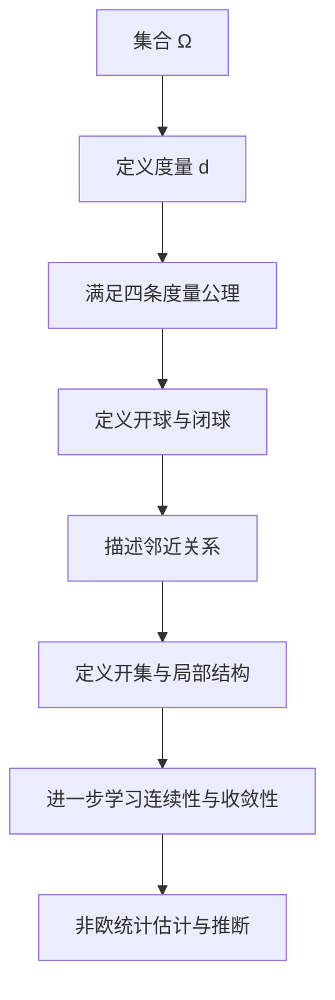

# 第 003 讲｜度量的性质与距离的几何意义

> **Non-Euclidean Statistics**
>
> **Lecture 003 — Metric Balls and the Geometry of Distance**
>
> 难度：入门
>
> 前置知识：集合、绝对值、欧氏距离、度量空间的定义

---

## 1. 本讲学习目标

上一讲我们介绍了度量空间（Metric Space）：

```math
(\Omega,d)
```

其中：

- $\Omega$ 是一个非空集合。
- $d$ 是定义在 $\Omega$ 上的度量函数。

度量必须满足非负性、同一性、对称性和三角不等式。

但是，仅仅知道距离的定义还不够。

我们需要进一步理解：

**一个距离函数究竟如何决定空间中的几何结构？**

本讲将学习：

1. 三角不等式有什么几何含义？
2. 什么是开球（Open Ball）？
3. 什么是闭球（Closed Ball）？
4. 为什么不同度量会产生不同形状的球？
5. 如何用距离定义邻近关系？
6. 这些概念与非欧统计有什么联系？

---

## 2. 回顾：度量空间的四条公理

设 $\Omega$ 为非空集合，函数：

```math
d:\Omega\times\Omega\rightarrow[0,\infty)
```

若对任意 $x,y,z\in\Omega$ 满足以下条件：

### 2.1 非负性

```math
d(x,y)\geq 0
```

### 2.2 同一性

```math
d(x,y)=0\iff x=y
```

### 2.3 对称性

```math
d(x,y)=d(y,x)
```

### 2.4 三角不等式

```math
d(x,z)\leq d(x,y)+d(y,z)
```

那么 $d$ 称为 $\Omega$ 上的一个度量。

对应的二元组：

```math
(\Omega,d)
```

称为度量空间。

本讲重点研究其中的三角不等式，以及它所支持的几何结构。

---

## 3. 三角不等式的几何意义

### 3.1 从三角形开始

考虑平面中的三个点：

```math
x,\quad y,\quad z
```

三角不等式告诉我们：

```math
d(x,z)\leq d(x,y)+d(y,z)
```

直观理解：

从 $x$ 到 $z$ 的直接距离，不会超过先从 $x$ 到 $y$、再从 $y$ 到 $z$ 的两段距离之和。

例如：

```math
x=(0,0),\quad y=(3,0),\quad z=(3,4)
```

使用欧氏距离：

```math
d(x,y)=3
```

```math
d(y,z)=4
```

```math
d(x,z)=5
```

所以：

```math
5\leq3+4
```

三角不等式成立。

需要注意：

这里的 $d$ 是欧氏距离。

在一般度量空间中，即使不存在可以画出来的三角形，三角不等式仍然成立。

因此，三角不等式是比普通平面几何更一般的数学性质。

### 3.2 三角不等式的另一种形式

三角不等式还可以推出一个非常有用的结论：

```math
|d(x,z)-d(y,z)|\leq d(x,y)
```

这称为**反向三角不等式（Reverse Triangle Inequality）**。

我们来理解它。

首先，由三角不等式：

```math
d(x,z)\leq d(x,y)+d(y,z)
```

移项得到：

```math
d(x,z)-d(y,z)\leq d(x,y)
```

交换 $x$ 和 $y$，又可以得到：

```math
d(y,z)-d(x,z)\leq d(x,y)
```

合并两式：

```math
|d(x,z)-d(y,z)|\leq d(x,y)
```

### 3.3 反向三角不等式意味着什么？

固定一个参考点 $z$。

我们比较两个点 $x,y$ 到 $z$ 的距离。

如果 $x$ 和 $y$ 非常接近，那么它们到同一个参考点 $z$ 的距离不可能相差太大。

例如：

```math
d(x,y)=0.1
```

那么：

```math
|d(x,z)-d(y,z)|\leq0.1
```

这个结论具有重要意义：

**一个点的位置发生小变化时，它到固定点的距离也只能发生有限的小变化。**

以后学习连续性、收敛性和统计估计时，这个性质会经常出现。

---

## 4. 什么是开球（Open Ball）？

### 4.1 从直观问题出发

假设我们有一个参考点 $x$，希望找出所有距离它小于 2 的点。

在普通二维平面中，我们会想到：

以 $x$ 为圆心、2 为半径的圆盘内部。

但是对于一般度量空间，我们不一定能够画出普通的圆。

因此，需要一个不依赖具体几何形状的定义。

### 4.2 开球的正式定义

设 $(\Omega,d)$ 是一个度量空间。

给定中心点：

```math
x\in\Omega
```

以及半径：

```math
r>0
```

定义以 $x$ 为中心、$r$ 为半径的开球：

```math
B(x,r)=\{y\in\Omega:d(x,y)<r\}
```

这里：

- $B(x,r)$：开球
- $x$：球心
- $r$：半径
- $y$：空间中的任意候选点
- $d(x,y)<r$：进入开球的条件

因此：

**开球就是所有与中心点距离严格小于 $r$ 的对象组成的集合。**

这里最重要的是严格小于号：

```math
d(x,y)<r
```

### 4.3 实数直线上的开球

考虑：

```math
\Omega=\mathbb R
```

使用通常距离：

```math
d(x,y)=|x-y|
```

取：

```math
x=3,\qquad r=2
```

那么：

```math
B(3,2)=\{y\in\mathbb R:|y-3|<2\}
```

解不等式：

```math
-2<y-3<2
```

得到：

```math
1<y<5
```

因此：

```math
B(3,2)=(1,5)
```

这就是一个开区间。

特别注意：

- 1 不属于该开球。
- 5 不属于该开球。
- 3 属于该开球。
- 1 和 5 之间的所有实数都属于该开球。

所以，在实数直线上，使用通常距离得到的开球就是开区间。

---

## 5. 什么是闭球（Closed Ball）？

现在考虑一个非常类似的定义。

### 5.1 闭球的正式定义

设 $(\Omega,d)$ 为度量空间。

以 $x$ 为中心、$r$ 为半径的闭球定义为：

```math
\bar B(x,r)=\{y\in\Omega:d(x,y)\leq r\}
```

注意，这里使用：

```math
d(x,y)\leq r
```

与开球相比，闭球允许距离等于半径。

### 5.2 实数直线上的闭球

仍然考虑：

```math
x=3,\qquad r=2
```

那么：

```math
\bar B(3,2)=\{y\in\mathbb R:|y-3|\leq2\}
```

解得：

```math
1\leq y\leq5
```

所以：

```math
\bar B(3,2)=[1,5]
```

与开球相比：

```math
B(3,2)=(1,5)
```

闭球包含距离恰好等于半径的点。

### 5.3 开球与闭球的区别

| 特征 | 开球 | 闭球 |
|---|---|---|
| 英文 | Open Ball | Closed Ball |
| 距离条件 | $d(x,y)<r$ | $d(x,y)\leq r$ |
| 是否包含距离恰为 $r$ 的点 | 否 | 是 |
| 是否包含球心（$r>0$） | 是 | 是 |
| 在实数通常距离下的形式 | 开区间 | 闭区间 |

这里有一个容易混淆的地方：

**开球和闭球是集合，不只是圆周或球面。**

在二维欧氏空间中，开球是圆盘内部，闭球则包含圆盘内部与圆周。

---

## 6. 为什么不同度量下的球形状不同？

这是本讲最重要的内容之一。

考虑同一个集合：

```math
\Omega=\mathbb R^2
```

我们分别定义三种距离。

### 6.1 欧氏距离（Euclidean Distance）

定义：

```math
d_2(x,y)=\sqrt{(x_1-y_1)^2+(x_2-y_2)^2}
```

以原点为中心、半径为 1 的开球：

```math
B_2(0,1)=\{x\in\mathbb R^2:d_2(x,0)<1\}
```

因此：

```math
B_2(0,1)=\{(x_1,x_2):x_1^2+x_2^2<1\}
```

这就是我们熟悉的单位圆盘内部。

**形状：圆形区域。**

### 6.2 曼哈顿距离（Manhattan Distance）

定义：

```math
d_1(x,y)=|x_1-y_1|+|x_2-y_2|
```

以原点为中心、半径为 1 的开球：

```math
B_1(0,1)=\{(x_1,x_2):|x_1|+|x_2|<1\}
```

这个集合与普通圆盘不同。

它在二维坐标中呈现菱形区域。

边界满足：

```math
|x_1|+|x_2|=1
```

边界顶点为：

```math
(1,0),\quad(0,1),\quad(-1,0),\quad(0,-1)
```

**形状：菱形区域。**

### 6.3 最大距离（Maximum Metric）

定义：

```math
d_\infty(x,y)=\max\{|x_1-y_1|,|x_2-y_2|\}
```

这里的 $\max$ 表示取两个数字中的最大值。

以原点为中心、半径为 1 的开球：

```math
B_\infty(0,1)=\{(x_1,x_2):\max\{|x_1|,|x_2|\}<1\}
```

这等价于：

```math
|x_1|<1,\qquad |x_2|<1
```

所以：

```math
B_\infty(0,1)=(-1,1)\times(-1,1)
```

这是一个与坐标轴平行的正方形内部。

**形状：正方形区域。**

### 6.4 三种度量的比较

| 度量 | 距离表达式 | 二维单位开球的形状 |
|---|---|---|
| Euclidean | $d_2(x,y)$ | 圆盘 |
| Manhattan | $d_1(x,y)$ | 菱形 |
| Maximum | $d_\infty(x,y)$ | 正方形 |

注意：上述形状指的是用通常二维坐标画出的区域，而不是说这些度量空间分别具有不同的坐标维度。

虽然三种度量定义在同一个集合 $\mathbb R^2$ 上，但它们给出的距离不同，因此开球的形状也不同。

### 6.5 一个具体例子

考虑：

```math
x=(0,0),\qquad y=(0.8,0.8)
```

在欧氏距离下：

```math
d_2(x,y)=\sqrt{0.8^2+0.8^2}\approx1.131
```

在曼哈顿距离下：

```math
d_1(x,y)=0.8+0.8=1.6
```

在最大距离下：

```math
d_\infty(x,y)=0.8
```

因此，对于半径为 1 的开球：

- $y\notin B_2(0,1)$
- $y\notin B_1(0,1)$
- $y\in B_\infty(0,1)$

同一个点，在不同度量定义的单位球中，可能具有不同的归属。

**这说明距离的选择直接影响空间中的邻近关系。**

---

## 7. 三种距离为什么都是合法的度量？

这里再讨论一下如何验证一个距离函数。

欧氏距离满足度量公理，可以通过欧氏范数的性质证明。

曼哈顿距离与最大距离也都满足度量公理。

以曼哈顿距离为例：

```math
d_1(x,y)=\sum_{j=1}^{p}|x_j-y_j|
```

非负性来自绝对值非负。

同一性来自每个绝对值都为零当且仅当每个坐标都相等。

对称性来自：

```math
|x_j-y_j|=|y_j-x_j|
```

三角不等式则可以从每个坐标的绝对值三角不等式推出：

```math
|x_j-z_j|\leq|x_j-y_j|+|y_j-z_j|
```

两边对 $j$ 求和：

```math
\sum_{j=1}^{p}|x_j-z_j|
\leq
\sum_{j=1}^{p}|x_j-y_j|
+
\sum_{j=1}^{p}|y_j-z_j|
```

所以：

```math
d_1(x,z)\leq d_1(x,y)+d_1(y,z)
```

这就完成了曼哈顿距离的三角不等式证明。

最大距离的三角不等式也可以由逐坐标的三角不等式和最大值的性质得到。

这一节说明：

**验证一个函数是否为度量，需要检查四条公理，而不能只凭借几何直觉。**

---

## 8. 开球为什么重要？

我们现在已经知道开球的定义：

```math
B(x,r)=\{y\in\Omega:d(x,y)<r\}
```

但它在数学上有什么价值？

### 8.1 定义邻近关系

在度量空间中，我们可以说：

如果：

```math
y\in B(x,r)
```

那么 $y$ 在以 $x$ 为中心、半径为 $r$ 的邻近区域之内。

这为一般空间中的“接近”提供了严格定义。

即使对象不是向量，也可以使用这样的方式刻画邻近关系。

例如：

- 两个概率分布是否接近？
- 两张图的结构是否接近？
- 两个形状是否相似？
- 两个正定矩阵是否接近？

只要定义了合理的度量，就可以进一步研究这些问题。

### 8.2 从邻近关系到局部分析

在传统统计中，有一种重要的思想：

**利用某个点附近的数据进行局部分析。**

例如，局部回归与近邻方法都依赖于邻近关系。

在一般度量空间中，开球可以用来描述局部区域：

```math
B(x,r)
```

我们可以研究落在这个区域中的数据。

这为一些非欧数据分析方法提供了基础。

不过，具体统计方法还需要概率模型、估计规则及相应的理论条件。

---

## 9. 开球还有一个更深层的性质

在数学中，开球不仅是一个方便的集合。

它还是定义度量空间中开集（Open Set）的基础。

### 9.1 什么是开集？

设：

```math
U\subseteq\Omega
```

如果对于任意：

```math
x\in U
```

都存在：

```math
r>0
```

使得：

```math
B(x,r)\subseteq U
```

那么称 $U$ 是一个开集。

直观上：

**集合里的每一个点，都可以找到一个足够小的开球，使得这个开球完全留在集合内部。**

### 9.2 为什么开球本身是开集？

考虑一个开球：

```math
B(x,r)
```

任取其中一点 $y$。

由于：

```math
d(x,y)<r
```

可以令：

```math
\varepsilon=r-d(x,y)>0
```

如果另一个点 $z$ 满足：

```math
d(y,z)<\varepsilon
```

那么由三角不等式：

```math
d(x,z)\leq d(x,y)+d(y,z)<r
```

因此：

```math
z\in B(x,r)
```

这说明：

```math
B(y,\varepsilon)\subseteq B(x,r)
```

所以开球中的每一个点，都能找到一个更小的开球完全包含在原开球中。

因此，**每一个开球都是开集**。

这个证明展示了三角不等式的重要作用。

### 9.3 闭球一定是闭集吗？

是的。

在度量空间中，闭球：

```math
\bar B(x,r)=\{y\in\Omega:d(x,y)\leq r\}
```

总是闭集。

直观原因是：点到固定中心的距离函数是连续的。

注意：

这里的“闭集”是度量空间中严格定义的数学概念，不只是日常语言中的“封闭”。

而且，一个集合可以同时是开集和闭集。

例如，在离散度量空间中，某些单点集合同时具有这两种性质。

---

## 10. 从度量球到空间结构

现在我们可以把本讲知识联系起来。



**图 1：从度量到空间局部结构的知识路线。**

这里非常重要的一点是：

度量不仅能够告诉我们两个对象相距多远。

它还能够帮助我们定义：

- 哪些对象接近某个点？
- 什么是一个点的邻域？
- 一个集合是否为开集？
- 一个序列是否收敛？
- 一个函数是否连续？

这些概念都是后续统计理论的重要基础。

---

## 11. 常见误区

### 误区一：开球一定是圆形

错误。

开球的形状取决于度量和空间。

例如在二维空间中：

- 欧氏度量产生圆盘。
- 曼哈顿度量产生菱形区域。
- 最大距离产生正方形区域。

在一般度量空间中，球甚至不一定具有通常的几何图形。

### 误区二：开球不包含中心点

错误。

对于任何 $r>0$：

```math
d(x,x)=0<r
```

所以：

```math
x\in B(x,r)
```

开球一定包含自身的中心点。

### 误区三：开球一定不是闭集

错误。

在一般度量空间中，一个集合可以同时是开集和闭集。

例如，考虑离散度量：

```math
d(x,y)=
\begin{cases}
0,&x=y,\\
1,&x\neq y.
\end{cases}
```

对于半径 $r=1$：

```math
B(x,1)=\{x\}
```

这个单点集合在离散度量下既是开集，也是闭集。

### 误区四：相同集合上的不同度量没有本质区别

错误。

不同度量可能产生不同的距离、不同的开球，以及不同的局部结构。

不过，某些不同的度量也可能诱导相同的开集结构。

例如，$\mathbb R^2$ 上的欧氏距离、曼哈顿距离和最大距离虽然数值及球的形状不同，但它们诱导相同的开集。

这一现象将在以后学习连续性与拓扑时进一步理解。

---

## 12. 本讲总结

本讲最重要的三个结论：

### 结论一：三角不等式约束了距离的变化

```math
d(x,z)\leq d(x,y)+d(y,z)
```

进一步可以推出：

```math
|d(x,z)-d(y,z)|\leq d(x,y)
```

### 结论二：开球和闭球描述邻近区域

开球：

```math
B(x,r)=\{y\in\Omega:d(x,y)<r\}
```

闭球：

```math
\bar B(x,r)=\{y\in\Omega:d(x,y)\leq r\}
```

### 结论三：距离决定了空间中的邻近结构

即使集合相同，不同度量也可能给出不同的球和距离关系。

**本讲核心思想：**

> A metric does more than measure distance; it determines the local geometry of a space.

度量不仅测量距离，也刻画空间的局部几何结构。

---

## 13. 课后练习

### 练习 1：开球与闭球

在实数空间 $\mathbb R$ 中，使用通常距离：

```math
d(x,y)=|x-y|
```

设：

```math
x=5,\qquad r=3
```

求：

1. 开球 $B(5,3)$
2. 闭球 $\bar B(5,3)$

### 练习 2：不同度量下的开球

在 $\mathbb R^2$ 中，考虑：

```math
x=(0,0),\qquad y=(1,1)
```

取半径：

```math
r=2
```

分别判断 $y$ 是否属于以下集合：

1. 欧氏开球 $B_2(x,2)$
2. 曼哈顿开球 $B_1(x,2)$
3. 最大距离开球 $B_\infty(x,2)$

### 练习 3：概念理解

为什么在一般度量空间中，开球不一定是普通意义下的圆形？

<details>
<summary>点击查看参考答案</summary>

### 练习 1

开球满足：

```math
|y-5|<3
```

因此：

```math
B(5,3)=(2,8)
```

闭球满足：

```math
|y-5|\leq3
```

因此：

```math
\bar B(5,3)=[2,8]
```

### 练习 2

欧氏距离：

```math
d_2(x,y)=\sqrt{1^2+1^2}=\sqrt{2}<2
```

因此属于欧氏开球。

曼哈顿距离：

```math
d_1(x,y)=|1|+|1|=2
```

因为开球要求距离严格小于 2，所以不属于曼哈顿开球，但属于对应的闭球。

最大距离：

```math
d_\infty(x,y)=\max\{1,1\}=1<2
```

因此属于最大距离开球。

### 练习 3

因为开球由距离函数定义：

```math
B(x,r)=\{y:d(x,y)<r\}
```

不同度量会给出不同的距离关系，因此对应的开球也可能具有不同形状。

普通圆形只是欧氏空间中采用欧氏距离时的一种特殊情况。

</details>

---

## 14. 下一讲预告

### 第 004 讲｜范数（Norm）与距离（Metric）有什么区别？

我们已经学习了：

- 欧氏距离
- 曼哈顿距离
- 最大距离

那么，这些距离为什么都具有相似的数学结构？

下一讲将正式介绍：

1. 什么是范数？
2. 范数与向量长度有什么关系？
3. 范数与度量有什么区别？
4. 什么是 $L_1$、$L_2$ 和 $L_\infty$ 范数？
5. 为什么范数可以自然地诱导度量？

这将进一步连接线性代数与非欧统计学。

---

**End of Lecture 003**
