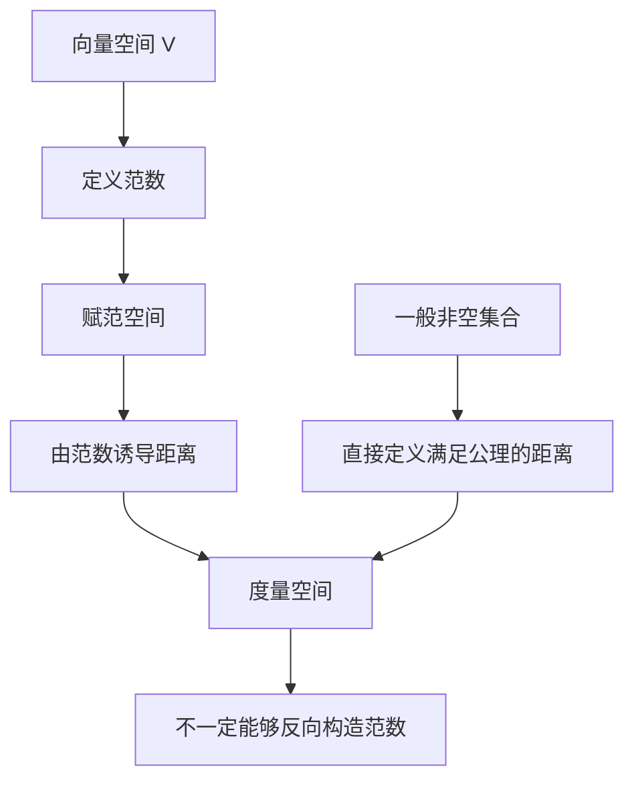
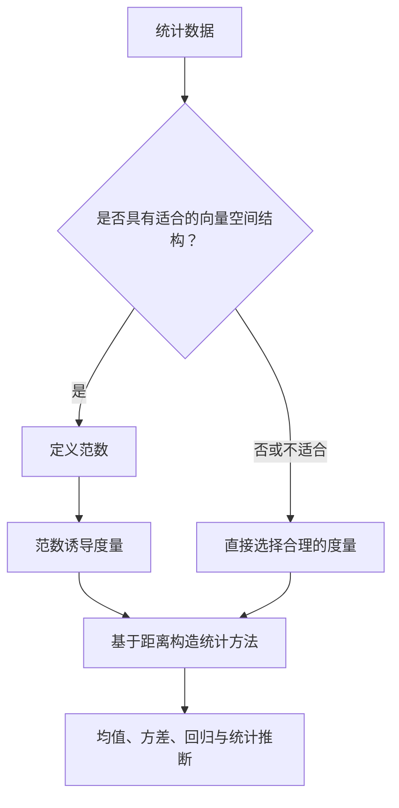

# 第 004 讲｜范数（Norm）与距离（Metric）有什么区别？

> **Non-Euclidean Statistics**
>
> **Lecture 004 — Norms and Metrics**
>
> 难度：入门
>
> 前置知识：向量、绝对值、欧氏距离、度量空间、三角不等式

---

## 1. 本讲学习目标

在前面三讲中，我们已经学习了：

- 欧氏空间与非欧数据
- 度量空间的定义
- 度量的四条基本公理
- 开球与闭球
- 不同度量下的几何结构

在第 003 讲中，我们介绍了三种距离：

1. 欧氏距离（Euclidean Distance）
2. 曼哈顿距离（Manhattan Distance）
3. 最大距离（Maximum Distance）

这些距离虽然计算方式不同，但都与向量的大小有关。

这引出了一个自然的问题：

**向量的长度与两个点之间的距离，到底有什么关系？**

本讲将学习：

1. 什么是范数（Norm）？
2. 范数必须满足哪些数学公理？
3. 什么是 $L_1$、$L_2$ 和 $L_\infty$ 范数？
4. 范数如何诱导度量？
5. 为什么度量不一定来自范数？
6. 范数与非欧统计学有什么联系？

---

## 2. 从向量长度开始

### 2.1 一维空间中的长度

考虑实数 $x=5$。

它到原点的距离为：

```math
\lvert x\rvert=5
```

如果 $x=-5$，那么：

```math
\lvert x\rvert=5
```

因此，绝对值描述了一个实数偏离原点的大小，而不是它的方向。

对于任意实数 $x$，都有：

```math
\lvert x\rvert\geq0
```

### 2.2 二维空间中的长度

考虑二维向量：

```math
x=(3,4)
```

根据勾股定理，它到原点的欧氏距离为：

```math
\sqrt{3^2+4^2}=5
```

我们通常使用双竖线表示向量的范数：

```math
\lVert x\rVert_2=5
```

这里的下标 2 表示采用 $L_2$ 范数。

对于任意二维向量：

```math
x=(x_1,x_2)
```

定义：

```math
\lVert x\rVert_2
=
\sqrt{x_1^2+x_2^2}
```

在 $p$ 维欧氏空间 $\mathbb R^p$ 中：

```math
\lVert x\rVert_2
=
\sqrt{\sum_{j=1}^{p}x_j^2}
```

其中：

- $p$ 表示向量的维度。
- $x_j$ 表示向量的第 $j$ 个坐标。
- $`\lVert x\rVert_2`$ 表示向量的欧氏长度。

这就是欧氏范数，也称为 $L_2$ 范数。

不过，向量长度并不只有这一种定义。

---

## 3. 什么是范数（Norm）？

### 3.1 数学定义

设 $V$ 是一个实向量空间。

我们考虑一个函数：

```math
\lVert\cdot\rVert:V\to[0,\infty)
```

它将 $V$ 中的每个向量映射到一个非负实数。

如果这个函数满足下面三条公理，就称为 $V$ 上的一个**范数（Norm）**。

这里：

- $V$：实向量空间。
- $x\in V$：空间中的向量。
- $`\lVert x\rVert`$：向量 $x$ 的范数。
- $`\lVert\cdot\rVert`$：定义范数的函数。

注意：

**范数首先要求研究对象属于一个向量空间。**

这是范数与一般度量的重要区别之一。

### 3.2 公理一：正定性（Positive Definiteness）

对于任意 $x\in V$：

```math
\lVert x\rVert\geq0
```

并且：

```math
\lVert x\rVert=0
\iff
x=0
```

其中右边的零表示向量空间中的零向量。

这意味着：

1. 向量的长度不能为负数。
2. 零向量的长度为零。
3. 非零向量必须具有正的长度。

例如，对于 $x=(3,4)$：

```math
\lVert x\rVert_2=5>0
```

而对于零向量：

```math
\lVert(0,0)\rVert_2=0
```

### 3.3 公理二：绝对齐次性（Absolute Homogeneity）

对于任意实数 $a$ 和向量 $x\in V$：

```math
\lVert ax\rVert
=
\lvert a\rvert\lVert x\rVert
```

这条公理描述向量缩放时，其长度如何变化。

**直观理解：向量放大多少倍，长度就按相同比例变化。**

例如，考虑 $x=(3,4)$。

我们知道：

```math
\lVert x\rVert_2=5
```

如果将向量放大 2 倍：

```math
2x=(6,8)
```

那么：

```math
\lVert2x\rVert_2=10
```

恰好满足：

```math
\lVert2x\rVert_2
=
2\lVert x\rVert_2
```

如果使用负数缩放：

```math
-2x=(-6,-8)
```

则：

```math
\lVert-2x\rVert_2=10
```

因此：

```math
\lVert-2x\rVert_2
=
\lvert-2\rvert\lVert x\rVert_2
```

这里出现绝对值，是因为负数倍会改变向量方向，但长度仍然应当非负。

### 3.4 公理三：三角不等式（Triangle Inequality）

对于任意 $x,y\in V$：

```math
\lVert x+y\rVert
\leq
\lVert x\rVert+\lVert y\rVert
```

这意味着：

**两个向量相加后的长度，不会超过两个向量长度之和。**

例如：

```math
x=(3,0),\qquad y=(0,4)
```

则：

```math
x+y=(3,4)
```

因此：

```math
\lVert x+y\rVert_2=5
```

另一方面：

```math
\lVert x\rVert_2+\lVert y\rVert_2=3+4=7
```

所以：

```math
5\leq7
```

三角不等式成立。

注意，这只是一个具体例子。要证明一个函数确实是范数，必须验证公理对所有允许的向量都成立。

### 3.5 三条公理总结

| 公理 | 英文 | 直观含义 |
|---|---|---|
| 正定性 | Positive Definiteness | 只有零向量的长度为零 |
| 绝对齐次性 | Absolute Homogeneity | 缩放向量，长度按比例变化 |
| 三角不等式 | Triangle Inequality | 向量和的长度不超过长度之和 |

对应的数学表达为：

**正定性：**

```math
\lVert x\rVert\geq0,
\qquad
\lVert x\rVert=0\iff x=0
```

**绝对齐次性：**

```math
\lVert ax\rVert
=
\lvert a\rvert\lVert x\rVert
```

**三角不等式：**

```math
\lVert x+y\rVert
\leq
\lVert x\rVert+\lVert y\rVert
```

这三条公理共同定义了范数。

---

## 4. 什么是赋范空间（Normed Space）？

类似于度量空间，我们可以将向量空间与范数组合起来。

**定义：赋范空间**

设 $V$ 是向量空间，$`\lVert\cdot\rVert`$ 是定义在 $V$ 上的一个范数。

那么二元组：

```math
(V,\lVert\cdot\rVert)
```

称为一个**赋范空间（Normed Space）**。

例如：

```math
(\mathbb R^p,\lVert\cdot\rVert_2)
```

就是一个赋范空间。

这里需要区分两个概念：

| 数学结构 | 组成 | 是否要求向量运算 |
|---|---|---|
| 度量空间 | 集合 + 度量 | 不要求 |
| 赋范空间 | 向量空间 + 范数 | 要求 |

赋范空间具有向量运算结构，而一般度量空间不一定具有。

---

## 5. 三种最常见的范数

在有限维向量空间 $\mathbb R^p$ 中，有三种特别重要的范数：

- $L_1$ 范数
- $L_2$ 范数
- $L_\infty$ 范数

严格来说，有限维向量的这些范数常使用小写的 $\ell_1$、$\ell_2$ 和 $\ell_\infty$ 记号。本课程在入门阶段沿用常见的 $L_q$ 称呼，后续涉及函数空间时再区分两套记号。

### 5.1 $L_1$ 范数

**$L_1$ Norm**

对于向量：

```math
x=(x_1,x_2,\ldots,x_p)
```

定义：

```math
\lVert x\rVert_1
=
\sum_{j=1}^{p}\lvert x_j\rvert
```

也就是说，将所有坐标的绝对值相加。

例如：

```math
x=(3,4)
```

那么：

```math
\lVert x\rVert_1
=
\lvert3\rvert+\lvert4\rvert
=
7
```

$L_1$ 范数经常出现在：

- 稀疏优化（Sparse Optimization）
- Lasso 回归
- 高维统计
- 正则化方法

这里暂时只需要理解它的定义，后续学习统计方法时再讨论相关应用。

### 5.2 $L_2$ 范数

**$L_2$ Norm / Euclidean Norm**

定义：

```math
\lVert x\rVert_2
=
\sqrt{\sum_{j=1}^{p}x_j^2}
```

例如：

```math
x=(3,4)
```

则：

```math
\lVert x\rVert_2
=
\sqrt{3^2+4^2}
=
5
```

$L_2$ 范数就是我们熟悉的欧氏长度。

它广泛应用于：

- 最小二乘估计
- 欧氏几何
- 统计优化
- 机器学习

### 5.3 $L_\infty$ 范数

**$L_\infty$ Norm / Maximum Norm**

定义：

```math
\lVert x\rVert_\infty
=
\max_{1\leq j\leq p}\lvert x_j\rvert
```

这表示取所有坐标绝对值中的最大值。

例如：

```math
x=(3,4)
```

则：

```math
\lVert x\rVert_\infty
=
\max\{3,4\}
=
4
```

### 5.4 三种范数的比较

对于同一个向量：

```math
x=(3,4)
```

三种范数的计算结果如下：

| 范数 | 计算方式 | 结果 |
|---|---|---|
| $L_1$ | 坐标绝对值之和 | 7 |
| $L_2$ | 坐标平方和的平方根 | 5 |
| $L_\infty$ | 坐标绝对值的最大值 | 4 |

因此：

```math
\lVert x\rVert_1=7,\qquad
\lVert x\rVert_2=5,\qquad
\lVert x\rVert_\infty=4
```

**同一个向量，在不同范数下可以具有不同的长度。**

这并不意味着其中某一种范数是错误的。

不同范数提供了衡量向量大小的不同方式。

---

## 6. 更一般的 $L_q$ 范数

前面介绍的 $L_1$ 和 $L_2$ 范数可以统一为更一般的形式。

对于有限维向量 $x\in\mathbb R^p$，当 $1\leq q<\infty$ 时，定义：

```math
\lVert x\rVert_q
=
\left(
\sum_{j=1}^{p}\lvert x_j\rvert^q
\right)^{1/q}
```

其中：

- $p$ 是向量维度。
- $q$ 是范数的参数。
- 不同的 $q$ 对各坐标的大小具有不同的敏感程度。

当 $q=1$ 时：

```math
\lVert x\rVert_1
=
\sum_{j=1}^{p}\lvert x_j\rvert
```

当 $q=2$ 时：

```math
\lVert x\rVert_2
=
\left(
\sum_{j=1}^{p}\lvert x_j\rvert^2
\right)^{1/2}
```

当 $q$ 越来越大时，在固定的有限维空间中：

```math
\lim_{q\to\infty}\lVert x\rVert_q
=
\max_{1\leq j\leq p}\lvert x_j\rvert
```

右边正是 $L_\infty$ 范数。

### 6.1 为什么要求 $q\geq1$？

这是一个重要的数学细节。

如果 $0<q<1$，虽然我们仍然可以写出：

```math
\left(
\sum_{j=1}^{p}\lvert x_j\rvert^q
\right)^{1/q}
```

但这个函数一般不满足三角不等式。

例如，考虑：

```math
x=(1,0),\qquad y=(0,1)
```

令：

```math
q=\frac12
```

可以计算：

```math
\lVert x\rVert_{1/2}=1
```

```math
\lVert y\rVert_{1/2}=1
```

但是：

```math
\lVert x+y\rVert_{1/2}
=
\left(1^{1/2}+1^{1/2}\right)^2
=
4
```

因此：

```math
\lVert x+y\rVert_{1/2}
>
\lVert x\rVert_{1/2}
+
\lVert y\rVert_{1/2}
```

这违反了三角不等式。

所以，当 $0<q<1$ 时，上述表达通常称为**拟范数（Quasi-Norm）**，而不是真正的范数。

---

## 7. 范数与距离有什么关系？

这是本讲最核心的部分。

回顾第 002 讲中度量的定义。

一个度量是函数：

```math
d:\Omega\times\Omega\to[0,\infty)
```

它接受两个对象，返回它们之间的距离。

而范数是函数：

```math
\lVert\cdot\rVert:V\to[0,\infty)
```

它接受一个向量，返回这个向量的大小。

那么：

**是否可以利用范数来构造距离？**

答案是可以。

### 7.1 范数诱导的度量

给定赋范空间：

```math
(V,\lVert\cdot\rVert)
```

我们定义：

```math
d(x,y)=\lVert x-y\rVert
```

其中 $x,y\in V$。

这个函数称为**由范数诱导的度量（Norm-Induced Metric）**。

直观理解：

1. 计算两个向量之差。
2. 计算差向量的范数。
3. 将结果作为两个点之间的距离。

例如：

```math
x=(1,2),\qquad y=(4,6)
```

它们的差向量为：

```math
x-y=(-3,-4)
```

使用 $L_2$ 范数：

```math
d_2(x,y)
=
\lVert x-y\rVert_2
=
5
```

使用 $L_1$ 范数：

```math
d_1(x,y)
=
\lVert x-y\rVert_1
=
7
```

使用 $L_\infty$ 范数：

```math
d_\infty(x,y)
=
\lVert x-y\rVert_\infty
=
4
```

这些正是前面学过的三种距离。

---

## 8. 为什么范数一定能够诱导度量？

现在给出正式证明。

### 命题

设 $V$ 是实向量空间，$`\lVert\cdot\rVert`$ 是 $V$ 上的一个范数。

定义：

```math
d(x,y)=\lVert x-y\rVert
```

那么 $d$ 是 $V$ 上的一个度量。

### 证明

需要验证度量的四条公理。

#### 第一步：非负性

根据范数的正定性：

```math
\lVert x-y\rVert\geq0
```

因此：

```math
d(x,y)\geq0
```

非负性成立。

#### 第二步：同一性

由范数的正定性：

```math
\lVert x-y\rVert=0
\iff
x-y=0
```

而：

```math
x-y=0\iff x=y
```

所以：

```math
d(x,y)=0\iff x=y
```

同一性成立。

#### 第三步：对称性

注意：

```math
y-x=-(x-y)
```

由绝对齐次性：

```math
\lVert y-x\rVert
=
\lVert-(x-y)\rVert
```

进一步：

```math
\lVert-(x-y)\rVert
=
\lvert-1\rvert\lVert x-y\rVert
=
\lVert x-y\rVert
```

因此：

```math
d(y,x)=d(x,y)
```

对称性成立。

#### 第四步：三角不等式

对于任意 $x,y,z\in V$：

```math
x-z=(x-y)+(y-z)
```

由范数的三角不等式：

```math
\lVert x-z\rVert
\leq
\lVert x-y\rVert+\lVert y-z\rVert
```

因此：

```math
d(x,z)
\leq
d(x,y)+d(y,z)
```

三角不等式成立。

### 结论

四条度量公理均成立，所以：

```math
d(x,y)=\lVert x-y\rVert
```

定义了一个合法的度量。

**命题得证。**

> Every norm induces a metric.

即：

**每一个范数都能够诱导一个度量。**

---

## 9. 反过来：每一个度量都来自范数吗？

答案是：

**不一定。**

这是理解非欧统计空间的重要区别。

### 9.1 范数诱导的度量具有特殊性质

如果：

```math
d(x,y)=\lVert x-y\rVert
```

那么对于任意向量 $a\in V$：

```math
d(x+a,y+a)=d(x,y)
```

因为：

```math
d(x+a,y+a)
=
\lVert(x+a)-(y+a)\rVert
=
\lVert x-y\rVert
```

这称为**平移不变性（Translation Invariance）**。

它意味着将两个点同时平移同一个向量，不会改变它们之间的距离。

此外，对于任意实数 $c$：

```math
d(cx,cy)=\lvert c\rvert d(x,y)
```

这是由范数的绝对齐次性得到的。

因此，范数诱导的度量不仅满足度量公理，还具有额外的代数性质。

### 9.2 反例：离散度量

考虑实数空间：

```math
\Omega=\mathbb R
```

定义离散度量：

```math
d(x,y)=
\begin{cases}
0,&x=y,\\
1,&x\neq y.
\end{cases}
```

这是第 002 讲介绍过的合法度量。

现在假设它来自某个范数：

```math
d(x,y)=\lVert x-y\rVert
```

那么：

```math
d(0,1)=\lVert1\rVert=1
```

根据范数的绝对齐次性：

```math
\lVert2\rVert
=
2\lVert1\rVert
=
2
```

所以必须有：

```math
d(0,2)=2
```

但是按照离散度量的定义：

```math
d(0,2)=1
```

产生矛盾。

因此，离散度量虽然是合法度量，却不能由 $\mathbb R$ 上的范数诱导。

### 9.3 为什么这个结论重要？

一般度量空间只要求我们能够定义两个对象之间的距离。

它不要求：

- 对象能够相加。
- 对象能够进行数乘。
- 存在零向量。
- 距离能够表示为差向量的范数。

因此：

**每个赋范空间都可以自然地看作度量空间，但一般度量空间不一定是赋范空间。**

### 9.4 数学结构关系图



**图 1：赋范空间与度量空间之间的关系。**

---

## 10. 范数如何决定几何形状？

在第 003 讲中，我们介绍了开球：

```math
B(x,r)=\{y:d(x,y)<r\}
```

如果度量来自范数：

```math
d(x,y)=\lVert x-y\rVert
```

那么开球可以写成：

```math
B(x,r)
=
\{y:\lVert y-x\rVert<r\}
```

特别地，以原点为中心、半径为 1 的开球称为单位开球：

```math
B(0,1)=\{x:\lVert x\rVert<1\}
```

现在考虑二维空间中的三种范数。

### 10.1 $L_1$ 单位开球

在 $\mathbb R^2$ 中：

```math
\lVert x\rVert_1
=
\lvert x_1\rvert+\lvert x_2\rvert
```

因此：

```math
B_1(0,1)
=
\{x:\lvert x_1\rvert+\lvert x_2\rvert<1\}
```

在普通二维坐标图中，这个集合是菱形内部。

### 10.2 $L_2$ 单位开球

```math
\lVert x\rVert_2
=
\sqrt{x_1^2+x_2^2}
```

因此：

```math
B_2(0,1)
=
\{x:x_1^2+x_2^2<1\}
```

这是圆盘内部。

### 10.3 $L_\infty$ 单位开球

```math
\lVert x\rVert_\infty
=
\max\{\lvert x_1\rvert,\lvert x_2\rvert\}
```

因此：

```math
B_\infty(0,1)
=
\{x:\lvert x_1\rvert<1,\ \lvert x_2\rvert<1\}
```

这是正方形内部。

### 10.4 三种范数的比较

| 范数 | 二维单位开球形状 |
|---|---|
| $L_1$ | 菱形 |
| $L_2$ | 圆盘 |
| $L_\infty$ | 正方形 |

为什么这些不同形状都称为“球”？

因为在度量空间中，球是通过距离条件定义的，而不是通过普通几何外形定义的。

**范数不仅决定向量长度，也通过诱导度量决定空间中的距离与球的形状。**

---

## 11. 范数与非欧统计有什么关系？

现在回到本课程的核心主题：非欧统计学。

### 11.1 欧氏统计中的情况

对于欧氏向量：

```math
x,y\in\mathbb R^p
```

我们通常使用：

```math
d(x,y)=\lVert x-y\rVert_2
```

因为：

1. 两个向量可以相减。
2. 差向量仍属于同一个向量空间。
3. 可以计算差向量的范数。

例如，在传统统计学中，我们经常考虑最小二乘目标函数：

```math
F(\mu)
=
\sum_{i=1}^{n}\lVert X_i-\mu\rVert_2^2
```

其中：

- $X_i$ 是第 $i$ 个观测向量。
- $\mu$ 是候选中心。
- $F(\mu)$ 是总平方距离。

### 11.2 一般非欧统计中的情况

假设数据位于一个一般度量空间：

```math
(\Omega,d)
```

观测对象为：

```math
X_1,\ldots,X_n\in\Omega
```

如果 $\Omega$ 不是向量空间，那么表达式：

```math
X_i-\mu
```

可能根本没有定义。

因此，我们不能直接使用差向量的范数：

```math
\lVert X_i-\mu\rVert
```

但是，只要定义了合适的度量，我们仍然可以计算：

```math
d(X_i,\mu)
```

并构造平方距离目标函数：

```math
F(\mu)
=
\sum_{i=1}^{n}d^2(X_i,\mu)
```

这说明：

**将基于向量差的范数表达，推广为一般对象之间的度量表达，是非欧统计中的一个重要思路。**

当然，具体统计方法还需要考虑：

- 目标函数是否存在最小值？
- 最优点是否唯一？
- 对应的统计估计是否具有良好的性质？

这些问题将成为后续学习 Fréchet 均值的重要内容。

### 11.3 从欧氏统计到一般度量空间统计



**图 2：从范数到一般度量空间统计的思路。**

需要强调：

即使数据可以用欧氏坐标表示，范数诱导的距离也未必是最适合研究问题的距离。

统计方法的选择仍然需要考虑数据的实际意义与几何结构。

---

## 12. 一个进一步的数学观察

我们已经知道：

```math
d(x,y)=\lVert x-y\rVert
```

可以通过范数构造度量。

那么，反过来是否可以利用距离恢复范数？

如果一个度量已知由某个范数诱导，那么答案是可以的。

因为：

```math
d(x,0)=\lVert x-0\rVert
```

所以：

```math
\lVert x\rVert=d(x,0)
```

也就是说：

**在赋范空间中，一个向量的范数等于它到零向量的距离。**

但是，对于一般度量空间，即使可以选出一个指定的零元素，函数 $d(x,0)$ 也不一定满足范数公理。

特别是绝对齐次性，不能仅从度量公理推出。

这说明范数与度量之间具有紧密联系，但二者并不等价。

---

## 13. 常见误区

### 误区一：范数就是距离

不完全正确。

范数通常接受一个向量，例如 $`\lVert x\rVert`$。

而度量接受两个对象，例如 $d(x,y)$。

虽然范数可以通过以下方式诱导度量：

```math
d(x,y)=\lVert x-y\rVert
```

但范数与度量不是同一个概念。

### 误区二：所有度量都可以写成范数形式

错误。

一般度量空间不要求具有向量空间结构。

即使某个集合本身是向量空间，也可能存在无法由范数诱导的度量。

离散度量就是一个反例。

### 误区三：只有 $L_2$ 范数才是真正的范数

错误。

$L_1$、$L_2$ 和 $L_\infty$ 都满足范数公理。

它们只是使用不同的方式测量向量的大小。

### 误区四：平方欧氏长度也是范数

错误。

考虑函数：

```math
f(x)=\lVert x\rVert_2^2
```

虽然它非负，并且只有零向量的函数值为零，但它一般不满足绝对齐次性。

因为：

```math
f(ax)=a^2f(x)
```

而范数要求：

```math
f(ax)=\lvert a\rvert f(x)
```

因此，平方欧氏长度不是范数。

### 误区五：不同范数一定产生完全不同的连续性理论

不一定。

在固定的有限维实向量空间 $\mathbb R^p$ 中，所有范数都是等价的。

例如，$L_1$、$L_2$ 和 $L_\infty$ 范数满足：

```math
\lVert x\rVert_\infty
\leq
\lVert x\rVert_2
\leq
\lVert x\rVert_1
```

并且：

```math
\lVert x\rVert_1
\leq
\sqrt p\,\lVert x\rVert_2
```

以及：

```math
\lVert x\rVert_2
\leq
\sqrt p\,\lVert x\rVert_\infty
```

这些不等式说明，在固定的有限维空间中，不同范数可以通过正常数倍相互控制。

因此，它们诱导相同的开集结构与收敛概念。

不过，它们给出的具体距离、单位球形状和统计优化目标仍然可能不同。

---

## 14. 本讲总结

本讲最重要的三个结论：

### 结论一：范数描述向量的大小

范数满足：

1. 正定性
2. 绝对齐次性
3. 三角不等式

### 结论二：范数可以诱导度量

对于一个赋范空间：

```math
(V,\lVert\cdot\rVert)
```

定义：

```math
d(x,y)=\lVert x-y\rVert
```

就可以得到一个合法的度量。

但是反过来不一定成立。

### 结论三：度量空间比赋范空间更一般

一般度量空间不要求对象能够进行向量加法或数乘。

因此，度量空间能够容纳更广泛的数据对象。

**本讲核心思想：**

> Norms measure the size of vectors, while metrics measure distances between objects.

范数测量向量大小，度量测量对象之间的距离。

---

## 15. 课后练习

### 练习 1：计算三种范数

给定向量：

```math
x=(2,-3,6)
```

计算：

1. $`\lVert x\rVert_1`$
2. $`\lVert x\rVert_2`$
3. $`\lVert x\rVert_\infty`$

### 练习 2：从范数到距离

给定：

```math
x=(1,2),\qquad y=(4,6)
```

分别计算：

1. $d_1(x,y)$
2. $d_2(x,y)$
3. $d_\infty(x,y)$

其中距离由对应范数诱导。

### 练习 3：判断是否为范数

在 $\mathbb R^2$ 上定义：

```math
f(x)=x_1^2+x_2^2
```

其中 $x=(x_1,x_2)$。

判断 $f$ 是否是一个范数，并说明原因。

### 练习 4：概念理解

为什么说度量空间比赋范空间更加一般？

请结合两者的定义解释。


<details>
<summary>点击查看参考答案</summary>

### 练习 1：计算三种范数

**（1）第一种范数**

```math
\lVert x\rVert_1
=
\lvert 2\rvert+\lvert-3\rvert+\lvert 6\rvert
=
11
```

**（2）第二种范数**

```math
\lVert x\rVert_2
=
\sqrt{2^2+(-3)^2+6^2}
=
7
```

**（3）最大范数**

```math
\lVert x\rVert_\infty
=
\max\{2,3,6\}
=
6
```

### 练习 2：从范数到距离

先计算差向量：

```math
x-y=(-3,-4)
```

三种距离分别为：

```math
d_1(x,y)=3+4=7
```

```math
d_2(x,y)=\sqrt{9+16}=5
```

```math
d_\infty(x,y)=\max\{3,4\}=4
```

### 练习 3：判断是否为范数

该函数不是范数，因为它不满足绝对齐次性。

取向量：

```math
x=(1,0)
```

则：

```math
f(x)=1
```

但：

```math
f(2x)=4\neq 2f(x)=2
```

因此它不满足范数公理。

### 练习 4：概念理解

赋范空间必须具有向量空间结构，而一般度量空间只需要集合与满足度量公理的距离函数。

因此，一般度量空间能够描述更广泛的数据对象。

</details>

---

## 16. 下一讲预告

### 第 005 讲｜什么是内积（Inner Product）？

我们已经建立了以下概念：

- 度量（Metric）
- 范数（Norm）
- 赋范空间（Normed Space）
- 范数诱导的距离（Norm-Induced Metric）

但是，长度并不能描述全部几何信息。

例如：

**两个向量之间的夹角应该如何定义？**

下一讲将介绍：

1. 什么是内积（Inner Product）？
2. 内积与向量夹角有什么关系？
3. 什么是正交（Orthogonality）？
4. 内积如何诱导范数？
5. 为什么不是所有范数都来自内积？
6. 内积、范数与度量之间存在怎样的关系？

这些知识将为后续理解切空间、黎曼度量与流形统计奠定基础。

---

**End of Lecture 004**
