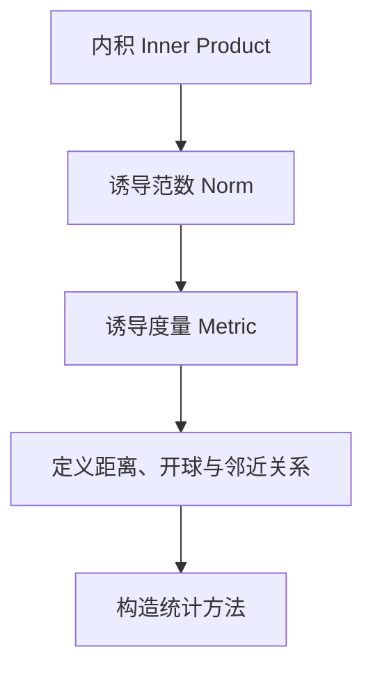
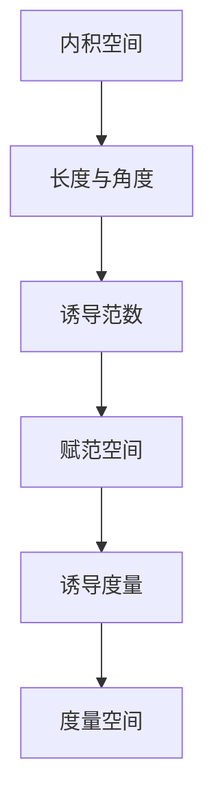

# 第 005 讲｜什么是内积（Inner Product）？

> **Non-Euclidean Statistics**
>
> **Lecture 005 — Inner Product Spaces**
>
> 难度：入门
>
> 前置知识：向量、范数、度量、三角不等式

---

## 1. 本讲学习目标

在前面四讲中，我们已经学习了：

- 欧氏空间与非欧数据
- 度量空间（Metric Space）
- 开球与闭球
- 范数（Norm）
- 赋范空间（Normed Space）
- 范数诱导的度量（Norm-Induced Metric）

在第 004 讲中，我们知道可以通过范数构造距离：

```math
d(x,y)=\lVert x-y\rVert
```

但是，长度与距离并不能完全描述向量之间的几何关系。

例如，考虑两个向量：

```math
x=(1,0),\qquad y=(0,1)
```

我们知道：

```math
\lVert x\rVert_2=1,\qquad
\lVert y\rVert_2=1
```

但是还有一个重要的几何事实：

**这两个向量相互垂直。**

那么：

1. 如何用数学方法定义两个向量之间的角度？
2. 什么是正交（Orthogonality）？
3. 什么是内积（Inner Product）？
4. 内积与范数有什么关系？
5. 为什么不是所有范数都来自内积？
6. 内积为什么对非欧几何与统计学重要？

本讲将逐一回答这些问题。

---

## 2. 从向量夹角开始

### 2.1 二维向量的夹角

考虑两个二维向量：

```math
x=(1,0),\qquad y=(0,1)
```

它们都从原点出发。

第一个向量沿着水平坐标轴方向，第二个向量沿着竖直坐标轴方向。

因此，它们之间的夹角为：

```math
\theta=90^\circ
```

再考虑：

```math
x=(1,0),\qquad y=(1,1)
```

这一次，两个向量之间的夹角为：

```math
\theta=45^\circ
```

问题是：

**是否存在一种代数运算，可以直接计算向量之间的夹角？**

答案是存在。

这种运算就是我们熟悉的点积（Dot Product）。

---

## 3. 从点积（Dot Product）开始

### 3.1 点积的定义

对于两个向量：

```math
x=(x_1,x_2,\ldots,x_p)
```

```math
y=(y_1,y_2,\ldots,y_p)
```

定义它们的标准欧氏点积：

```math
x\cdot y
=
\sum_{j=1}^{p}x_jy_j
```

展开后：

```math
x\cdot y
=
x_1y_1+x_2y_2+\cdots+x_py_p
```

例如：

```math
x=(1,2),\qquad y=(3,4)
```

那么：

```math
x\cdot y
=
1\times3+2\times4
=
11
```

需要注意：

- 向量加法的结果仍然是向量。
- 点积的结果是一个实数。

这是两种不同的运算。

### 3.2 点积的几何意义

在欧氏空间中，点积可以写成：

```math
x\cdot y
=
\lVert x\rVert_2
\lVert y\rVert_2
\cos\theta
```

其中：

- $x,y$ 是两个非零向量。
- $\theta$ 是它们之间的夹角。
- $\cos\theta$ 是夹角的余弦值。

所以，点积不仅与向量的长度有关，还与向量之间的方向关系有关。

由此可以得到：

```math
\cos\theta
=
\frac{x\cdot y}
{\lVert x\rVert_2\lVert y\rVert_2}
```

### 3.3 一个计算例子

考虑：

```math
x=(1,0),\qquad y=(1,1)
```

首先计算点积：

```math
x\cdot y
=
1\times1+0\times1
=
1
```

再计算两个向量的欧氏范数：

```math
\lVert x\rVert_2=1
```

```math
\lVert y\rVert_2=\sqrt{2}
```

代入夹角公式：

```math
\cos\theta
=
\frac{1}{\sqrt2}
```

因此：

```math
\theta=45^\circ
```

这说明我们可以通过代数运算恢复向量之间的几何夹角。

### 3.4 点积的正负意味着什么？

对于两个非零向量：

```math
x\cdot y
=
\lVert x\rVert_2\lVert y\rVert_2\cos\theta
```

由于两个范数均大于零，所以点积的符号由 $\cos\theta$ 决定。

| 点积结果 | 几何含义 |
|---|---|
| 正数 | 两个向量形成锐角 |
| 零 | 两个向量相互垂直 |
| 负数 | 两个向量形成钝角 |

特别地：

```math
x\cdot y=0
```

对于非零向量，这意味着它们相互垂直。

这个概念将在后面进一步推广。

---

## 4. 什么是内积（Inner Product）？

### 4.1 为什么需要推广点积？

在普通欧氏空间中，我们有标准点积：

```math
x\cdot y=\sum_{j=1}^{p}x_jy_j
```

但是，点积的计算公式依赖于向量的坐标表示。

我们希望得到一种更一般的数学概念，使其不仅适用于普通欧氏空间，也能适用于其他向量空间，例如：

- 多项式空间
- 函数空间
- 矩阵空间
- 某些无限维向量空间

这就引出了内积。

### 4.2 内积的正式定义

设 $V$ 是一个实向量空间。

考虑一个函数：

```math
\langle\cdot,\cdot\rangle
:
V\times V\to\mathbb R
```

这个函数接受两个向量，并返回一个实数。

如果它满足以下三条公理，就称为 $V$ 上的一个**内积（Inner Product）**。

本讲只讨论实向量空间。复向量空间中的内积需要使用共轭对称性，其定义略有不同。

### 4.3 公理一：对称性（Symmetry）

对于任意 $x,y\in V$：

```math
\langle x,y\rangle
=
\langle y,x\rangle
```

也就是说，交换两个向量的位置，不会改变内积的结果。

例如，在标准欧氏点积下：

```math
x=(1,2),\qquad y=(3,4)
```

我们有：

```math
\langle x,y\rangle
=
1\times3+2\times4
=
11
```

同时：

```math
\langle y,x\rangle
=
3\times1+4\times2
=
11
```

因此：

```math
\langle x,y\rangle
=
\langle y,x\rangle
```

### 4.4 公理二：线性性（Linearity）

对于任意向量 $x,y,z\in V$，以及任意实数 $a,b$：

```math
\langle ax+by,z\rangle
=
a\langle x,z\rangle
+
b\langle y,z\rangle
```

这称为内积对第一个变量的线性性。

由于我们还要求对称性，因此内积对第二个变量也具有线性性：

```math
\langle x,ay+bz\rangle
=
a\langle x,y\rangle
+
b\langle x,z\rangle
```

所以在实向量空间中，内积是一个对称双线性函数。

**直观理解：内积与向量加法、数乘之间具有良好的代数兼容性。**

例如：

```math
\langle 2x+y,z\rangle
=
2\langle x,z\rangle
+
\langle y,z\rangle
```

这使得内积特别适合数学推导。

### 4.5 公理三：正定性（Positive Definiteness）

对于任意 $x\in V$：

```math
\langle x,x\rangle\geq0
```

并且：

```math
\langle x,x\rangle=0
\iff
x=0
```

这意味着：

- 向量与自身的内积不能为负。
- 只有零向量与自身的内积等于零。

注意：

**正定性不意味着任意两个不同向量的内积都非负。**

例如：

```math
x=(1,0),\qquad y=(-1,0)
```

标准点积为：

```math
\langle x,y\rangle=-1
```

这是完全允许的。

正定性要求的是向量与自身的内积，而不是任意两个向量之间的内积。

### 4.6 三条公理总结

| 公理 | 英文 | 直观含义 |
|---|---|---|
| 对称性 | Symmetry | 交换向量顺序，内积不变 |
| 线性性 | Linearity | 内积与向量加法及数乘兼容 |
| 正定性 | Positive Definiteness | 非零向量与自身的内积为正 |

满足这些公理的函数就是实向量空间上的内积。

---

## 5. 什么是内积空间（Inner Product Space）？

设 $V$ 是一个实向量空间，$\langle\cdot,\cdot\rangle$ 是其上的内积。

那么：

```math
(V,\langle\cdot,\cdot\rangle)
```

称为一个**内积空间（Inner Product Space）**。

例如，在 $\mathbb R^p$ 中定义：

```math
\langle x,y\rangle
=
\sum_{j=1}^{p}x_jy_j
```

就得到了标准欧氏内积空间。

但需要注意：

内积不一定只能采用标准欧氏点积的形式。

对于同一个向量空间，也可能定义不同的内积。

我们稍后会介绍一个例子。

---

## 6. 内积如何诱导范数？

这是本讲最重要的内容之一。

在第 004 讲中，我们已经知道：

**范数可以诱导度量。**

那么内积与范数之间有什么关系？

答案是：

**每一个内积都可以自然地诱导一个范数。**

### 6.1 定义

给定内积空间：

```math
(V,\langle\cdot,\cdot\rangle)
```

定义：

```math
\lVert x\rVert
=
\sqrt{\langle x,x\rangle}
```

这称为由内积诱导的范数（Inner-Product-Induced Norm）。

其直观含义是：

向量的长度等于该向量与自身内积的平方根。

### 6.2 欧氏空间中的例子

在 $\mathbb R^p$ 中，标准内积为：

```math
\langle x,y\rangle
=
\sum_{j=1}^{p}x_jy_j
```

因此：

```math
\langle x,x\rangle
=
\sum_{j=1}^{p}x_j^2
```

所以：

```math
\sqrt{\langle x,x\rangle}
=
\sqrt{\sum_{j=1}^{p}x_j^2}
```

这正是我们熟悉的 $L_2$ 范数：

```math
\lVert x\rVert_2
=
\sqrt{\sum_{j=1}^{p}x_j^2}
```

因此，欧氏范数可以由标准内积诱导得到。

### 6.3 从内积到距离

上一讲我们证明了：

如果 $\lVert\cdot\rVert$ 是范数，那么：

```math
d(x,y)=\lVert x-y\rVert
```

是一个合法度量。

将内积诱导的范数代入：

```math
d(x,y)
=
\sqrt{\langle x-y,x-y\rangle}
```

所以，我们获得了一个重要的数学关系：



**图 1：内积、范数与度量之间的关系。**

不过，图中的箭头一般不能直接反过来。

也就是说：

- 不是每个度量都来自范数。
- 不是每个范数都来自内积。

---

## 7. Cauchy–Schwarz 不等式

现在我们介绍内积空间中一个非常重要的数学结果。

它称为**柯西–施瓦茨不等式（Cauchy–Schwarz Inequality）**。

### 7.1 数学表达

对于任意 $x,y\in V$：

```math
\lvert\langle x,y\rangle\rvert
\leq
\lVert x\rVert\lVert y\rVert
```

这里的范数由内积诱导。

这个不等式说明：

**两个向量内积的绝对值，不会超过它们长度的乘积。**

### 7.2 一个例子

考虑：

```math
x=(1,2),\qquad y=(3,4)
```

计算标准内积：

```math
\langle x,y\rangle
=
1\times3+2\times4
=
11
```

计算范数：

```math
\lVert x\rVert_2
=
\sqrt5
```

```math
\lVert y\rVert_2
=
5
```

因此：

```math
\lVert x\rVert_2\lVert y\rVert_2
=
5\sqrt5
```

而：

```math
11\leq5\sqrt5
```

所以 Cauchy–Schwarz 不等式成立。

当然，这只是一个数值例子。

该不等式对所有内积空间中的向量都成立。

### 7.3 为什么它重要？

因为我们希望通过内积定义角度：

```math
\cos\theta
=
\frac{\langle x,y\rangle}
{\lVert x\rVert\lVert y\rVert}
```

对于非零向量，Cauchy–Schwarz 不等式保证：

```math
-1
\leq
\frac{\langle x,y\rangle}
{\lVert x\rVert\lVert y\rVert}
\leq
1
```

因此，右边确实可以作为某个角度的余弦值。

这使得我们能够在一般实内积空间中定义向量夹角。

### 7.4 一个简短证明

为了理解其数学结构，我们给出一个简短证明。

当 $y=0$ 时，不等式显然成立。

下面假设 $y\neq0$，并取：

```math
t=
\frac{\langle x,y\rangle}
{\langle y,y\rangle}
```

由于内积正定：

```math
\langle x-ty,x-ty\rangle\geq0
```

利用对称性和双线性展开：

```math
\langle x,x\rangle
-
2t\langle x,y\rangle
+
t^2\langle y,y\rangle
\geq0
```

代入所选的 $t$：

```math
\langle x,x\rangle
-
\frac{\langle x,y\rangle^2}
{\langle y,y\rangle}
\geq0
```

因此：

```math
\langle x,y\rangle^2
\leq
\langle x,x\rangle
\langle y,y\rangle
```

两边开平方：

```math
\lvert\langle x,y\rangle\rvert
\leq
\sqrt{\langle x,x\rangle}
\sqrt{\langle y,y\rangle}
```

也就是：

```math
\lvert\langle x,y\rangle\rvert
\leq
\lVert x\rVert\lVert y\rVert
```

证毕。

这里最关键的思想是：

**利用内积的正定性构造一个非负表达式，再通过代数展开获得不等式。**

---

## 8. 为什么内积诱导的函数是范数？

在第 6 节中，我们给出了：

```math
\lVert x\rVert
=
\sqrt{\langle x,x\rangle}
```

现在来验证它确实满足范数的三条公理。

### 8.1 正定性

由内积正定性：

```math
\langle x,x\rangle\geq0
```

因此：

```math
\lVert x\rVert\geq0
```

而且：

```math
\lVert x\rVert=0
\iff
\langle x,x\rangle=0
\iff
x=0
```

所以正定性成立。

### 8.2 绝对齐次性

对于任意实数 $a$：

```math
\lVert ax\rVert^2
=
\langle ax,ax\rangle
```

由双线性：

```math
\langle ax,ax\rangle
=
a^2\langle x,x\rangle
```

所以：

```math
\lVert ax\rVert
=
\sqrt{a^2\langle x,x\rangle}
=
\lvert a\rvert\lVert x\rVert
```

因此绝对齐次性成立。

### 8.3 三角不等式

考虑：

```math
\lVert x+y\rVert^2
=
\langle x+y,x+y\rangle
```

展开：

```math
\lVert x+y\rVert^2
=
\lVert x\rVert^2
+
2\langle x,y\rangle
+
\lVert y\rVert^2
```

根据 Cauchy–Schwarz 不等式：

```math
\langle x,y\rangle
\leq
\lVert x\rVert\lVert y\rVert
```

所以：

```math
\lVert x+y\rVert^2
\leq
\lVert x\rVert^2
+
2\lVert x\rVert\lVert y\rVert
+
\lVert y\rVert^2
```

右边恰好为：

```math
(\lVert x\rVert+\lVert y\rVert)^2
```

因此：

```math
\lVert x+y\rVert^2
\leq
(\lVert x\rVert+\lVert y\rVert)^2
```

两边取平方根：

```math
\lVert x+y\rVert
\leq
\lVert x\rVert+\lVert y\rVert
```

三角不等式成立。

### 8.4 结论

内积诱导的函数：

```math
\lVert x\rVert
=
\sqrt{\langle x,x\rangle}
```

满足全部范数公理。

所以：

> Every inner product induces a norm.

**每一个内积都能够诱导一个范数。**

---

## 9. 什么是正交（Orthogonality）？

正交是内积空间中非常重要的概念。

### 9.1 正交的定义

在内积空间中，如果两个向量满足：

```math
\langle x,y\rangle=0
```

那么称它们是**正交的（Orthogonal）**。

记作：

```math
x\perp y
```

在普通欧氏空间中，两个非零向量正交意味着它们相互垂直。

### 9.2 一个例子

考虑：

```math
x=(1,2),\qquad y=(2,-1)
```

使用标准欧氏内积：

```math
\langle x,y\rangle
=
1\times2+2\times(-1)
=
0
```

因此：

```math
x\perp y
```

这两个向量正交。

### 9.3 正交与统计学

在统计学中，正交非常重要。

例如：

- 线性回归中的正交投影
- 最小二乘估计
- 正交基
- 主成分分析（PCA）
- 函数空间中的正交展开

这些方法都与内积结构密切相关。

不过需要注意：

正交关系取决于所选择的内积。

更换内积后，同一对向量可能不再正交。

---

## 10. 为什么不是所有范数都来自内积？

我们已经证明：


但是，反向关系不一定成立。

那么，如何判断某个范数是否来自内积？

这里需要介绍一个重要性质：**平行四边形恒等式（Parallelogram Identity）**。

### 10.1 平行四边形恒等式

如果一个范数由内积诱导，则对于任意向量 $x,y$，必然满足：

```math
\lVert x+y\rVert^2
+
\lVert x-y\rVert^2
=
2\lVert x\rVert^2
+
2\lVert y\rVert^2
```

为什么？

因为：

```math
\lVert x+y\rVert^2
=
\langle x+y,x+y\rangle
```

展开：

```math
\lVert x+y\rVert^2
=
\lVert x\rVert^2
+
2\langle x,y\rangle
+
\lVert y\rVert^2
```

另一方面：

```math
\lVert x-y\rVert^2
=
\lVert x\rVert^2
-
2\langle x,y\rangle
+
\lVert y\rVert^2
```

两式相加，中间的内积项相互抵消：

```math
\lVert x+y\rVert^2
+
\lVert x-y\rVert^2
=
2\lVert x\rVert^2
+
2\lVert y\rVert^2
```

因此，所有内积诱导的范数都满足平行四边形恒等式。

### 10.2 使用 $L_1$ 范数构造反例

考虑二维空间中的两个向量：

```math
x=(1,0),\qquad y=(0,1)
```

采用 $L_1$ 范数：

```math
\lVert x\rVert_1=1
```

```math
\lVert y\rVert_1=1
```

首先：

```math
x+y=(1,1)
```

所以：

```math
\lVert x+y\rVert_1=2
```

其次：

```math
x-y=(1,-1)
```

所以：

```math
\lVert x-y\rVert_1=2
```

平行四边形恒等式左边：

```math
\lVert x+y\rVert_1^2
+
\lVert x-y\rVert_1^2
=
2^2+2^2
=
8
```

右边：

```math
2\lVert x\rVert_1^2
+
2\lVert y\rVert_1^2
=
2+2
=
4
```

因此：

```math
8\neq4
```

平行四边形恒等式不成立。

所以，在 $\mathbb R^2$ 上，$L_1$ 范数不可能由某个内积诱导。

### 10.3 一个更深入的结论

实际上，在实赋范空间中：

**一个范数由内积诱导，当且仅当它满足平行四边形恒等式。**

这是 Jordan–von Neumann 定理的核心结论。

在满足这一条件时，可以通过下面的公式恢复内积：

```math
\langle x,y\rangle
=
\frac14
\left(
\lVert x+y\rVert^2
-
\lVert x-y\rVert^2
\right)
```

这个公式称为**极化恒等式（Polarization Identity）**。

本讲只需理解：

平行四边形恒等式可以用来判断范数是否来自内积。

完整的充分性证明暂时不需要掌握。

---

## 11. 同一个空间可以定义不同的内积

前面我们学习的都是标准欧氏内积：

```math
\langle x,y\rangle
=
x_1y_1+x_2y_2
```

但这不是唯一可能的内积。

### 11.1 加权内积（Weighted Inner Product）

在 $\mathbb R^2$ 中，考虑：

```math
\langle x,y\rangle_A
=
4x_1y_1+x_2y_2
```

这里：

```math
x=(x_1,x_2),\qquad
y=(y_1,y_2)
```

我们可以验证：

1. 它满足对称性。
2. 它对两个变量分别线性。
3. 对于任意非零向量，有：

```math
\langle x,x\rangle_A
=
4x_1^2+x_2^2>0
```

所以它是一个合法内积。

### 11.2 对应的范数

由该内积诱导的范数为：

```math
\lVert x\rVert_A
=
\sqrt{\langle x,x\rangle_A}
```

也就是：

```math
\lVert x\rVert_A
=
\sqrt{4x_1^2+x_2^2}
```

而标准欧氏范数为：

```math
\lVert x\rVert_2
=
\sqrt{x_1^2+x_2^2}
```

两者并不相同。

### 11.3 几何有什么变化？

考虑加权内积诱导的单位开球：

```math
B_A(0,1)
=
\{x:\lVert x\rVert_A<1\}
```

代入范数：

```math
B_A(0,1)
=
\{x:4x_1^2+x_2^2<1\}
```

这在通常的二维坐标图中是一个椭圆内部。

相比之下，标准欧氏内积诱导的单位开球满足：

```math
x_1^2+x_2^2<1
```

它是圆盘内部。

因此：

**即使向量空间不变，只要改变内积，也可能改变长度、角度和单位球的几何形状。**

需要注意，这种正定加权内积依然属于平坦的内积空间几何，不意味着空间已经具有曲率。

### 11.4 矩阵表示

刚才的加权内积可以写成矩阵形式：

```math
\langle x,y\rangle_A=x^TAy
```

其中：

```math
A=
\begin{pmatrix}
4&0\\
0&1
\end{pmatrix}
```

矩阵 $A$ 是对称正定矩阵（Symmetric Positive Definite Matrix）。

一般地，如果 $A$ 是对称正定矩阵，则：

```math
\langle x,y\rangle_A=x^TAy
```

可以定义 $\mathbb R^p$ 上的一个内积。

这里的 $x^T$ 表示向量的转置。

对应的范数为：

```math
\lVert x\rVert_A=\sqrt{x^TAx}
```

这一形式将来学习正定矩阵空间和黎曼度量时还会遇到。

---

## 12. 内积与非欧统计有什么联系？

到目前为止，我们建立了三个重要的数学结构：

| 结构 | 核心数学对象 | 提供的几何信息 |
|---|---|---|
| 度量空间 | Metric | 两个对象之间的距离 |
| 赋范空间 | Norm | 向量大小与距离 |
| 内积空间 | Inner Product | 长度、角度与正交关系 |

它们之间具有层层递进的关系。

### 12.1 从内积到度量

如果存在内积：

```math
\langle x,y\rangle
```

那么可以定义范数：

```math
\lVert x\rVert
=
\sqrt{\langle x,x\rangle}
```

进一步定义度量：

```math
d(x,y)=\lVert x-y\rVert
```

因此：



**图 2：内积空间、赋范空间与度量空间的关系。**

### 12.2 为什么这对非欧统计重要？

后续我们将学习流形（Manifold）。

在一般流形上，我们不能总是直接对两个位置点进行向量加减。

但在光滑流形的每一个点附近，可以引入切空间（Tangent Space）。

切空间是一个向量空间。

在黎曼几何中，我们会为每个切空间指定一个正定内积，用来测量切向量的长度和夹角。

这种随位置变化的内积结构就是**黎曼度量（Riemannian Metric）**的核心。

它可以进一步用来定义：

- 曲线的长度
- 测地距离
- 测地线
- 流形上的梯度
- 流形上的统计优化与推断

因此，本讲的内积不仅是线性代数的概念，也是未来理解黎曼几何的重要数学基础。

### 12.3 一个需要记住的区别

**普通内积空间：**

在整个向量空间上定义一个内积。

**黎曼流形：**

在每个点的切空间上定义内积，并要求这些内积随位置光滑变化。

后面我们会详细解释这一差别。

---

## 13. 常见误区

### 误区一：内积就是普通点积

不完全正确。

标准欧氏点积只是内积的一个重要例子。

一般内积可以定义在函数空间、矩阵空间及其他向量空间上。

### 误区二：内积一定非负

错误。

内积的正定性只要求：

```math
\langle x,x\rangle\geq0
```

而对于不同向量，内积可以为正、为零或为负。

### 误区三：所有范数都来自内积

错误。

$L_1$ 范数和 $L_\infty$ 范数在维度至少为 2 的标准实向量空间中不能由内积诱导。

一个重要判断工具是平行四边形恒等式。

### 误区四：正交一定意味着普通坐标下的垂直

不完全正确。

正交性取决于所采用的内积。

对于标准欧氏内积，正交对应熟悉的垂直关系。

在其他内积下，正交关系可能不同。

### 误区五：定义内积以后就自动得到曲率

错误。

内积本身不意味着空间具有曲率。

普通有限维内积空间仍具有平坦几何。

曲率的出现需要进一步研究流形上的几何结构以及内积如何随位置变化。

---

## 14. 本讲总结

本讲最重要的三个结论：

### 结论一：内积提供长度与角度信息

内积能够描述两个向量之间的几何关系。

特别地，正交可以通过下面的条件定义：

```math
\langle x,y\rangle=0
```

### 结论二：内积能够诱导范数与度量

```math
\lVert x\rVert
=
\sqrt{\langle x,x\rangle}
```

```math
d(x,y)
=
\sqrt{\langle x-y,x-y\rangle}
```

但反向关系一般不成立。

### 结论三：不是所有范数都由内积诱导

内积诱导的范数必须满足平行四边形恒等式：

```math
\lVert x+y\rVert^2
+
\lVert x-y\rVert^2
=
2\lVert x\rVert^2
+
2\lVert y\rVert^2
```

这一性质帮助我们理解内积空间与一般赋范空间的区别。

**本讲核心思想：**

> An inner product provides a geometric structure for measuring lengths, angles, and orthogonality.

内积为向量空间提供了测量长度、角度和正交关系的几何结构。

---

## 15. 课后练习

### 练习 1：计算内积与夹角

给定二维向量：

```math
x=(1,0),\qquad y=(1,1)
```

使用标准欧氏内积，计算：

1. 两个向量的内积
2. 两个向量的欧氏范数
3. 两个向量之间的夹角

### 练习 2：判断正交性

给定：

```math
x=(2,3),\qquad y=(3,-2)
```

判断这两个向量在标准欧氏内积下是否正交。

### 练习 3：内积诱导的范数

在 $\mathbb R^2$ 中定义加权内积：

```math
\langle x,y\rangle_A
=
2x_1y_1+3x_2y_2
```

给定：

```math
x=(1,2)
```

计算由该内积诱导的范数。

### 练习 4：平行四边形恒等式

考虑 $\mathbb R^2$ 上的 $L_1$ 范数，以及：

```math
x=(1,0),\qquad y=(0,1)
```

验证它是否满足平行四边形恒等式。

由此判断 $L_1$ 范数是否来自内积。

### 练习 5：概念理解

为什么说内积空间具有比赋范空间更丰富的几何结构？

请结合长度、角度与正交性的定义解释。

### 参考答案

<details>
<summary>点击查看参考答案</summary>

#### 练习 1：计算内积与夹角

首先计算内积：

```math
\langle x,y\rangle
=
1\times1+0\times1
=
1
```

两个向量的欧氏范数分别为：

```math
\lVert x\rVert_2=1
```

```math
\lVert y\rVert_2=\sqrt2
```

利用夹角公式：

```math
\cos\theta
=
\frac{\langle x,y\rangle}
{\lVert x\rVert_2\lVert y\rVert_2}
=
\frac1{\sqrt2}
```

因此：

```math
\theta=45^\circ
```

#### 练习 2：判断正交性

使用标准欧氏内积：

```math
\langle x,y\rangle
=
2\times3+3\times(-2)
```

因此：

```math
\langle x,y\rangle=6-6=0
```

内积为零，所以两个向量正交。

#### 练习 3：内积诱导的范数

首先计算向量与自身的内积：

```math
\langle x,x\rangle_A
=
2\times1^2+3\times2^2
```

所以：

```math
\langle x,x\rangle_A=2+12=14
```

由内积诱导的范数：

```math
\lVert x\rVert_A
=
\sqrt{\langle x,x\rangle_A}
=
\sqrt{14}
```

#### 练习 4：平行四边形恒等式

首先：

```math
x+y=(1,1)
```

```math
x-y=(1,-1)
```

使用第一范数：

```math
\lVert x+y\rVert_1=2
```

```math
\lVert x-y\rVert_1=2
```

因此左边为：

```math
\lVert x+y\rVert_1^2
+
\lVert x-y\rVert_1^2
=
4+4
=
8
```

另一方面：

```math
\lVert x\rVert_1=1
```

```math
\lVert y\rVert_1=1
```

所以右边为：

```math
2\lVert x\rVert_1^2
+
2\lVert y\rVert_1^2
=
2+2
=
4
```

由于：

```math
8\neq4
```

平行四边形恒等式不成立。

因此，二维空间中的第一范数不是由内积诱导的。

#### 练习 5：概念理解

赋范空间提供向量长度，并通过范数诱导距离。

内积空间不仅能够定义长度，还能够定义：

1. 两个向量之间的夹角
2. 向量的正交关系
3. 正交投影
4. 与内积相关的几何分解

所以内积空间具有比一般赋范空间更丰富的几何结构。

</details>

---

## 16. 下一讲预告

### 第 006 讲｜从欧氏空间到圆周与球面

我们已经建立了三个重要数学基础：

- 度量（Metric）
- 范数（Norm）
- 内积（Inner Product）

接下来，我们将开始研究真正具有非平凡几何结构的数据空间。

下一讲将介绍：

1. 什么是圆周空间？
2. 什么是球面空间？
3. 为什么圆周和球面不是普通的欧氏向量空间？
4. 什么是内禀距离与外禀距离？
5. 如何计算圆周上的最短路径距离？
6. 为什么球面数据中的距离需要特别处理？

我们将从方向数据出发，逐步走向非欧几何与统计分析。

---

**End of Lecture 005**
