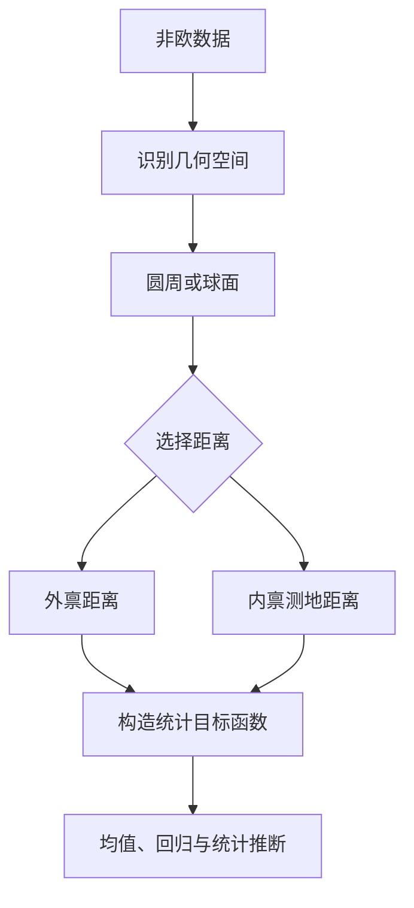

# 第 006 讲｜从欧氏空间到圆周与球面（Circles and Spheres）

> **Non-Euclidean Statistics**
>
> **Lecture 006 — Circles, Spheres, and Geometric Distances**
>
> 难度：入门
>
> 前置知识：欧氏空间、度量、范数、内积、三角函数

---

## 1. 本讲学习目标

在前面五讲中，我们已经建立了三个重要的数学概念：

- 度量（Metric）：衡量两个对象之间的距离。
- 范数（Norm）：衡量向量的大小。
- 内积（Inner Product）：描述向量的长度、角度和正交关系。

我们还知道，内积可以诱导范数，范数可以诱导度量。

但是，目前讨论的例子主要位于普通欧氏空间中。

从本讲开始，我们将接触具有特殊几何约束的数据空间。

例如：

- 方向数据位于圆周上。
- 地球表面的位置位于近似球面上。
- 三维空间中的单位方向向量位于球面上。

这些数据虽然可以用欧氏坐标表示，但它们并不能随意进行普通的向量运算。

本讲主要回答：

1. 什么是圆周空间？
2. 什么是球面空间？
3. 为什么圆周与球面不是普通欧氏向量空间？
4. 什么是外禀距离（Extrinsic Distance）？
5. 什么是内禀距离（Intrinsic Distance）？
6. 如何计算圆周和球面上的测地距离？
7. 为什么这些几何结构对统计分析非常重要？

---

## 2. 从方向数据开始

### 2.1 一个熟悉的问题

假设我们观察两个方向：

```math
\theta_1=10^\circ,\qquad
\theta_2=350^\circ
```

如果把它们看作普通实数，那么两者的差为：

```math
\lvert 350-10\rvert=340
```

但是，从几何上看：

- 第一个方向位于正北偏东。
- 第二个方向位于正北偏西。
- 两者实际上非常接近。

它们之间的最短角度差只有：

```math
20^\circ
```

为什么普通的实数距离会产生不合理的结果？

因为方向数据存在周期性。

### 2.2 角度具有周期性

对于方向来说：

```math
0^\circ\sim360^\circ
```

这里的符号 $\sim$ 表示两个角度代表同一个方向。

更一般地：

```math
\theta\sim\theta+360^\circ k,
\qquad k\in\mathbb Z
```

其中 $\mathbb Z$ 是整数集合。

例如：

```math
10^\circ\sim370^\circ\sim730^\circ
```

它们都代表同一个方向。

这说明：

**方向数据的自然空间不是普通实数直线，而是圆周。**

---

## 3. 什么是圆周空间？

### 3.1 单位圆的定义

在二维欧氏空间 $\mathbb R^2$ 中，考虑集合：

```math
S^1
=
\left\{
(x_1,x_2)\in\mathbb R^2:
x_1^2+x_2^2=1
\right\}
```

这个集合称为单位圆周（Unit Circle）。

其中：

- $S^1$ 表示一维球面，也就是通常的圆周。
- $\mathbb R^2$ 表示二维欧氏空间。
- 条件 $x_1^2+x_2^2=1$ 表示点到原点的欧氏距离为 1。

注意：

**$S^1$ 是一个一维几何对象，但它嵌入在二维欧氏空间中。**

为什么称为一维？

因为我们只需要一个参数（例如角度）就可以描述圆周上的位置。

### 3.2 圆周的参数化

利用三角函数，可以将角度映射为圆周上的点：

```math
x(\theta)
=
(\cos\theta,\sin\theta)
```

其中 $\theta$ 使用弧度。

例如：

当 $\theta=0$ 时：

```math
x(0)=(1,0)
```

当 $\theta=\frac{\pi}{2}$ 时：

```math
x\left(\frac{\pi}{2}\right)=(0,1)
```

当 $\theta=\pi$ 时：

```math
x(\pi)=(-1,0)
```

当 $\theta=2\pi$ 时：

```math
x(2\pi)=(1,0)
```

因此：

```math
x(0)=x(2\pi)
```

这正是圆周周期性的体现。

### 3.3 为什么这个参数化有效？

因为：

```math
\cos^2\theta+\sin^2\theta=1
```

所以对于任意角度 $\theta$：

```math
x(\theta)\in S^1
```

换句话说：

**每一个角度都对应单位圆周上的一个点。**

反过来，圆周上的每个点也可以通过某个角度表示，但角度表示并不唯一。

---

## 4. 圆周为什么不是普通的欧氏向量空间？

这是理解非欧数据的重要一步。

虽然 $S^1$ 是 $\mathbb R^2$ 的一个子集，但它不是 $\mathbb R^2$ 的线性子空间。

原因是它不满足向量空间对加法和数乘的封闭性要求。

### 4.1 向量加法可能离开圆周

考虑圆周上的两个点：

```math
x=(1,0),\qquad y=(0,1)
```

它们都满足：

```math
x_1^2+x_2^2=1
```

所以都属于 $S^1$。

但是：

```math
x+y=(1,1)
```

这个新向量的欧氏长度为：

```math
\lVert x+y\rVert_2=\sqrt2
```

因为：

```math
\sqrt2\neq1
```

所以：

```math
x+y\notin S^1
```

这说明圆周对普通向量加法不封闭。

### 4.2 数乘也可能离开圆周

考虑：

```math
x=(1,0)\in S^1
```

将它乘以 2：

```math
2x=(2,0)
```

但是：

```math
\lVert2x\rVert_2=2
```

因此：

```math
2x\notin S^1
```

所以圆周对普通数乘也不封闭。

### 4.3 普通算术平均可能离开圆周

考虑两个相反的方向：

```math
x=(1,0),\qquad y=(-1,0)
```

它们的算术平均为：

```math
\frac{x+y}{2}=(0,0)
```

但是：

```math
\lVert(0,0)\rVert_2=0
```

因此：

```math
(0,0)\notin S^1
```

这意味着：

**两个合法的圆周观测值，其普通算术平均可能不是合法的圆周数据。**

这与我们在第 001 讲中遇到的平均方向问题密切相关。

---

## 5. 什么是球面空间？

### 5.1 单位球面的定义

在三维欧氏空间 $\mathbb R^3$ 中，定义：

```math
S^2
=
\left\{
(x_1,x_2,x_3)\in\mathbb R^3:
x_1^2+x_2^2+x_3^2=1
\right\}
```

这个集合称为单位二维球面（Unit Sphere）。

注意：

- $S^1$ 是圆周，嵌入在 $\mathbb R^2$ 中。
- $S^2$ 是通常的球面，嵌入在 $\mathbb R^3$ 中。

为什么 $S^2$ 是二维的？

因为球面上的位置可以使用两个独立参数描述。

例如：

- 经度
- 纬度

虽然球面位于三维空间中，但它本身只有两个自由度。

### 5.2 一般半径的球面

如果半径为 $R>0$，则定义：

```math
S_R^2
=
\left\{
x\in\mathbb R^3:
x_1^2+x_2^2+x_3^2=R^2
\right\}
```

也可以写为：

```math
S_R^2
=
\{x\in\mathbb R^3:\lVert x\rVert_2=R\}
```

当 $R=1$ 时：

```math
S_R^2=S^2
```

### 5.3 球面数据的例子

球面数据非常常见。

例如：

**地理位置**

地球表面的位置可以近似表示在球面上。

**三维方向**

一个三维单位方向向量满足：

```math
x_1^2+x_2^2+x_3^2=1
```

因此属于 $S^2$。

**科学测量**

一些方向性观测，例如空间中的朝向、法向量和部分物理测量数据，也可以自然地表示为球面数据。

这些数据都具有共同特点：

**它们受到球面几何约束，不能简单地看成任意三维向量。**

---

## 6. 什么是外禀距离（Extrinsic Distance）？

我们已经知道，圆周与球面都可以嵌入欧氏空间。

因此，一个很自然的问题是：

能否直接使用周围欧氏空间的距离？

答案是可以。

### 6.1 外禀距离的直观理解

考虑圆周上的两个点：

```math
x,y\in S^1
```

虽然它们位于圆周上，但我们仍然可以计算普通欧氏距离：

```math
d_E(x,y)=\lVert x-y\rVert_2
```

这种通过周围欧氏空间测量距离的方法称为外禀方法（Extrinsic Approach）。

对于圆周和球面，限制在其上的欧氏距离也称为弦距离（Chord Distance）。

### 6.2 什么是弦长？

考虑单位圆周上的两个点：

```math
x=(1,0)
```

```math
y=(0,1)
```

它们之间的欧氏距离为：

```math
d_E(x,y)
=
\sqrt{(1-0)^2+(0-1)^2}
```

因此：

```math
d_E(x,y)=\sqrt2
```

几何上，这个距离就是连接圆周上两个点的直线段长度。

这条线段称为弦（Chord）。

**弦长允许连接路径穿过圆周内部，而不要求路径始终位于圆周上。**

注意：这里的弦距离是一个合法的度量。

因此，我们并不是说欧氏距离不能用于圆周数据，而是说它不一定能够表达所有感兴趣的圆周几何性质。

---

## 7. 什么是内禀距离（Intrinsic Distance）？

现在考虑一个不同的问题。

假设一个对象只能沿着圆周移动。

那么，它从圆周上的一个点移动到另一个点时，应该如何测量距离？

这一次，我们不允许直接穿过圆内部。

路径必须始终停留在圆周上。

### 7.1 内禀距离的直观理解

对于圆周，我们可以考虑：

**沿着圆周本身连接两点的最短路径长度。**

这是一种内禀几何（Intrinsic Geometry）的观点。

它只利用圆周自身的几何结构来测量长度。

与外禀距离相比：

- 外禀弦距离：通过周围欧氏空间测量两点之间的直线距离。
- 内禀测地距离：考虑限制在圆周上的最短路径长度。

### 7.2 圆周上的最短路径

在圆周上，两个不同的非对径点通常可以通过两段圆弧连接。

我们选择其中较短的圆弧。

例如，两个方向分别为：

```math
\theta_1=10^\circ,\qquad
\theta_2=350^\circ
```

一条圆弧对应：

```math
340^\circ
```

另一条圆弧对应：

```math
20^\circ
```

显然，较短的圆弧对应 $20^\circ$。

对于单位圆，若将其转换为弧度，就得到了最短圆弧的长度。

### 7.3 弧度是什么？

回顾弧度（Radian）的定义。

对于半径为 $R$ 的圆：

```math
s=R\theta
```

其中：

- $s$ 是圆弧长度。
- $R$ 是圆的半径。
- $\theta$ 是以弧度表示的圆心角。

当 $R=1$ 时：

```math
s=\theta
```

因此：

**在单位圆上，最短圆弧长度等于对应的最小非负角度差（以弧度计）。**

---

## 8. 圆周上的测地距离（Geodesic Distance）

### 8.1 测地距离的定义

考虑单位圆周上的两个点：

```math
x(\theta)=(\cos\theta,\sin\theta)
```

```math
x(\phi)=(\cos\phi,\sin\phi)
```

其中角度采用弧度。

单位圆上的测地距离可以定义为：

```math
d_G(\theta,\phi)
=
\min_{k\in\mathbb Z}
\lvert\theta-\phi+2\pi k\rvert
```

这里：

- $d_G$ 表示测地距离。
- $\theta,\phi$ 表示两个方向。
- $k$ 是整数。
- 加上整圈角度后，仍表示同一个圆周方向。

这个公式的作用是：

**在所有等价的角度表示中，寻找最小的绝对角度差。**

对于任意两个圆周方向：

```math
0\leq d_G(\theta,\phi)\leq\pi
```

这是因为单位圆上两个方向之间的最短圆弧最多对应半圈。

### 8.2 用度数表示

如果角度以度为单位，且：

```math
0^\circ\leq a,b<360^\circ
```

那么最短角度差为：

```math
\delta(a,b)
=
\min\{
\lvert a-b\rvert,\,
360^\circ-\lvert a-b\rvert
\}
```

这里的结果仍以度为单位。

若想得到单位圆上的测地距离，需要将角度转换为弧度。

### 8.3 具体计算

考虑：

```math
a=10^\circ,\qquad b=350^\circ
```

首先：

```math
\lvert a-b\rvert=340^\circ
```

因此：

```math
\delta(a,b)
=
\min\{340^\circ,20^\circ\}
=
20^\circ
```

转换为弧度：

```math
20^\circ=\frac{\pi}{9}
```

所以单位圆上的测地距离为：

```math
d_G(a,b)=\frac{\pi}{9}
```

数值约为：

```math
d_G(a,b)\approx0.3491
```

如果圆的半径为 $R$，则测地距离为：

```math
d_G(a,b)=\frac{\pi R}{9}
```

### 8.4 一个特殊情况：对径点

考虑单位圆上的两个点：

```math
x=(1,0),\qquad y=(-1,0)
```

它们位于圆周的两端，称为对径点（Antipodal Points）。

两个点之间存在两条等长的半圆弧。

它们的测地距离为：

```math
d_G(x,y)=\pi
```

但是，实现这个最短距离的圆弧并不唯一。

这说明：

**测地距离可以是唯一的数值，但最短路径不一定唯一。**

这一现象在后面学习测地线和流形统计时非常重要。

---

## 9. 弦距离与测地距离有什么区别？

现在我们已经有了两种测量圆周上两点距离的方法。

### 9.1 弦距离

对于单位圆上的两个点，令最短角度差为 $\delta$，并使用弧度。

则弦长为：

```math
d_E=2\sin\left(\frac{\delta}{2}\right)
```

这是由等腰三角形的几何关系得到的。

### 9.2 测地距离

对于单位圆：

```math
d_G=\delta
```

因此：

```math
d_E=2\sin\left(\frac{d_G}{2}\right)
```

由于正弦函数满足相应的不等式，可以得到：

```math
d_E\leq d_G
```

也就是说：

**圆周上两点之间的直线弦长，不会超过沿圆周的最短圆弧长度。**

当两点重合时取等号；对于不同的两点，弦长严格小于测地距离。

### 9.3 一个具体例子

取单位圆上的：

```math
x=(1,0),\qquad y=(0,1)
```

两个点之间的最小圆心角为：

```math
\delta=\frac{\pi}{2}
```

弦距离为：

```math
d_E(x,y)=\sqrt2
```

测地距离为：

```math
d_G(x,y)=\frac{\pi}{2}
```

数值比较：

```math
\sqrt2\approx1.4142
```

```math
\frac{\pi}{2}\approx1.5708
```

因此：

```math
d_E(x,y)<d_G(x,y)
```

### 9.4 为什么这两种距离都合理？

因为它们回答的是不同问题。

**弦距离回答：**

如果允许使用周围的欧氏空间，两点之间的直线距离是多少？

**测地距离回答：**

如果路径必须沿圆周移动，最短路径有多长？

两者都是合法度量，但代表不同的几何含义。

| 比较 | 弦距离 | 测地距离 |
|---|---|---|
| 英文 | Chord Distance | Geodesic Distance |
| 几何视角 | 外禀 | 内禀 |
| 路径含义 | 周围欧氏空间中的直线 | 圆周上的最短路径 |
| 是否尊重圆周路径约束 | 不要求 | 要求 |
| 单位圆上的数值关系 | 不大于测地距离 | 不小于弦距离 |

需要注意：

外禀方法并不等于错误的方法。

研究目的不同，合适的距离也可能不同。

---

## 10. 球面上的测地距离

圆周是我们理解测地距离的第一个例子。

现在将这个概念推广到球面。

### 10.1 球面上的两点

考虑半径为 $R$ 的球面：

```math
S_R^2
=
\{x\in\mathbb R^3:\lVert x\rVert_2=R\}
```

取两个点：

```math
x,y\in S_R^2
```

我们可以计算它们之间的欧氏距离：

```math
d_E(x,y)=\lVert x-y\rVert_2
```

但如果我们只能沿球面移动，那么最短路径是什么？

### 10.2 大圆（Great Circle）

在球面上，通过球心的平面与球面相交所形成的圆，称为大圆（Great Circle）。

例如，在理想球体模型中：

- 赤道是一个大圆。
- 经过南北两极的完整经线圆也是大圆。

在标准球面几何中，球面上两点之间的最短路径通常是某条大圆上的较短圆弧。

对于非对径点，这条较短大圆弧唯一。

对于对径点，则存在无穷多条最短大圆半弧。

### 10.3 球面测地距离的公式

设两个球面点为 $x,y$，半径为 $R$。

它们与球心所形成的夹角记为 $\alpha$。

由于：

```math
\lVert x\rVert_2
=
\lVert y\rVert_2
=
R
```

根据内积与夹角的关系：

```math
\langle x,y\rangle
=
R^2\cos\alpha
```

因此：

```math
\cos\alpha
=
\frac{\langle x,y\rangle}{R^2}
```

所以：

```math
\alpha
=
\arccos\left(
\frac{\langle x,y\rangle}{R^2}
\right)
```

其中：

```math
0\leq\alpha\leq\pi
```

球面上的测地距离为：

```math
d_G(x,y)=R\alpha
```

因此得到：

```math
d_G(x,y)
=
R\arccos\left(
\frac{\langle x,y\rangle}{R^2}
\right)
```

这就是标准球面上的测地距离公式。

注意：在实际数值计算中，由于浮点误差，反余弦函数的输入可能略微超出允许范围，通常需要将其截断到闭区间 [-1, 1] 中。

### 10.4 单位球面的特殊情况

当 $R=1$ 时：

```math
\lVert x\rVert_2
=
\lVert y\rVert_2
=
1
```

所以：

```math
d_G(x,y)
=
\arccos(\langle x,y\rangle)
```

这说明：

**单位球面上的测地距离可以直接通过两个单位向量的内积计算。**

这与第 005 讲的内积知识建立了直接联系。

---

## 11. 球面上的一个具体例子

考虑单位球面 $S^2$ 上的两个点：

```math
x=(1,0,0)
```

```math
y=(0,1,0)
```

### 11.1 计算欧氏距离

首先：

```math
x-y=(1,-1,0)
```

因此：

```math
d_E(x,y)
=
\sqrt{1^2+(-1)^2+0^2}
```

所以：

```math
d_E(x,y)=\sqrt2
```

### 11.2 计算测地距离

首先计算内积：

```math
\langle x,y\rangle
=
1\times0+0\times1+0\times0
=
0
```

由于半径为 1：

```math
d_G(x,y)
=
\arccos(0)
```

因此：

```math
d_G(x,y)=\frac{\pi}{2}
```

所以：

```math
d_E(x,y)=\sqrt2
```

```math
d_G(x,y)=\frac{\pi}{2}
```

再次得到：

```math
d_E(x,y)<d_G(x,y)
```

### 11.3 如果球面半径不是 1 呢？

设球面半径为 $R$。

当两点与球心的夹角为 $\alpha$ 时，测地距离为：

```math
d_G=R\alpha
```

而弦距离为：

```math
d_E
=
2R\sin\left(\frac{\alpha}{2}\right)
```

因此：

```math
d_E\leq d_G
```

这与圆周中的结论一致。

---

## 12. 圆周与球面的共同结构

现在我们将两者放在一起比较。

| 特征 | 圆周 | 球面 |
|---|---|---|
| 数学记号 | $S^1$ | $S^2$ |
| 内在维度 | 1 | 2 |
| 嵌入空间 | $\mathbb R^2$ | $\mathbb R^3$ |
| 自然参数 | 一个角度 | 两个角度 |
| 最短路径 | 较短圆弧 | 较短大圆弧 |
| 是否具有向量空间结构 | 否 | 否 |

它们有几个重要共同点：

1. 都可以嵌入普通欧氏空间。
2. 都受到固定长度的几何约束。
3. 普通向量加法可能使结果离开原空间。
4. 都可以定义弦距离与测地距离。
5. 都可能出现最短路径不唯一的情况。

还有一个重要共同点：

**圆周与球面都是光滑流形的经典例子。**

我们将在后续课程中正式学习流形的定义。

---

## 13. 为什么这些几何差异对统计学重要？

到目前为止，我们讨论的主要是几何。

现在回到非欧统计学。

### 13.1 均值可能不在原空间

假设方向数据位于 $S^1$。

如果直接计算其欧氏坐标平均：

```math
\bar X
=
\frac1n\sum_{i=1}^{n}X_i
```

所得结果可能不属于 $S^1$。

这意味着传统算术平均不一定是合法的方向对象。

### 13.2 距离选择影响统计目标

假设我们希望寻找一个代表性中心 $\mu$。

一种可能的目标函数为：

```math
F(\mu)
=
\sum_{i=1}^{n}d^2(X_i,\mu)
```

如果使用弦距离，得到的是一种外禀几何下的优化目标。

如果使用测地距离，则得到内禀几何下的优化目标。

不同的距离可能导致不同的最优中心。

这正是后续 Fréchet 均值理论要解决的问题。

### 13.3 最短路径不唯一也会影响统计分析

在球面上，对径点之间存在多条最短路径。

这意味着一些需要选择最短路径的几何运算可能面临不唯一性。

此外，在非欧空间中，平方距离目标函数也不一定具有唯一的最小化点。

因此，非欧统计中的很多理论问题都与空间的几何性质有关。

### 13.4 从数据空间到统计方法



**图 1：圆周与球面数据的统计分析思路。**

本讲暂时不深入研究估计量。

我们只需要建立一个重要认识：

**非欧统计方法的构造，离不开对数据空间及其距离结构的理解。**

---

## 14. 常见误区

### 误区一：圆周是二维空间

不完全正确。

圆周嵌入二维欧氏空间，但圆周本身是一维几何对象。

同理，球面 $S^2$ 嵌入三维欧氏空间，但本身是二维的。

必须区分：

- 内在维度
- 嵌入空间维度

### 误区二：球面就是球体

错误。

在数学中，球面指满足固定半径条件的表面。

例如：

```math
x_1^2+x_2^2+x_3^2=1
```

描述单位球面。

而单位闭球体由下面的不等式描述：

```math
x_1^2+x_2^2+x_3^2\leq1
```

球面只是球体的边界。

### 误区三：欧氏距离不能用于球面数据

错误。

球面上的两个点仍然可以使用欧氏距离比较。

这种距离称为弦距离，是合法度量。

只是它和球面测地距离代表不同的几何含义。

### 误区四：测地距离就是角度

不完全正确。

对于单位圆与单位球面，测地距离恰好等于对应的最小圆心角（以弧度计）。

但如果半径为 $R$：

```math
d_G=R\alpha
```

此时测地距离不仅取决于角度，也取决于半径。

### 误区五：两个点之间的最短路径一定唯一

错误。

例如，球面上的两个对径点之间存在无穷多条最短大圆半弧。

因此，最短距离的数值可以唯一，但对应的最短路径不一定唯一。

### 误区六：非欧空间一定不能嵌入欧氏空间

错误。

圆周与球面都是嵌入欧氏空间中的非平凡几何对象。

能否嵌入欧氏空间，与空间本身是否适合直接使用普通欧氏统计方法，是两个不同的问题。

---

## 15. 本讲总结

本讲最重要的三个结论：

### 结论一：数据空间具有几何约束

单位圆与单位球面分别满足：

```math
S^1
=
\{x\in\mathbb R^2:\lVert x\rVert_2=1\}
```

```math
S^2
=
\{x\in\mathbb R^3:\lVert x\rVert_2=1\}
```

它们不是普通欧氏空间的线性子空间。

### 结论二：内禀距离与外禀距离不同

外禀弦距离：

```math
d_E(x,y)=\lVert x-y\rVert_2
```

球面上的内禀测地距离：

```math
d_G(x,y)
=
R\arccos\left(
\frac{\langle x,y\rangle}{R^2}
\right)
```

两种距离都合理，但反映不同几何观点。

### 结论三：统计方法需要尊重数据空间的结构

对于圆周和球面数据：

- 普通平均可能离开原空间。
- 不同距离可能得到不同的统计中心。
- 最短路径与统计目标可能存在不唯一性。

这些现象是非欧统计学的重要研究动机。

**本讲核心思想：**

> Geometry determines how distances are measured, and distances influence how statistics are constructed.

几何结构决定距离的测量方式，而距离的选择会影响统计方法的构造。

---

## 16. 课后练习

### 练习 1：判断圆周上的点

给定以下三个二维向量：

```math
x=(1,0)
```

```math
y=(1,1)
```

```math
z=\left(\frac35,\frac45\right)
```

判断哪些点属于单位圆周 $S^1$。

并说明理由。

### 练习 2：圆周上的两种距离

考虑单位圆上的两个点：

```math
x=(1,0),\qquad y=(-1,0)
```

计算：

1. 两点之间的弦距离。
2. 两点之间的测地距离。
3. 两点之间是否存在唯一的最短圆弧？

### 练习 3：方向数据

考虑两个方向：

```math
\theta_1=30^\circ,\qquad
\theta_2=330^\circ
```

计算：

1. 直接将角度作为实数时的绝对差。
2. 两个方向的最小角度差。
3. 单位圆上对应的测地距离。

### 练习 4：球面测地距离

在单位球面 $S^2$ 上，给定：

```math
x=(0,0,1)
```

```math
y=(1,0,0)
```

计算：

1. 两点之间的欧氏距离。
2. 两点之间的内积。
3. 两点之间的球面测地距离。

### 练习 5：概念理解

为什么说圆周和球面虽然嵌入了欧氏空间，却不应该简单地看成普通欧氏向量空间？

请结合向量加法、数乘以及几何距离进行解释。

### 参考答案

<details>
<summary>点击查看参考答案</summary>

#### 练习 1：判断圆周上的点

单位圆周要求点的两个坐标平方和等于 1。

对于第一个点：

```math
1^2+0^2=1
```

因此属于单位圆周。

对于第二个点：

```math
1^2+1^2=2\neq1
```

因此不属于单位圆周。

对于第三个点：

```math
\left(\frac35\right)^2
+
\left(\frac45\right)^2
=
\frac9{25}+\frac{16}{25}
=
1
```

因此属于单位圆周。

所以第一个点和第三个点属于单位圆周。

#### 练习 2：圆周上的两种距离

首先计算弦距离：

```math
d_E(x,y)
=
\sqrt{(1+1)^2+(0-0)^2}
=
2
```

两个点是单位圆上的对径点。

因此最小圆心角为：

```math
\delta=\pi
```

单位圆上的测地距离为：

```math
d_G(x,y)=\pi
```

由于存在两条等长的半圆弧，所以最短路径不唯一。

最终：

```math
d_E(x,y)=2,\qquad d_G(x,y)=\pi
```

#### 练习 3：方向数据

将角度作为普通实数时：

```math
\lvert330-30\rvert=300^\circ
```

最小角度差：

```math
\delta
=
\min\{300^\circ,60^\circ\}
=
60^\circ
```

将角度转换为弧度：

```math
60^\circ=\frac{\pi}{3}
```

因此单位圆上的测地距离为：

```math
d_G=\frac{\pi}{3}
```

#### 练习 4：球面测地距离

首先计算欧氏距离：

```math
d_E(x,y)
=
\sqrt{(-1)^2+0^2+1^2}
=
\sqrt2
```

计算内积：

```math
\langle x,y\rangle
=
0\times1+0\times0+1\times0
=
0
```

由于球面半径为 1：

```math
d_G(x,y)
=
\arccos(\langle x,y\rangle)
```

因此：

```math
d_G(x,y)
=
\arccos(0)
=
\frac{\pi}{2}
```

最终得到：

```math
d_E(x,y)=\sqrt2,\qquad
d_G(x,y)=\frac{\pi}{2}
```

#### 练习 5：概念理解

圆周和球面虽然可以使用欧氏坐标表示，但它们受到固定半径的约束。

普通向量加法和数乘可能产生不满足约束的新向量。

例如：

```math
(1,0)+(0,1)=(1,1)
```

但是：

```math
\lVert(1,1)\rVert_2=\sqrt2\neq1
```

因此所得向量不属于单位圆周。

此外，欧氏弦距离与沿空间本身的测地距离也不相同。

所以分析这些数据时，需要考虑它们自身的几何结构，而不能无条件沿用所有普通欧氏向量运算。

</details>

---

## 17. 下一讲预告

### 第 007 讲｜什么是测地线（Geodesic）？

本讲已经介绍了：

- 圆周空间
- 球面空间
- 外禀距离
- 内禀距离
- 测地距离

但是，我们尚未正式定义测地线。

下一讲将进一步研究：

1. 什么是曲线？
2. 如何定义曲线的长度？
3. 什么是测地线？
4. 测地线与最短路径有什么关系？
5. 为什么测地线不一定全局最短？
6. 圆周与球面上的测地线有哪些特殊性质？

这些知识将帮助我们从具体的圆周和球面，逐步过渡到一般的流形几何。

---

**End of Lecture 006**
