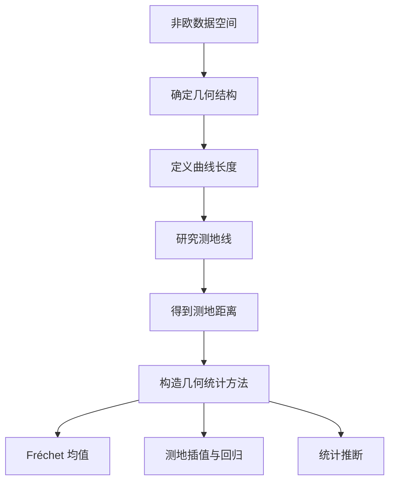

# 第 007 讲｜什么是测地线（Geodesic）？

> **Non-Euclidean Statistics**
>
> **Lecture 007 — Geodesics and Shortest Paths**
>
> 难度：入门至初级
>
> 前置知识：度量空间、范数、内积、圆周与球面、三角函数

---

## 1. 本讲学习目标

在第 006 讲中，我们学习了两个重要的非欧数据空间：

- 圆周 $S^1$
- 球面 $S^2$

我们还区分了两种距离：

- 外禀距离（Extrinsic Distance）
- 内禀距离（Intrinsic Distance）

例如，在单位圆上，两个点之间的弦距离为：

```math
d_E(x,y)=\lVert x-y\rVert_2
```

而测地距离等于沿着圆周连接两点的最短圆弧长度。

但是，我们还没有正式解释一个重要概念：

**什么是测地线（Geodesic）？**

本讲将学习：

1. 什么是曲线（Curve）？
2. 如何定义曲线的长度？
3. 什么是最短路径？
4. 什么是测地线？
5. 测地线与最短路径有什么区别？
6. 为什么测地线不一定全局最短？
7. 圆周和球面上的测地线是什么？
8. 测地线为什么对非欧统计学重要？

---

## 2. 从直线到曲线

### 2.1 欧氏空间中的两点

考虑二维欧氏空间中的两个点：

```math
x=(0,0),\qquad y=(3,4)
```

它们之间的欧氏距离为：

```math
d_E(x,y)
=
\sqrt{(3-0)^2+(4-0)^2}
=
5
```

我们知道，连接两个点的直线段是欧氏空间中的最短路径。

但现在考虑另一种情况：

**如果数据所在的空间本身是弯曲的，那么最短路径应该是什么？**

例如：

- 在圆周上，路径必须沿圆周移动。
- 在球面上，路径必须沿球面移动。
- 在一般曲面上，路径必须保持在曲面内部。

这说明我们需要先理解什么是曲线。

### 2.2 曲线的数学定义

在欧氏空间 $\mathbb R^p$ 中，一条参数化曲线可以表示为一个连续映射：

```math
\gamma:[a,b]\longrightarrow\mathbb R^p
```

其中：

- $\gamma$ 表示曲线。
- $[a,b]$ 是参数区间。
- $t\in[a,b]$ 是参数。
- $\gamma(t)$ 表示曲线上对应于参数 $t$ 的点。

例如，在二维空间中：

```math
\gamma(t)=(t,t^2)
```

当 $t\in[0,1]$ 时，这条曲线从 $(0,0)$ 延伸到 $(1,1)$，其轨迹是抛物线的一部分。

需要区分：

**曲线是一条由参数描述的路径，而不仅仅是空间中的一个点集。**

同一条几何轨迹可以使用不同的参数化方式表示。

---

## 3. 如何定义曲线的长度？

### 3.1 从折线长度开始

假设我们沿一条弯曲路径移动。

一种自然的测量方法是：

1. 在路径上选择若干个点。
2. 用直线段连接相邻点。
3. 计算折线的总长度。
4. 让分割越来越细。

对于足够光滑的曲线，可以通过积分计算长度。

### 3.2 欧氏空间中的弧长公式

设曲线：

```math
\gamma(t)
=
\bigl(\gamma_1(t),\ldots,\gamma_p(t)\bigr)
```

定义在 $[a,b]$ 上，并假设它分段连续可微。

其导数为：

```math
\gamma'(t)
=
\bigl(\gamma_1'(t),\ldots,\gamma_p'(t)\bigr)
```

导数向量描述曲线在该参数位置的运动方向和速度。

曲线长度定义为：

```math
L(\gamma)
=
\int_a^b
\lVert\gamma'(t)\rVert_2\,dt
```

也可以展开为：

```math
L(\gamma)
=
\int_a^b
\sqrt{
\sum_{j=1}^{p}
\bigl(\gamma_j'(t)\bigr)^2
}\,dt
```

这个公式非常重要。

它告诉我们：

**曲线的长度等于沿着曲线对速度大小进行积分。**

这里的速度指参数变化引起的位置变化率，不一定代表实际物理运动速度。

### 3.3 一个简单例子

考虑：

```math
\gamma(t)=(3t,4t),
\qquad t\in[0,1]
```

这是一条从 $(0,0)$ 到 $(3,4)$ 的直线段。

首先求导：

```math
\gamma'(t)=(3,4)
```

速度大小为：

```math
\lVert\gamma'(t)\rVert_2
=
\sqrt{3^2+4^2}
=
5
```

因此：

```math
L(\gamma)
=
\int_0^1 5\,dt
=
5
```

这恰好等于两个端点之间的欧氏距离。

为什么？

因为这条曲线是一条直线段，已经实现了欧氏空间中的最短距离。

---

## 4. 从曲线长度到最短路径

### 4.1 一条曲线不一定最短

给定两个端点 $x$ 和 $y$。

它们之间可能存在许多不同的连接曲线。

例如，在二维平面中，可以选择：

- 一条直线段
- 一条半圆弧
- 一条折线
- 一条弯曲路径

这些曲线都能够连接两个端点，但长度通常不同。

因此，我们可以提出一个优化问题：

**在所有连接两个点的允许路径中，哪一条长度最短？**

### 4.2 通过最短路径定义距离

假设我们研究的空间为 $M$，并且能够定义其中适当曲线的长度。

对于两个点 $x,y\in M$，可以考虑：

```math
d_G(x,y)
=
\inf_{\gamma\in\Gamma(x,y)}
L(\gamma)
```

其中：

- $\Gamma(x,y)$ 表示所有连接 $x$ 与 $y$ 的允许曲线。
- $L(\gamma)$ 表示曲线长度。
- $\inf$ 表示下确界。
- $d_G(x,y)$ 表示由路径长度得到的距离。

在本课程目前讨论的圆周、球面及标准黎曼几何中，我们可以使用这样的方式理解测地距离。

需要注意：并非每一个任意定义的度量空间，都必须通过曲线长度来定义距离。

### 4.3 下确界与最小值有什么区别？

我们写：

```math
\inf_{\gamma\in\Gamma(x,y)}L(\gamma)
```

而不是直接使用 $\min$，是因为一般情况下未必存在真正达到最短长度的曲线。

如果存在一条曲线 $\gamma^\ast$，满足：

```math
L(\gamma^\ast)=d_G(x,y)
```

那么它就是一条实现两点距离的全局最短路径。

在欧氏空间、圆周和完整标准球面上，任意两点之间都存在这样的最短路径。

但在更一般的空间中，最短路径未必存在。

---

## 5. 什么是测地线（Geodesic）？

这是本讲最核心的概念。

### 5.1 最初的直观理解

在普通欧氏空间中：

**直线是最自然的测地线。**

在球面上：

**大圆弧是最自然的测地线。**

因此，我们可以把测地线初步理解为：

> 测地线是空间内部对直线概念的几何推广。

但这句话还不够严谨。

因为我们需要区分：

- 局部最短
- 全局最短

### 5.2 什么是全局最短？

考虑连接 $x$ 与 $y$ 的一条曲线 $\gamma$。

如果：

```math
L(\gamma)=d_G(x,y)
```

那么这条曲线实现了两个端点之间的全局最短距离。

这意味着在所有允许的连接曲线中，没有其他曲线比它更短。

我们称其为一条全局长度最小化曲线（Globally Length-Minimizing Curve）。

### 5.3 什么是局部最短？

局部最短的思想有所不同。

考虑曲线上的某个点及其附近的一小段曲线。

如果在每个足够小的局部区间内，该曲线段都实现其两个端点之间的最短距离，那么称它具有局部长度最小化性质。

直观上：

**从局部看，它已经沿着空间中最自然的短路径前进。**

但是，把许多局部最短的曲线段连接起来，整条路径不一定仍然是全局最短。

这一区别在球面上尤其重要。

### 5.4 黎曼几何中的测地线

在黎曼几何中，测地线有更严格的微分几何定义。

它可以理解为一条沿自身方向没有内禀加速度的曲线。

在恰当的参数化下，它满足：

```math
\nabla_{\dot\gamma}\dot\gamma=0
```

其中：

- $\dot\gamma$ 表示曲线的速度向量。
- $\nabla$ 表示黎曼流形上的协变导数。
- 该方程描述速度向量沿曲线的平行移动。

这一公式涉及尚未学习的切空间与联络。

因此，本讲不要求掌握其推导。

我们暂时记住：

**黎曼测地线在足够小的局部区间上具有长度最小化性质，但不一定在任意长的区间上保持全局最短。**

以后学习黎曼流形时，会正式解释测地线方程。

### 5.5 度量空间中的另一种定义

在只使用距离的度量几何中，经常把满足下面条件的曲线称为测地线段。

设：

```math
\gamma:[0,1]\longrightarrow\Omega
```

如果对于所有 $s,t\in[0,1]$：

```math
d\bigl(\gamma(s),\gamma(t)\bigr)
=
\lvert s-t\rvert
d\bigl(\gamma(0),\gamma(1)\bigr)
```

那么 $\gamma$ 是一条以恒定速度参数化的最短测地线段。

这一定义直接要求任意两个参数点之间的曲线段都实现距离。

需要特别注意：

**度量几何中的最短测地线段，与黎曼几何中可能延伸很长的测地线，并不总是完全相同的概念。**

本课程后面讨论流形时，主要使用黎曼几何的测地线概念。

---

## 6. 欧氏空间中的测地线

### 6.1 两点之间的直线段

考虑：

```math
x,y\in\mathbb R^p
```

连接两点的直线段可以参数化为：

```math
\gamma(t)
=
(1-t)x+ty,
\qquad t\in[0,1]
```

其中：

- $t=0$ 时，曲线位于 $x$。
- $t=1$ 时，曲线位于 $y$。
- $0<t<1$ 时，曲线位于两点之间。

例如，当 $t=\frac12$ 时：

```math
\gamma\left(\frac12\right)
=
\frac{x+y}{2}
```

这就是两个点的中点。

### 6.2 计算直线段的长度

对参数 $t$ 求导：

```math
\gamma'(t)=y-x
```

因此：

```math
L(\gamma)
=
\int_0^1
\lVert y-x\rVert_2\,dt
```

由于被积函数与 $t$ 无关：

```math
L(\gamma)
=
\lVert y-x\rVert_2
```

而欧氏距离为：

```math
d_E(x,y)
=
\lVert x-y\rVert_2
```

所以：

```math
L(\gamma)=d_E(x,y)
```

说明直线段确实实现了两点之间的欧氏距离。

### 6.3 一个重要结论

在标准欧氏空间中，两个不同点之间的直线段是唯一的全局最短路径。

因此：

**欧氏空间中的测地线是按照恒定速度参数化的直线。**

这也是为什么测地线常被称为直线在更一般空间中的推广。

---

## 7. 圆周上的测地线

现在回到第 006 讲中的单位圆：

```math
S^1
=
\{x\in\mathbb R^2:\lVert x\rVert_2=1\}
```

### 7.1 圆周上的曲线

一个常见的参数化方式是：

```math
\gamma(t)
=
(\cos t,\sin t)
```

当 $t$ 从 0 增加到 $2\pi$ 时，这条曲线沿着单位圆转动一整圈。

它始终满足：

```math
\lVert\gamma(t)\rVert_2=1
```

因此：

```math
\gamma(t)\in S^1
```

### 7.2 计算圆周曲线的长度

首先对曲线求导：

```math
\gamma'(t)
=
(-\sin t,\cos t)
```

速度大小为：

```math
\lVert\gamma'(t)\rVert_2
=
\sqrt{\sin^2t+\cos^2t}
=
1
```

因此，在参数区间 $[a,b]$ 上：

```math
L(\gamma)
=
\int_a^b 1\,dt
=
b-a
```

这里假设 $a\leq b$。

所以在单位圆上，这种恒速曲线的弧长恰好等于参数角度的变化量。

### 7.3 两点之间的最短圆弧

考虑单位圆上的两个点：

```math
x=(1,0)
```

```math
y=(0,1)
```

它们分别对应角度：

```math
\theta_x=0,\qquad
\theta_y=\frac{\pi}{2}
```

沿逆时针方向，可以取曲线：

```math
\gamma(t)
=
(\cos t,\sin t),
\qquad
0\leq t\leq\frac{\pi}{2}
```

其长度为：

```math
L(\gamma)
=
\int_0^{\pi/2}1\,dt
=
\frac{\pi}{2}
```

这条曲线是两点之间的较短圆弧。

因此：

```math
d_G(x,y)=\frac{\pi}{2}
```

它是一条全局最短测地线段。

### 7.4 圆周上的测地距离

对于两个方向：

```math
x(\theta)=(\cos\theta,\sin\theta)
```

```math
x(\phi)=(\cos\phi,\sin\phi)
```

测地距离为：

```math
d_G(\theta,\phi)
=
\min_{k\in\mathbb Z}
\lvert\theta-\phi+2\pi k\rvert
```

其中角度以弧度表示。

这个公式选择所有等价角度差中绝对值最小的一个。

例如：

```math
\theta=10^\circ,\qquad
\phi=350^\circ
```

最小角度差为：

```math
20^\circ=\frac{\pi}{9}
```

因此：

```math
d_G(\theta,\phi)=\frac{\pi}{9}
```

---

## 8. 为什么测地线不一定全局最短？

这是本讲最值得理解的地方。

### 8.1 考虑单位圆上的一条长圆弧

仍然考虑：

```math
\gamma(t)
=
(\cos t,\sin t)
```

但这次取：

```math
0\leq t\leq\frac{3\pi}{2}
```

这条曲线从：

```math
\gamma(0)=(1,0)
```

沿逆时针方向转过：

```math
\frac{3\pi}{2}
```

最终到达：

```math
\gamma\left(\frac{3\pi}{2}\right)=(0,-1)
```

### 8.2 计算曲线的长度

由于：

```math
\lVert\gamma'(t)\rVert_2=1
```

所以：

```math
L(\gamma)
=
\int_0^{3\pi/2}1\,dt
=
\frac{3\pi}{2}
```

### 8.3 但两点之间的最短距离是多少？

从 $(1,0)$ 到 $(0,-1)$，其实可以沿顺时针方向移动四分之一圈。

这条短圆弧的长度为：

```math
d_G\bigl((1,0),(0,-1)\bigr)
=
\frac{\pi}{2}
```

因此：

```math
L(\gamma)=\frac{3\pi}{2}
```

但是：

```math
d_G\bigl(\gamma(0),\gamma(3\pi/2)\bigr)
=
\frac{\pi}{2}
```

显然：

```math
L(\gamma)
>
d_G\bigl(\gamma(0),\gamma(3\pi/2)\bigr)
```

### 8.4 为什么它仍然是测地线？

因为在单位圆的标准黎曼几何中，匀速圆周运动是测地线。

这条长圆弧的每一段足够短的局部曲线，都具有最短路径性质。

但是，整段路径绕得太远，因此不再是两个端点之间的全局最短路径。

这说明：

**局部具有最短性质，并不保证整条曲线全局最短。**

### 8.5 几何直觉

可以把测地线理解为：

在当前空间中一直沿着最自然的方向前进，没有进行内禀意义上的转弯。

但是，如果空间是闭合或弯曲的，那么持续沿着这个方向前进，可能绕很远才能到达终点。

所以：

- 测地线关注曲线本身的局部几何性质。
- 全局最短路径关注指定两个端点之间的整体最短长度。

这两个概念有紧密联系，但不能直接等同。

---

## 9. 球面上的测地线

现在考虑单位球面：

```math
S^2
=
\{x\in\mathbb R^3:\lVert x\rVert_2=1\}
```

### 9.1 什么是大圆（Great Circle）？

大圆是由经过球心的平面与球面相交形成的圆。

例如：

- 赤道是一个大圆。
- 经过南北两极的完整经线圆也是大圆。

在标准球面几何中：

**大圆上的恒速运动轨迹是测地线。**

注意，大圆上的一段弧不一定都是两端点之间的全局最短路径。

### 9.2 一个大圆参数化

考虑单位球面赤道上的曲线：

```math
\gamma(t)
=
(\cos t,\sin t,0)
```

因为：

```math
\cos^2t+\sin^2t+0^2=1
```

所以：

```math
\gamma(t)\in S^2
```

这条曲线沿赤道运动。

### 9.3 计算曲线长度

首先求导：

```math
\gamma'(t)
=
(-\sin t,\cos t,0)
```

因此：

```math
\lVert\gamma'(t)\rVert_2
=
\sqrt{\sin^2t+\cos^2t}
=
1
```

所以在区间 $[0,\alpha]$ 上：

```math
L(\gamma)
=
\int_0^\alpha 1\,dt
=
\alpha
```

这里取 $0\leq\alpha$。

这说明单位球面上的大圆弧长等于所对应的圆心角（以弧度计）。

### 9.4 球面上的测地距离

对于半径为 $R$ 的标准球面：

```math
S_R^2
=
\{x\in\mathbb R^3:\lVert x\rVert_2=R\}
```

设：

```math
x,y\in S_R^2
```

它们的球面测地距离为：

```math
d_G(x,y)
=
R\arccos\left(
\frac{\langle x,y\rangle}{R^2}
\right)
```

其中：

```math
0\leq
\arccos\left(
\frac{\langle x,y\rangle}{R^2}
\right)
\leq\pi
```

该公式给出了两点之间较短大圆弧的长度。

特别地，当 $R=1$ 时：

```math
d_G(x,y)
=
\arccos(\langle x,y\rangle)
```

这与第 005 讲的内积直接联系起来。

---

## 10. 球面上测地线不唯一的情况

### 10.1 什么是对径点（Antipodal Points）？

在单位球面上，如果：

```math
y=-x
```

那么 $x$ 和 $y$ 是对径点。

例如：

```math
x=(0,0,1)
```

```math
y=(0,0,-1)
```

分别位于球面的北极与南极。

### 10.2 计算测地距离

首先：

```math
\langle x,y\rangle=-1
```

所以：

```math
d_G(x,y)
=
\arccos(-1)
=
\pi
```

因此：

```math
d_G(x,y)=\pi
```

### 10.3 最短路径是否唯一？

不唯一。

从北极到南极可以沿不同经线方向运动。

每一条经过南北极的大圆半弧长度都是 $\pi$。

因此，存在无穷多条不同的最短路径。

这说明：

**测地距离的数值可以唯一确定，但实现该距离的最短测地线段可以不唯一。**

### 10.4 为什么不唯一性值得关注？

因为后续的非欧统计方法可能需要：

- 在两个点之间选择测地线。
- 沿测地线进行插值。
- 沿测地线定义几何运动。
- 利用测地距离建立估计方法。

如果最短测地线不唯一，这些操作有时也可能产生歧义。

因此，在非欧统计理论中，唯一性经常是需要额外研究的性质。

---

## 11. 测地线与欧氏直线有什么区别？

我们现在已经接触了三种几何空间：

1. 欧氏空间
2. 圆周
3. 球面

它们的测地线具有不同的具体形式。

| 空间 | 典型测地线 | 局部性质 |
|---|---|---|
| 欧氏空间 | 直线 | 局部最短 |
| 圆周 | 匀速圆弧 | 局部最短 |
| 标准球面 | 匀速大圆弧 | 局部最短 |

其中，欧氏空间的直线段对其任意两个端点都是全局最短的。

而圆周或球面上的长测地线段，不一定全局最短。

### 11.1 几何观点的统一

虽然这些空间的形状不同，但它们有一个共同思想：

**测地线描述了在相应几何结构中最自然的直线式运动。**

这种思想可以从普通欧氏空间推广到更一般的黎曼流形。

### 11.2 为什么不能只用外禀直线？

考虑球面上的两个点。

如果直接使用欧氏直线段连接它们，除了特殊情况，线段内部通常位于球体内部，而不在球面上。

因此，这条直线虽然可以用于计算弦距离，却不是一条保持在球面上的路径。

如果研究的是沿球面移动的问题，那么必须考虑球面自身的曲线。

这就是内禀几何的重要性。

---

## 12. 测地线与非欧统计学的联系

现在回到我们最初的目标：理解非欧统计学。

### 12.1 测地距离可以定义数据之间的差异

对于普通欧氏数据，我们通常使用：

```math
d_E(x,y)=\lVert x-y\rVert_2
```

而对于球面上的数据，我们可以使用：

```math
d_G(x,y)
=
\arccos(\langle x,y\rangle)
```

这里假设 $x,y$ 属于单位球面。

因此，测地距离提供了尊重球面几何结构的差异衡量方式。

### 12.2 测地距离可以用于定义统计中心

假设我们有观测数据：

```math
X_1,\ldots,X_n\in M
```

其中 $M$ 是某个几何空间。

可以考虑下面的目标函数：

```math
F(\mu)
=
\sum_{i=1}^{n}d_G^2(X_i,\mu)
```

如果存在 $\hat\mu\in M$ 使得：

```math
F(\hat\mu)
=
\min_{\mu\in M}F(\mu)
```

那么 $\hat\mu$ 就是一个基于测地距离定义的样本中心。

这是内禀 Fréchet 均值的重要思想。

需要注意：

- 最小值是否存在需要考虑空间性质。
- 最小化点不一定唯一。
- 不同距离可能对应不同的统计中心。

这些问题将在之后的课程中正式研究。

### 12.3 测地线可以用于非欧插值

在欧氏空间中，两个点之间的线性插值为：

```math
\gamma(t)
=
(1-t)x+ty,
\qquad t\in[0,1]
```

当 $t=0$ 时得到 $x$。

当 $t=1$ 时得到 $y$。

而在球面上，直接使用这一公式，通常会离开球面。

一种自然的替代方法是：

**沿着连接两点的最短测地线进行插值。**

这样，插值结果仍位于数据空间中。

如果存在多条不同的最短测地线，则插值结果还可能取决于路径选择。

### 12.4 从测地线到统计方法



**图 1：测地线在非欧统计中的基础作用。**

这一知识结构将连接后续课程中的流形统计、Fréchet 均值和几何回归。

---

## 13. 常见误区

### 误区一：测地线一定是全局最短路径

错误。

在标准黎曼几何中，测地线具有局部长度最小化性质，但较长的测地线段不一定全局最短。

例如，圆周上的长圆弧可以是测地线的一部分，却不是两端点之间的最短路径。

### 误区二：球面上的测地线是任意圆弧

错误。

在标准球面上，测地线是大圆弧，而不是任意圆弧。

例如，赤道是大圆。

但普通纬线圆（除赤道外）不是大圆，因此沿这些纬线的运动一般不是球面测地线。

### 误区三：测地线必须是欧氏空间中的直线

错误。

测地线取决于空间自身的几何结构。

欧氏空间中的测地线是直线。

圆周上的测地线沿圆周延伸。

标准球面上的测地线沿大圆延伸。

### 误区四：最短距离唯一意味着最短路径唯一

错误。

球面上两个对径点之间的测地距离为一个确定数值，但最短测地线段有无穷多条。

### 误区五：任意参数化的同一条曲线都是相同意义下的测地线

不完全正确。

在黎曼几何中，标准测地线方程要求使用适当的仿射参数化。

如果对同一条几何轨迹进行任意非线性重新参数化，轨迹本身没有改变，但新的参数化未必继续满足测地线方程。

对于初学者，先记住：

**研究测地线时，不仅需要关注几何轨迹，有时还需要关注参数化方式。**

### 误区六：任何度量空间都一定存在连接任意两点的测地线

错误。

一般度量空间不一定具有这种性质。

只有满足相应条件的空间，才保证存在连接任意两点的最短测地线段。

这也是以后研究长度空间和测地空间的重要原因。

---

## 14. 本讲总结

本讲最重要的三个结论如下。

### 结论一：曲线长度是理解测地线的基础

在欧氏空间中，分段连续可微曲线的长度为：

```math
L(\gamma)
=
\int_a^b
\lVert\gamma'(t)\rVert_2\,dt
```

对于圆周和球面，我们可以使用这一公式计算嵌入空间中的曲线弧长。

### 结论二：测地线不一定全局最短

在黎曼几何中，测地线具有局部最短性质。

但是，一条较长的测地线段不一定实现其端点之间的全局最短距离。

因此，必须区分：

- Geodesic：测地线。
- Locally Length-Minimizing：局部长度最小化。
- Globally Length-Minimizing：全局长度最小化。

### 结论三：测地线是非欧统计的重要几何工具

测地线与测地距离可以用于：

- 定义对象间的几何差异。
- 建立 Fréchet 均值。
- 构造非欧插值。
- 研究流形上的回归和统计推断。

**本讲核心思想：**

> A geodesic generalizes the idea of a straight line to a geometric space, but it need not remain globally shortest.

测地线是直线概念在几何空间中的推广，但它不一定始终保持全局最短。

---

## 15. 课后练习

### 练习 1：计算欧氏曲线的长度

考虑二维曲线：

```math
\gamma(t)=(3t,4t),
\qquad t\in[0,1]
```

计算：

1. 曲线的导数。
2. 曲线的速度大小。
3. 曲线的长度。
4. 两个端点之间的欧氏距离。

判断曲线是否为最短路径。

### 练习 2：圆周测地距离

在单位圆上，给定两个方向：

```math
\theta_1=20^\circ,\qquad
\theta_2=340^\circ
```

计算：

1. 将角度作为普通实数时的绝对差。
2. 两个方向的最小角度差。
3. 单位圆上的测地距离。

### 练习 3：对径点

考虑单位圆上的两个点：

```math
x=(1,0),\qquad y=(-1,0)
```

回答：

1. 它们的弦距离是多少？
2. 它们的测地距离是多少？
3. 最短圆弧是否唯一？

### 练习 4：局部最短与全局最短

考虑单位球面赤道上的曲线：

```math
\gamma(t)
=
(\cos t,\sin t,0)
```

其中：

```math
0\leq t\leq\frac{3\pi}{2}
```

计算：

1. 整条曲线的长度。
2. 两个端点之间的球面测地距离。
3. 这条曲线是否全局最短？
4. 为什么它仍然可以是黎曼测地线的一部分？

### 练习 5：概念理解

解释下面两个概念的区别：

- 测地线
- 全局最短路径

为什么在球面上，这两个概念不能完全等同？

### 参考答案

<details>
<summary>点击查看参考答案</summary>

#### 练习 1：计算欧氏曲线的长度

首先求导：

```math
\gamma'(t)=(3,4)
```

速度大小为：

```math
\lVert\gamma'(t)\rVert_2
=
\sqrt{3^2+4^2}
=
5
```

因此：

```math
L(\gamma)
=
\int_0^1 5\,dt
=
5
```

两个端点分别为：

```math
\gamma(0)=(0,0)
```

```math
\gamma(1)=(3,4)
```

欧氏距离为：

```math
d_E\bigl(\gamma(0),\gamma(1)\bigr)
=
\sqrt{3^2+4^2}
=
5
```

所以：

```math
L(\gamma)
=
d_E\bigl(\gamma(0),\gamma(1)\bigr)
```

因此，这条曲线是连接两个端点的全局最短路径。

#### 练习 2：圆周测地距离

首先计算普通角度差：

```math
\lvert340^\circ-20^\circ\rvert
=
320^\circ
```

由于方向具有周期性，我们需要比较两条圆弧对应的角度。

最小角度差为：

```math
\delta
=
\min\{320^\circ,40^\circ\}
=
40^\circ
```

将角度转换为弧度：

```math
40^\circ
=
\frac{40\pi}{180}
=
\frac{2\pi}{9}
```

因此，单位圆上的测地距离为：

```math
d_G=\frac{2\pi}{9}
```

#### 练习 3：对径点

首先计算弦距离：

```math
d_E(x,y)
=
\sqrt{(1+1)^2+0^2}
=
2
```

由于两点是对径点，它们对应的最小圆心角为：

```math
\delta=\pi
```

单位圆上的测地距离为：

```math
d_G(x,y)=\pi
```

两个对径点可以通过顺时针和逆时针两条半圆弧连接。

两条半圆弧的长度均为：

```math
L=\pi
```

因此最短路径不唯一。

#### 练习 4：局部最短与全局最短

首先求导：

```math
\gamma'(t)
=
(-\sin t,\cos t,0)
```

所以：

```math
\lVert\gamma'(t)\rVert_2=1
```

整条曲线的长度为：

```math
L(\gamma)
=
\int_0^{3\pi/2}1\,dt
=
\frac{3\pi}{2}
```

两个端点为：

```math
\gamma(0)=(1,0,0)
```

```math
\gamma\left(\frac{3\pi}{2}\right)
=
(0,-1,0)
```

它们的内积为：

```math
\langle\gamma(0),\gamma(3\pi/2)\rangle=0
```

所以单位球面上的测地距离为：

```math
d_G
=
\arccos(0)
=
\frac{\pi}{2}
```

因此：

```math
L(\gamma)=\frac{3\pi}{2}
```

而：

```math
d_G=\frac{\pi}{2}
```

显然：

```math
L(\gamma)>d_G
```

所以整条曲线不是两端点之间的全局最短路径。

但是，这条曲线沿球面大圆以恒定速度运动。

它满足标准球面上的黎曼测地线条件，并且任意足够短的局部曲线段都是最短路径。

因此，它可以是一条黎曼测地线的一部分，却不是全局最短路径。

#### 练习 5：概念理解

在黎曼几何中，测地线描述沿自身方向没有内禀加速度的曲线。

其足够短的局部曲线段具有长度最小化性质。

而全局最短路径要求整条曲线的长度等于两个端点之间的最短距离。

球面上的大圆弧是测地线，但沿大圆行进超过半圈时，较长的弧通常不再是两个端点之间的全局最短路径。

因此：

**测地线的局部性质与全局最短路径性质不能直接等同。**

</details>

---

## 16. 下一讲预告

### 第 008 讲｜什么是流形（Manifold）？

到目前为止，我们已经学习了：

- 欧氏空间
- 度量空间
- 范数与内积
- 圆周与球面
- 曲线与测地线

接下来，我们将正式引入非欧几何中的一个核心概念：

**流形（Manifold）。**

下一讲将介绍：

1. 为什么需要流形？
2. 什么叫一个空间局部看起来像欧氏空间？
3. 什么是局部坐标？
4. 什么是坐标图（Chart）？
5. 圆周和球面为什么是流形？
6. 流形与普通欧氏空间有什么区别？
7. 为什么流形是非欧统计学的重要数据空间？

我们将从直观几何开始，逐步建立流形的数学定义，为后面学习切空间和黎曼度量奠定基础。

---

**End of Lecture 007**
