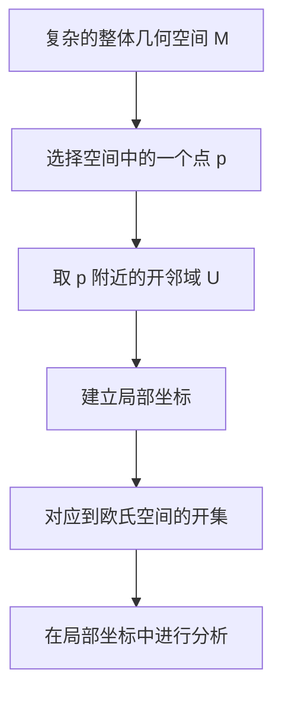
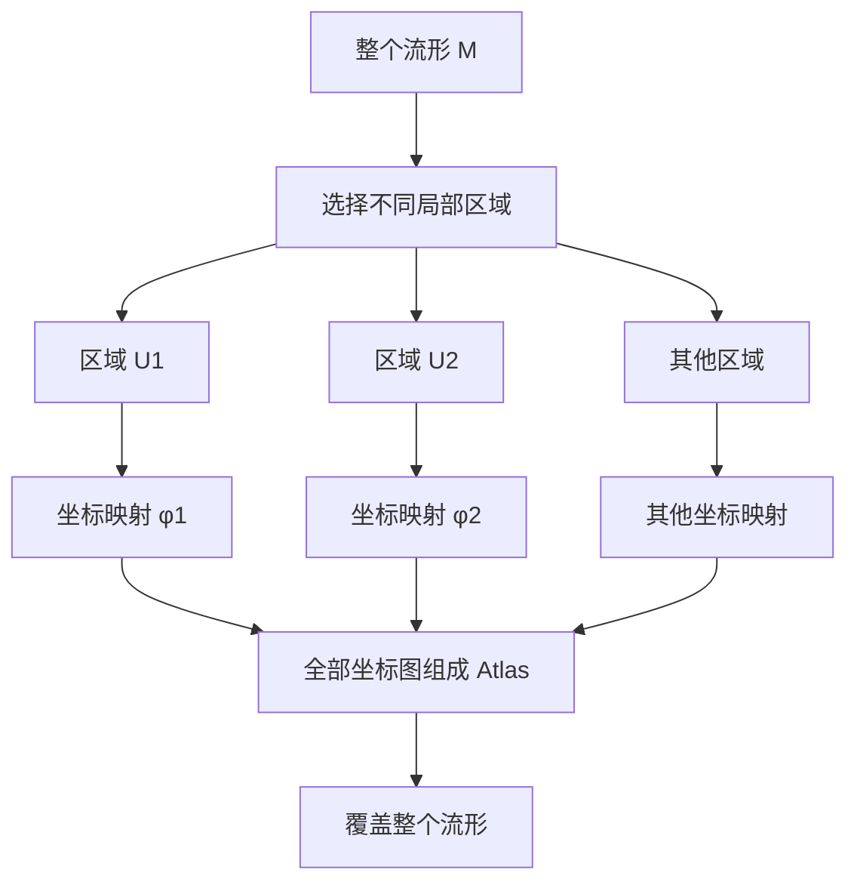
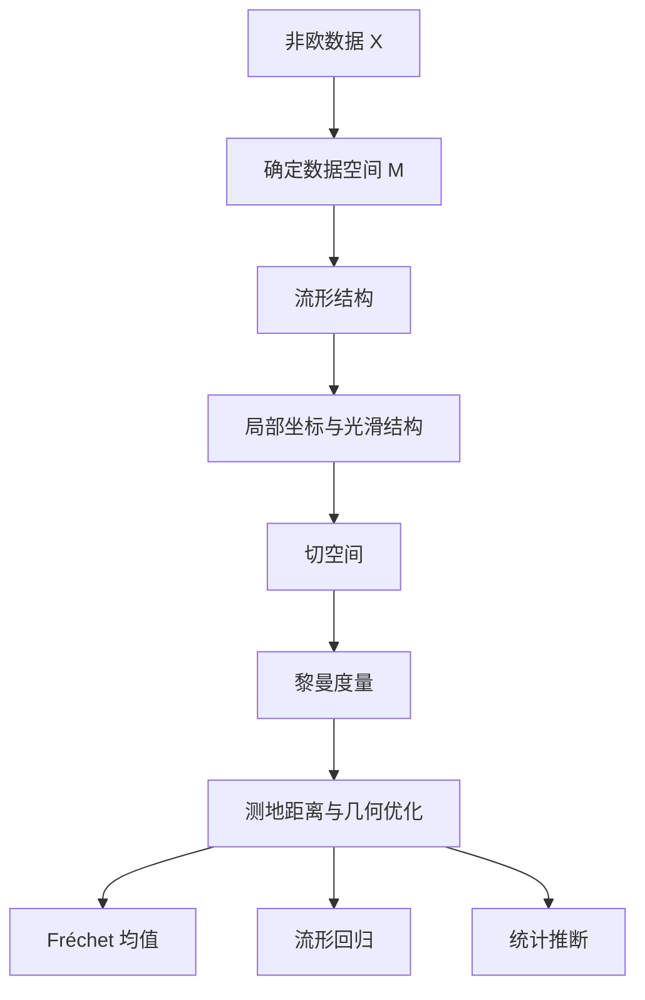

# 第 008 讲｜什么是流形（Manifold）？

> **Non-Euclidean Statistics**
>
> **Lecture 008 — Introduction to Manifolds**
>
> 难度：初级
>
> 前置知识：欧氏空间、度量空间、圆周与球面、测地线、基本微积分

---

## 1. 本讲学习目标

在前面七讲中，我们已经学习了：

- 欧氏空间（Euclidean Space）
- 度量空间（Metric Space）
- 范数（Norm）
- 内积（Inner Product）
- 圆周与球面（Circles and Spheres）
- 测地线（Geodesic）

在第 007 讲中，我们知道：

欧氏空间中的测地线是直线，而标准球面上的测地线沿着大圆延伸。

这说明不同空间可以具有不同的几何结构。

但新的问题出现了：

**能否建立一种统一的数学框架，同时研究欧氏空间、圆周、球面以及更复杂的几何空间？**

答案是可以。

这种框架的核心概念之一就是**流形（Manifold）**。

本讲将学习：

1. 为什么需要流形？
2. 什么叫一个空间局部看起来像欧氏空间？
3. 什么是流形的维度？
4. 什么是局部坐标（Local Coordinates）？
5. 什么是坐标图（Chart）？
6. 什么是坐标图册（Atlas）？
7. 什么是光滑流形（Smooth Manifold）？
8. 流形与度量空间、黎曼流形有什么区别？
9. 为什么流形对非欧统计学重要？

---

## 2. 为什么需要流形？

### 2.1 从欧氏空间开始

我们熟悉的二维欧氏空间为：

```math
\mathbb R^2
```

一个点可以用两个坐标表示：

```math
x=(x_1,x_2)
```

在这个空间中，我们可以自然地进行：

- 向量加法
- 数乘
- 求导
- 积分
- 距离计算
- 统计估计

这些运算有完善的数学理论。

但是，并不是所有数据都自然地位于整个欧氏空间中。

### 2.2 圆周上的数据

考虑单位圆周：

```math
S^1
=
\left\{
(x_1,x_2)\in\mathbb R^2:
x_1^2+x_2^2=1
\right\}
```

圆周中的点虽然可以用两个坐标表示，但必须满足约束：

```math
x_1^2+x_2^2=1
```

因此，并不是所有二维向量都属于圆周。

例如：

```math
(1,0)\in S^1
```

但：

```math
(2,0)\notin S^1
```

圆周不是普通的二维线性空间。

### 2.3 球面上的数据

类似地，单位球面定义为：

```math
S^2
=
\left\{
(x_1,x_2,x_3)\in\mathbb R^3:
x_1^2+x_2^2+x_3^2=1
\right\}
```

球面上的点必须满足固定半径约束。

因此，球面也不是普通的三维向量空间。

不过，圆周和球面具有一个共同特点：

**虽然它们整体上不是普通欧氏空间，但在足够小的局部区域内，可以使用欧氏坐标描述。**

这就是流形思想的起点。

---

## 3. 流形最重要的直觉：局部欧氏性

### 3.1 从地球表面开始

想象我们站在地球表面。

从整体上看，地球可以近似看作一个球体。

但是，如果只观察脚下很小的一块区域，我们会发现：

这块区域看起来几乎是平坦的。

例如，在一个较小的城市区域内，我们经常使用二维平面地图描述地理位置。

这并不意味着地球表面真的变成了一个平面。

而是说明：

**在局部区域内，可以用二维平面坐标来描述球面上的位置。**

这是一种非常重要的数学思想。

### 3.2 什么叫局部？

设一个空间为 $M$，并取其中一点：

```math
p\in M
```

我们只考虑点 $p$ 附近的某个小区域：

```math
U\subseteq M
```

这个区域称为点 $p$ 的一个邻域（Neighborhood），这里要求它是包含 $p$ 的开集。

如果这个邻域可以通过某种连续且具有连续逆映射的坐标变换，对应到欧氏空间的一个开集，那么我们就说这个区域具有局部欧氏结构。

需要注意：

**局部欧氏性并不只是视觉上看起来平坦，而是存在严格的数学对应关系。**

这种对应关系称为同胚（Homeomorphism）。

### 3.3 同胚的初步理解

假设两个空间之间存在一个映射：

```math
f:X\to Y
```

如果：

1. $f$ 是一一对应的。
2. $f$ 连续。
3. 逆映射也连续。

那么称 $f$ 是一个同胚映射。

直观上，同胚意味着两个空间具有相同的拓扑结构。

例如，一个圆周上的足够短的开弧段，与实数直线上的一个开区间是同胚的。

但是，整个圆周并不同胚于整条实数直线。

这一差别非常重要。

### 3.4 一个直观示意



**图 1：流形局部欧氏性的基本思想。**

需要记住：

局部欧氏不是说空间的每一部分都是普通欧氏向量空间。

而是说：

**在每个点附近，都存在能够使用欧氏坐标描述的局部区域。**

---

## 4. 什么是流形（Manifold）？

现在给出正式定义。

### 4.1 拓扑流形的定义

一个非空拓扑空间 $M$ 称为一个 $m$ 维拓扑流形（Topological Manifold），如果满足：

1. $M$ 是 Hausdorff 空间。
2. $M$ 具有可数基（Second Countable）。
3. $M$ 局部同胚于 $\mathbb R^m$。

其中第三条是我们目前最关心的性质。

它意味着：

对于任意点 $p\in M$，都存在包含 $p$ 的开邻域 $U$，以及一个同胚映射：

```math
\varphi:U\longrightarrow V
```

其中：

```math
V\subseteq\mathbb R^m
```

是欧氏空间中的开集。

因此，流形上的一个局部区域可以通过 $\varphi$ 表示为欧氏坐标。

### 4.2 前两个条件是什么意思？

**Hausdorff 条件**

它要求任意两个不同的点都能够被互不相交的开邻域分开。

这一条件排除了一些不符合通常几何直觉的特殊拓扑空间。

**可数基条件**

它要求存在一个可数的开集族，使空间中的每个开集都可以表示成其中若干开集的并。

这一条件有助于保证流形具有良好的整体拓扑性质。

这两个概念涉及拓扑学。

目前不要求完整掌握，只需要知道：

**严格的流形定义除了局部欧氏性，还包含一些保证空间性质良好的拓扑条件。**

### 4.3 流形定义的核心数学表达

在本课程中，我们最需要理解的是：

```math
\varphi:U\longrightarrow V\subseteq\mathbb R^m
```

其中：

- $M$：整个流形。
- $p$：流形中的一个点。
- $U$：包含 $p$ 的局部开区域。
- $V$：$m$ 维欧氏空间中的开集。
- $\varphi$：局部坐标映射。
- $m$：流形的维度。

通过这个映射，可以使用欧氏坐标描述流形上的局部位置。

---

## 5. 什么是流形的维度？

### 5.1 内在维度与嵌入维度

在第 006 讲中，我们已经注意到：

单位圆周 $S^1$ 位于 $\mathbb R^2$ 中，但它本身是一维的。

单位球面 $S^2$ 位于 $\mathbb R^3$ 中，但它本身是二维的。

现在我们可以更准确地解释这一现象。

**流形的维度由其局部欧氏坐标所需要的维度决定。**

例如：

| 空间 | 流形维度 | 常见嵌入空间 |
|---|---|---|
| 实数直线 | 1 | $\mathbb R$ |
| 单位圆周 $S^1$ | 1 | $\mathbb R^2$ |
| 单位球面 $S^2$ | 2 | $\mathbb R^3$ |
| 二维环面 $T^2$ | 2 | $\mathbb R^3$ |
| 一般球面 $S^m$ | $m$ | $\mathbb R^{m+1}$ |

需要特别注意：

**流形维度不等于嵌入空间的维度。**

### 5.2 为什么圆周是一维的？

考虑圆周上的点：

```math
x(\theta)
=
(\cos\theta,\sin\theta)
```

只需要一个角度参数 $\theta$，就可以描述圆周上的位置。

因此，圆周只有一个局部自由度。

所以：

```math
\dim(S^1)=1
```

这里的 $\dim$ 表示维度。

### 5.3 为什么球面是二维的？

考虑单位球面上的点。

我们可以使用两个角度进行参数化：

```math
x(\theta,\phi)
=
\begin{pmatrix}
\sin\theta\cos\phi\\
\sin\theta\sin\phi\\
\cos\theta
\end{pmatrix}
```

其中：

```math
0\leq\theta\leq\pi
```

```math
0\leq\phi<2\pi
```

这里：

- $\theta$ 是极角。
- $\phi$ 是方位角。

虽然我们使用三个欧氏坐标表示球面上的点，但只需要两个独立参数。

因此：

```math
\dim(S^2)=2
```

不过，这组球面角度坐标在两极存在坐标退化，在经度接缝处也存在跳变。

所以它不能作为覆盖整个球面的单个光滑坐标图。

这引出了接下来要学习的坐标图概念。

---

## 6. 什么是坐标图（Chart）？

### 6.1 为什么需要坐标图？

在普通欧氏空间中，我们可以直接使用：

```math
x=(x_1,\ldots,x_m)
```

表示一个点。

但是在一般流形上，可能不存在一组能够良好描述整个空间的全局坐标。

例如：

- 圆周的角度表示具有周期性。
- 球面的经度在某些位置存在接缝。
- 球面极点处，经度不再具有唯一的几何意义。

因此，我们需要局部坐标。

### 6.2 坐标图的定义

设 $M$ 是一个 $m$ 维拓扑流形。

一张坐标图（Chart）是一个二元组：

```math
(U,\varphi)
```

其中：

```math
U\subseteq M
```

是流形中的一个开集，并且：

```math
\varphi:U\longrightarrow\varphi(U)\subseteq\mathbb R^m
```

是一个同胚映射，且 $\varphi(U)$ 是欧氏空间中的开集。

这里：

- $U$：坐标图覆盖的区域。
- $\varphi$：坐标映射。
- $\varphi(U)$：对应的欧氏坐标区域。

### 6.3 坐标映射的意义

对于流形上的点：

```math
p\in U
```

经过映射：

```math
\varphi(p)
=
(u^1,\ldots,u^m)
```

就可以得到 $p$ 的局部坐标。

这里的上标只是坐标分量的编号，并不是幂运算。

反过来：

```math
p=\varphi^{-1}(u^1,\ldots,u^m)
```

可以将局部欧氏坐标重新映射回流形。

因此：

**坐标图建立了流形局部区域与欧氏空间之间的双向对应。**

---

## 7. 圆周上的一个具体坐标图

我们现在利用单位圆构造一个真正的坐标图。

### 7.1 单位圆的定义

考虑：

```math
S^1
=
\{(x,y)\in\mathbb R^2:x^2+y^2=1\}
```

取圆周顶部的点：

```math
N=(0,1)
```

我们把它称为北极点。

定义区域：

```math
U_N=S^1\setminus\{N\}
```

也就是去掉北极点后的整个圆周。

### 7.2 构造坐标映射

定义：

```math
\varphi_N(x,y)
=
\frac{x}{1-y}
```

其中：

```math
(x,y)\in U_N
```

由于北极点已经被排除，分母不会为零。

这个映射实际上来自一种几何投影方法：

**立体投影（Stereographic Projection）。**

它可以把去掉一个点的圆周映射到整条实数直线。

### 7.3 反向映射

给定实数坐标：

```math
u\in\mathbb R
```

可以通过下面的表达式恢复圆周上的点：

```math
\varphi_N^{-1}(u)
=
\left(
\frac{2u}{1+u^2},
\frac{u^2-1}{1+u^2}
\right)
```

我们可以验证它确实位于单位圆上。

首先：

```math
x^2+y^2
=
\frac{4u^2}{(1+u^2)^2}
+
\frac{(u^2-1)^2}{(1+u^2)^2}
```

合并分子：

```math
x^2+y^2
=
\frac{
4u^2+u^4-2u^2+1
}{
(1+u^2)^2
}
```

因此：

```math
x^2+y^2
=
\frac{u^4+2u^2+1}{(1+u^2)^2}
=
1
```

所以反向映射的结果始终位于单位圆上。

### 7.4 为什么这是坐标图？

因为映射：

```math
\varphi_N:U_N\longrightarrow\mathbb R
```

满足：

1. 一一对应。
2. 连续。
3. 具有连续的逆映射。

因此它是同胚映射。

所以：

```math
(U_N,\varphi_N)
```

是单位圆上的一张合法坐标图。

这个例子告诉我们：

**虽然整个圆周不能用一个普通实数坐标全局无歧义地描述，但去掉一个点后，可以建立完整的实数坐标。**

---

## 8. 为什么一张坐标图通常不够？

### 8.1 刚才的坐标图缺少一个点

我们刚刚定义的区域是：

```math
U_N=S^1\setminus\{N\}
```

它不包含北极点。

因此，不能单独覆盖整个圆周。

为了解决这个问题，我们可以再构造一张坐标图。

### 8.2 从南极点构造第二张坐标图

定义南极点：

```math
S=(0,-1)
```

令：

```math
U_S=S^1\setminus\{S\}
```

定义：

```math
\varphi_S(x,y)
=
\frac{x}{1+y}
```

这是另一张立体投影坐标图。

同样：

```math
\varphi_S:U_S\longrightarrow\mathbb R
```

是一个同胚映射。

### 8.3 两张坐标图共同覆盖圆周

由于：

```math
U_N=S^1\setminus\{N\}
```

并且：

```math
U_S=S^1\setminus\{S\}
```

因此：

```math
U_N\cup U_S=S^1
```

这意味着：

**虽然任何一张坐标图都没有覆盖整个圆周，但两张坐标图联合起来就可以覆盖整个圆周。**

这正是坐标图册的思想。

---

## 9. 什么是坐标图册（Atlas）？

### 9.1 定义

设 $M$ 是一个 $m$ 维流形。

一组坐标图：

```math
\mathcal A
=
\{(U_\alpha,\varphi_\alpha)\}_{\alpha\in I}
```

如果其定义域覆盖整个流形：

```math
M=\bigcup_{\alpha\in I}U_\alpha
```

那么称这组坐标图构成 $M$ 的一个坐标图册（Atlas）。

其中：

- $\mathcal A$ 表示坐标图册。
- $I$ 是坐标图的索引集合。
- $U_\alpha$ 是第 $\alpha$ 张坐标图对应的区域。
- $\varphi_\alpha$ 是相应的局部坐标映射。

### 9.2 圆周的坐标图册

对于单位圆周，我们已经构造了：

```math
(U_N,\varphi_N)
```

以及：

```math
(U_S,\varphi_S)
```

因此可以定义：

```math
\mathcal A
=
\{
(U_N,\varphi_N),
(U_S,\varphi_S)
\}
```

因为：

```math
U_N\cup U_S=S^1
```

所以 $\mathcal A$ 是单位圆上的一个坐标图册。

### 9.3 坐标图与坐标图册的关系



**图 2：坐标图与坐标图册的关系。**

可以把坐标图册理解为：

**用多张局部地图共同描述一个复杂空间。**

---

## 10. 什么是坐标变换（Transition Map）？

现在出现了一个自然的问题。

假设某个点同时位于两张坐标图覆盖的区域内。

那么，这个点会有两套不同的局部坐标。

这两套坐标之间是什么关系？

### 10.1 两张坐标图的重叠区域

设：

```math
(U_\alpha,\varphi_\alpha)
```

和：

```math
(U_\beta,\varphi_\beta)
```

是两张坐标图。

如果：

```math
U_\alpha\cap U_\beta\neq\varnothing
```

那么重叠区域中的点可以分别使用两种坐标表示。

设：

```math
u=\varphi_\alpha(p)
```

以及：

```math
v=\varphi_\beta(p)
```

我们希望能够从 $u$ 计算 $v$。

### 10.2 坐标变换的定义

首先通过第一张坐标图的逆映射回到流形：

```math
p=\varphi_\alpha^{-1}(u)
```

再使用第二张坐标图：

```math
v=\varphi_\beta(p)
```

因此：

```math
v
=
\varphi_\beta\left(
\varphi_\alpha^{-1}(u)
\right)
```

相应的坐标变换为：

```math
\varphi_\beta\circ\varphi_\alpha^{-1}
```

其中 $\circ$ 表示函数复合。

这个映射称为过渡映射（Transition Map），也称为坐标变换。

### 10.3 圆周上的一个例子

回顾前面构造的两张坐标图：

```math
u=\varphi_N(x,y)=\frac{x}{1-y}
```

以及：

```math
v=\varphi_S(x,y)=\frac{x}{1+y}
```

在两张图的重叠区域中，点既不是北极，也不是南极。

因此：

```math
x\neq0
```

利用圆周约束：

```math
x^2+y^2=1
```

可以得到：

```math
1-y^2=x^2
```

所以：

```math
uv
=
\frac{x}{1-y}\frac{x}{1+y}
=
\frac{x^2}{1-y^2}
=
1
```

因此：

```math
v=\frac1u
```

这就是两张坐标图之间的过渡映射。

注意，这个表达式只在重叠区域对应的非零坐标上定义。

### 10.4 为什么坐标变换重要？

因为在不同坐标图中，同一个几何对象可能具有不同的坐标表达式。

如果我们希望建立与坐标选择无关的数学理论，就必须理解不同坐标表示之间如何转换。

这也是流形微积分的重要基础。

---

## 11. 什么是光滑流形（Smooth Manifold）？

到目前为止，我们已经学习了拓扑流形和坐标图册。

但如果我们希望在流形上进行微积分，还需要进一步的结构。

### 11.1 为什么需要光滑性？

在欧氏空间中，我们可以计算：

- 导数
- 梯度
- 偏导数
- 微分
- 积分

在流形中，我们希望也能进行类似的运算。

但是，流形可能使用多张坐标图。

因此，不同坐标图之间的转换必须足够规则。

否则，在某个坐标图中可微的表达式，换到另一张坐标图后可能不再可微。

### 11.2 光滑坐标图册

考虑坐标图之间的过渡映射：

```math
\varphi_\beta\circ\varphi_\alpha^{-1}
```

如果每一对重叠坐标图之间的过渡映射都是光滑的，也就是具有任意阶连续导数，那么称该坐标图册是光滑坐标图册。

数学上通常记作：

```math
C^\infty
```

其中：

- $C^1$ 表示具有连续的一阶导数。
- $C^2$ 表示具有连续的一阶和二阶导数。
- $C^\infty$ 表示具有任意阶连续导数。

### 11.3 光滑流形的定义

一个光滑流形（Smooth Manifold）是一个拓扑流形，配备了一个光滑结构。

这个光滑结构可以通过一个光滑坐标图册来指定，严格地说通常考虑与其兼容的极大光滑图册。

因此：

**光滑流形 = 拓扑流形 + 相互兼容的光滑局部坐标结构。**

### 11.4 为什么圆周是光滑流形？

在前面构造的圆周坐标图中，过渡映射为：

```math
v=\frac1u
```

它在：

```math
u\neq0
```

的区域上具有任意阶连续导数。

例如：

```math
\frac{dv}{du}=-\frac1{u^2}
```

以及：

```math
\frac{d^2v}{du^2}=\frac2{u^3}
```

这些导数在非零坐标区域内都是连续的。

因此，两张坐标图之间的过渡映射是光滑的。

这说明我们构造的图册为单位圆提供了一个光滑结构。

所以：

```math
S^1
```

是一个一维光滑流形。

---

## 12. 为什么球面也是光滑流形？

现在考虑单位球面：

```math
S^2
=
\{(x,y,z)\in\mathbb R^3:x^2+y^2+z^2=1\}
```

### 12.1 从球面上半部分开始

取球面上的开区域：

```math
U_+
=
\{(x,y,z)\in S^2:z>0\}
```

也就是球面的上半部分，不包含赤道。

由于：

```math
x^2+y^2+z^2=1
```

且 $z>0$，我们可以写：

```math
z=\sqrt{1-x^2-y^2}
```

因此，区域中的点可以表示为：

```math
(x,y,\sqrt{1-x^2-y^2})
```

只需要两个独立参数 $x,y$。

### 12.2 建立局部坐标

定义：

```math
\varphi_+(x,y,z)=(x,y)
```

其坐标区域为：

```math
D
=
\{(x,y)\in\mathbb R^2:x^2+y^2<1\}
```

也就是二维单位开圆盘。

反向映射为：

```math
\varphi_+^{-1}(x,y)
=
(x,y,\sqrt{1-x^2-y^2})
```

该映射在单位开圆盘上是光滑的。

因此，上半球面可以使用二维欧氏坐标描述。

### 12.3 为什么还需要其他坐标图？

因为上半球面的坐标图不能覆盖：

- 赤道
- 下半球面

但是，我们可以构造其他坐标图。

例如：

- 下半球面坐标图
- 正 x 方向半球坐标图
- 负 x 方向半球坐标图
- 正 y 方向半球坐标图
- 负 y 方向半球坐标图

这些坐标图能够共同覆盖整个球面，并具有光滑的过渡映射。

因此，单位球面是一个二维光滑流形。

### 12.4 一个重要结论

```math
\dim(S^1)=1
```

```math
\dim(S^2)=2
```

更一般地：

```math
S^m
=
\left\{
x\in\mathbb R^{m+1}:
\sum_{j=1}^{m+1}x_j^2=1
\right\}
```

是一个 $m$ 维光滑流形。

它的维度比其标准嵌入空间的维度少 1。

---

## 13. 不是所有几何集合都是流形

到目前为止，圆周和球面都是流形的例子。

但并不是任何一个几何形状都自动构成流形。

### 13.1 考虑两条直线的交叉

在二维欧氏空间中定义：

```math
X
=
\{(x,0):x\in\mathbb R\}
\cup
\{(0,y):y\in\mathbb R\}
```

这个集合由水平直线和竖直直线组成。

两条直线在原点相交。

### 13.2 普通点附近的结构

如果取：

```math
p=(1,0)
```

在足够小的邻域中，集合只表现为一小段水平直线。

因此，该点附近看起来像实数直线上的开区间。

### 13.3 原点附近的结构

但是，在：

```math
p=(0,0)
```

附近，集合呈现十字形。

如果我们从一个足够小的十字形邻域中移除原点，剩余部分会分成四个相互分离的分支。

而对于实数直线上的开区间，移除中间一点只会得到两个分支。

因此，十字形交点附近不能同胚于一维欧氏空间的开区间。

它也不能成为二维流形的局部区域，因为整个集合没有二维的局部欧氏结构。

所以，这个交叉集合不是通常意义下的固定维度流形。

### 13.4 这个例子说明什么？

流形的重要要求不是“能够画出来”，而是：

**每个点附近都必须具有一致的局部欧氏结构。**

交叉点、分叉点和某些奇异点可能破坏这种结构。

因此，在更一般的非欧数据分析中，还会出现并非流形的空间。

例如：

- 某些图空间
- 某些树空间
- 带分叉的几何对象
- 含有奇异点的空间

这也是为什么非欧统计学的研究范围比光滑流形统计更加广泛。

---

## 14. 流形与度量空间有什么区别？

这是一个非常重要的问题。

### 14.1 度量空间强调距离

一个度量空间表示为：

```math
(\Omega,d)
```

其中：

- $\Omega$ 是非空集合。
- $d$ 是满足度量公理的距离函数。

度量空间主要告诉我们：

**两个对象之间如何测量距离？**

### 14.2 流形强调局部结构

一个光滑流形主要包含：

- 拓扑结构
- 局部欧氏坐标
- 光滑坐标变换

它告诉我们：

**如何在一个可能具有复杂整体结构的空间中建立局部微积分？**

### 14.3 光滑流形是否自动带有距离？

需要区分两个层次。

光滑流形的定义本身并没有指定一个特殊的几何距离。

但在常见条件下，流形可以配备与其拓扑兼容的距离。

更重要的是：

**同一个光滑流形可以选择不同的几何度量。**

这些度量可能给出不同的：

- 曲线长度
- 测地距离
- 测地线
- 几何优化问题

所以，我们不能把“光滑流形”和“已经指定了距离的几何空间”完全等同起来。

### 14.4 从流形到黎曼流形

为了在光滑流形上定义长度、角度和测地距离，我们可以进一步为每个点的切空间指定一个内积。

如果这些内积随位置光滑变化，就得到了黎曼度量。

配备黎曼度量的光滑流形称为**黎曼流形（Riemannian Manifold）**。

这一概念将在后续课程中正式学习。

### 14.5 三种结构的比较

| 结构 | 核心思想 | 主要提供 |
|---|---|---|
| 度量空间 | 定义对象之间的距离 | 距离与收敛等结构 |
| 光滑流形 | 局部欧氏坐标与光滑变换 | 微积分结构 |
| 黎曼流形 | 在切空间指定光滑变化的内积 | 长度、角度、测地距离 |

注意：

表中的三种概念不是简单互斥的类别。

一个黎曼流形既是光滑流形，也可以通过黎曼距离看成度量空间。

---

## 15. 为什么流形对非欧统计学重要？

现在回到我们的课程主题：非欧统计学。

### 15.1 统计数据可以位于流形上

设随机对象 $X$ 取值于流形 $M$：

```math
X\in M
```

这里的 $X$ 不一定是普通的欧氏向量。

例如：

- 方向数据可能位于 $S^1$。
- 球面方向数据可能位于 $S^2$。
- 正定协方差矩阵可以位于正定矩阵流形。
- 某些形状数据可以表示在形状流形上。

因此，研究这些对象时，需要考虑空间的几何结构。

### 15.2 普通算术平均可能不合法

假设：

```math
X_1,\ldots,X_n\in M
```

如果 $M$ 不是向量空间，那么：

```math
\frac1n\sum_{i=1}^{n}X_i
```

可能没有自然定义，或者计算结果不属于 $M$。

因此，我们需要重新思考统计中心的定义。

### 15.3 可以利用距离定义均值

假设流形 $M$ 配备了一个合适的距离 $d$。

可以定义样本平方距离目标函数：

```math
F(\mu)
=
\sum_{i=1}^{n}d^2(X_i,\mu)
```

其中：

```math
\mu\in M
```

如果存在 $\hat\mu\in M$ 满足：

```math
F(\hat\mu)
=
\min_{\mu\in M}F(\mu)
```

那么它可以作为一个基于距离定义的样本中心。

这就是样本 Fréchet 均值的基本思想。

不过，是否存在最小值以及最小化点是否唯一，仍取决于空间和数据的性质。

### 15.4 为什么需要切空间？

流形上的点通常不能直接相减。

但是，我们希望：

- 计算导数
- 构造梯度
- 研究优化算法
- 建立统计估计的渐近理论

这时就需要切空间（Tangent Space）。

切空间为流形上的局部变化提供线性化描述。

后续我们将学习：

**虽然流形本身不一定是向量空间，但每个点的切空间是向量空间。**

这是连接欧氏微积分与流形几何的重要桥梁。

### 15.5 从流形到统计分析



**图 3：流形结构在非欧统计中的作用。**

这也是接下来课程的重要学习路线。

---

## 16. 常见误区

### 误区一：流形一定是弯曲的

错误。

普通欧氏空间本身就是光滑流形。

例如：

```math
\mathbb R^m
```

是一个 $m$ 维光滑流形。

因此，流形不一定具有曲率。

流形的核心性质是局部欧氏性，而不是必须弯曲。

### 误区二：流形必须嵌入更高维欧氏空间才能定义

不完全正确。

流形可以通过局部坐标图和坐标图之间的过渡映射进行内禀定义。

虽然很多流形可以嵌入欧氏空间，但流形的基本定义不依赖于预先指定某个嵌入。

### 误区三：流形的维度等于嵌入空间的维度

错误。

例如：

```math
S^1\subset\mathbb R^2
```

但是：

```math
\dim(S^1)=1
```

同理：

```math
S^2\subset\mathbb R^3
```

但是：

```math
\dim(S^2)=2
```

### 误区四：流形上一定存在全局坐标

错误。

一般流形可能需要多张坐标图才能覆盖整个空间。

例如，整个圆周不能用一张与实数开集同胚的坐标图覆盖。

### 误区五：光滑流形一定已经具有黎曼距离

错误。

光滑结构本身并不指定黎曼度量。

需要额外选择随位置光滑变化的正定内积结构，才能定义对应的黎曼曲线长度与测地距离。

### 误区六：所有非欧数据空间都是流形

错误。

非欧统计研究的对象非常广泛。

某些图空间、树空间以及包含奇异点的空间可能不是光滑流形。

因此，流形统计是非欧统计的重要组成部分，但并不涵盖全部非欧统计。

---

## 17. 本讲总结

本讲最重要的三个结论如下。

### 结论一：流形具有局部欧氏结构

对于 $m$ 维流形 $M$ 中的任意一点，都存在局部坐标图：

```math
\varphi:U\longrightarrow V\subseteq\mathbb R^m
```

其中 $\varphi$ 是同胚映射，$V$ 是欧氏空间中的开集。

这意味着流形的每个点附近都可以使用欧氏坐标描述。

### 结论二：坐标图册可以描述整个流形

一组坐标图：

```math
\mathcal A
=
\{(U_\alpha,\varphi_\alpha)\}_{\alpha\in I}
```

如果满足：

```math
M=\bigcup_{\alpha\in I}U_\alpha
```

就构成覆盖整个流形的坐标图册。

如果坐标图之间的过渡映射光滑，就能够建立光滑结构。

### 结论三：流形为非欧统计提供局部微积分框架

流形的局部坐标结构使我们能够进一步研究：

- 切空间
- 黎曼度量
- 测地线
- 流形上的梯度
- 统计估计与优化
- 非欧统计推断

**本讲核心思想：**

> A manifold is a space that locally resembles Euclidean space, even when its global geometry is more complicated.

流形是一种局部具有欧氏结构，但整体几何可能更加复杂的空间。

---

## 18. 课后练习

### 练习 1：判断流形维度

考虑以下空间：

1. 实数直线 $\mathbb R$
2. 单位圆周 $S^1$
3. 二维欧氏平面 $\mathbb R^2$
4. 单位球面 $S^2$
5. 三维欧氏空间 $\mathbb R^3$

分别写出它们的流形维度。

### 练习 2：理解局部坐标

考虑单位圆：

```math
S^1
=
\{(x,y)\in\mathbb R^2:x^2+y^2=1\}
```

回答：

1. 为什么它不是二维向量空间？
2. 为什么它仍然是一维流形？
3. 为什么整个圆周通常需要多张坐标图？

### 练习 3：验证球面的局部坐标

考虑单位球面的上半部分：

```math
U_+
=
\{(x,y,z)\in S^2:z>0\}
```

定义：

```math
\varphi_+(x,y,z)=(x,y)
```

试回答：

1. 对应的二维坐标区域是什么？
2. 如何根据坐标 $(x,y)$ 恢复球面上的点？
3. 为什么它体现了球面的局部二维结构？

### 练习 4：坐标变换

考虑圆周上两张坐标图：

```math
u=\frac{x}{1-y}
```

以及：

```math
v=\frac{x}{1+y}
```

已知：

```math
x^2+y^2=1
```

并假设点同时位于两张坐标图的定义域中。

证明：

```math
v=\frac1u
```

### 练习 5：概念理解

解释以下三个概念的主要区别：

1. 度量空间
2. 光滑流形
3. 黎曼流形

为什么说黎曼流形需要比光滑流形更多的几何结构？

### 参考答案

<details>
<summary>点击查看参考答案</summary>

#### 练习 1：判断流形维度

对应维度分别为：

```math
\dim(\mathbb R)=1
```

```math
\dim(S^1)=1
```

```math
\dim(\mathbb R^2)=2
```

```math
\dim(S^2)=2
```

```math
\dim(\mathbb R^3)=3
```

因此，流形维度与其常见嵌入空间的维度不一定相同。

#### 练习 2：理解局部坐标

单位圆不是二维向量空间，因为它对普通向量加法和数乘不封闭。

例如：

```math
(1,0)+(0,1)=(1,1)
```

但：

```math
1^2+1^2=2\neq1
```

所以结果不属于单位圆。

另一方面，圆周上的位置只需要一个局部参数描述，因此其内在维度为 1。

整个圆周具有周期性，不能使用一张与实数开集同胚的坐标图描述全部位置。

因此，需要使用多张局部坐标图。

#### 练习 3：验证球面的局部坐标

单位球面满足：

```math
x^2+y^2+z^2=1
```

上半球面还满足：

```math
z>0
```

所以：

```math
z=\sqrt{1-x^2-y^2}
```

因此对应的二维坐标区域是：

```math
D
=
\{(x,y)\in\mathbb R^2:x^2+y^2<1\}
```

反向映射为：

```math
\varphi_+^{-1}(x,y)
=
(x,y,\sqrt{1-x^2-y^2})
```

因此，上半球面可以用两个独立的欧氏坐标描述。

这说明球面具有局部二维结构。

#### 练习 4：坐标变换

已知：

```math
u=\frac{x}{1-y}
```

以及：

```math
v=\frac{x}{1+y}
```

将两式相乘：

```math
uv
=
\frac{x^2}{(1-y)(1+y)}
```

因此：

```math
uv
=
\frac{x^2}{1-y^2}
```

由圆周约束：

```math
x^2+y^2=1
```

可得：

```math
1-y^2=x^2
```

在两张坐标图的重叠区域中：

```math
x\neq0
```

所以：

```math
uv
=
\frac{x^2}{x^2}
=
1
```

因此：

```math
v=\frac1u
```

证毕。

#### 练习 5：概念理解

**度量空间**

关注对象之间的距离。

它需要一个集合和满足度量公理的距离函数。

**光滑流形**

关注空间的局部欧氏结构及光滑坐标变换。

它使我们能够在局部进行微积分。

**黎曼流形**

是在光滑流形上进一步指定黎曼度量的几何空间。

黎曼度量为每个切空间赋予一个正定内积，并要求这些内积随位置光滑变化。

因此，黎曼流形不仅具有光滑结构，还能够定义切向量长度、夹角、曲线长度和相应测地距离。

</details>

---

## 19. 下一讲预告

### 第 009 讲｜什么是切空间（Tangent Space）？

本讲已经学习了：

- 局部欧氏性
- 流形的维度
- 坐标图
- 坐标图册
- 坐标变换
- 光滑流形

现在出现一个重要问题：

**如果流形本身不是向量空间，我们应该如何在流形上定义方向、速度和导数？**

下一讲将正式介绍切空间（Tangent Space）。

主要内容包括：

1. 什么是切向量？
2. 如何通过曲线定义切向量？
3. 什么是切空间？
4. 圆周和球面的切空间长什么样？
5. 为什么切空间是向量空间？
6. 切空间与流形微积分有什么关系？
7. 切空间为什么对非欧统计估计重要？

切空间将成为连接流形几何、黎曼度量与非欧统计推断的重要桥梁。

---

**End of Lecture 008**
