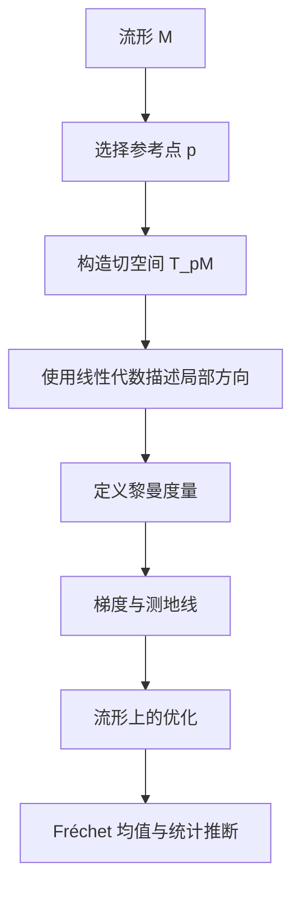

# 第 009 讲｜什么是切空间（Tangent Space）？

> **Non-Euclidean Statistics**
>
> **Lecture 009 — Tangent Vectors and Tangent Spaces**
>
> 难度：初级
>
> 前置知识：向量、导数、内积、圆周与球面、光滑流形、局部坐标

---

## 1. 本讲学习目标

在第 008 讲中，我们正式介绍了流形（Manifold）。

流形的核心特点是：

**一个空间虽然整体上可能具有复杂的几何结构，但在每个点附近都可以使用欧氏坐标描述。**

例如：

- 圆周 $S^1$ 是一维光滑流形。
- 球面 $S^2$ 是二维光滑流形。
- 欧氏空间 $\mathbb R^m$ 本身也是 $m$ 维光滑流形。

但是，我们还没有回答一个非常重要的问题：

**如果流形本身不是向量空间，那么我们应该如何在流形上定义方向和导数？**

例如，在普通欧氏空间中，我们可以计算两个点之差：

```math
y-x
```

并把这个差向量理解为从 $x$ 指向 $y$ 的方向。

但是，对于一般流形上的两个点：

```math
p,q\in M
```

表达式 $q-p$ 可能没有定义。

即使流形嵌入欧氏空间，差向量也不一定属于流形自身的局部线性方向。

因此，我们需要一个新的数学对象：

**切空间（Tangent Space）。**

本讲将学习：

1. 为什么需要切空间？
2. 什么是切向量（Tangent Vector）？
3. 如何利用曲线定义切向量？
4. 什么是切空间（Tangent Space）？
5. 为什么切空间是向量空间？
6. 如何计算圆周和球面的切空间？
7. 什么是法向量（Normal Vector）？
8. 局部坐标与切向量有什么关系？
9. 切空间为什么对非欧统计学重要？

---

## 2. 为什么需要切空间？

### 2.1 从普通欧氏空间开始

考虑二维欧氏空间：

```math
\mathbb R^2
```

在某个点：

```math
p=(1,2)
```

附近，我们可以沿任意方向移动。

例如，沿向量：

```math
v=(3,4)
```

移动一小段距离。

相应的路径可以表示为：

```math
\gamma(t)=p+tv
```

代入：

```math
\gamma(t)=(1+3t,2+4t)
```

当 $t=0$ 时：

```math
\gamma(0)=p
```

对曲线求导：

```math
\gamma'(t)=(3,4)
```

所以：

```math
\gamma'(0)=v
```

向量 $v$ 描述了曲线经过点 $p$ 时的运动方向和速度。

在欧氏空间中，这样的方向可以任意选择。

### 2.2 圆周上的情况

现在考虑单位圆周：

```math
S^1=
\left\{
(x,y)\in\mathbb R^2:
x^2+y^2=1
\right\}
```

取圆周上的点：

```math
p=(1,0)
```

如果我们沿水平方向移动：

```math
v=(1,0)
```

那么：

```math
p+tv=(1+t,0)
```

对于非零且足够小的 $t$，通常有：

```math
(1+t)^2\neq1
```

因此：

```math
p+tv\notin S^1
```

也就是说，沿水平方向直接移动，会离开圆周。

但是，如果我们沿竖直方向开始运动，就可以沿着圆周前进。

例如，考虑：

```math
\gamma(t)=(\cos t,\sin t)
```

它始终满足：

```math
\cos^2t+\sin^2t=1
```

因此：

```math
\gamma(t)\in S^1
```

当 $t=0$ 时：

```math
\gamma(0)=(1,0)=p
```

其导数为：

```math
\gamma'(t)=(-\sin t,\cos t)
```

所以：

```math
\gamma'(0)=(0,1)
```

这说明：

**在点 $(1,0)$ 处，沿着圆周运动的瞬时方向是竖直方向。**

### 2.3 从例子得到的直觉

我们发现：

- 欧氏空间中的点可以沿任意方向移动。
- 圆周上的点受到几何约束。
- 沿圆周运动的瞬时方向必须符合圆周的局部结构。

因此：

**切空间描述了一个流形在某一点处所有可能的瞬时运动方向。**

注意，这里的“方向”通常也包含速度大小，而不只是单位方向。

---

## 3. 什么是切向量（Tangent Vector）？

### 3.1 从曲线速度定义切向量

设 $M$ 是一个光滑流形，取其中一个点：

```math
p\in M
```

考虑一条经过 $p$ 的光滑曲线：

```math
\gamma:(-\varepsilon,\varepsilon)\longrightarrow M
```

并要求：

```math
\gamma(0)=p
```

其中 $\varepsilon>0$。

如果 $M$ 是嵌入欧氏空间的光滑子流形，我们可以直接计算曲线的欧氏导数：

```math
v=\gamma'(0)
```

这个向量称为曲线在 $p$ 处的切向量（Tangent Vector）。

它描述了曲线经过点 $p$ 时的瞬时速度。

### 3.2 切向量包含哪些信息？

考虑：

```math
\gamma(t)=(\cos t,\sin t)
```

在 $t=0$ 时：

```math
\gamma'(0)=(0,1)
```

如果改变运动速度：

```math
\eta(t)=(\cos 2t,\sin 2t)
```

那么：

```math
\eta'(t)=(-2\sin2t,2\cos2t)
```

因此：

```math
\eta'(0)=(0,2)
```

两条曲线都经过：

```math
p=(1,0)
```

并且沿同一个切线方向运动。

但它们的速度大小不同。

因此：

```math
\gamma'(0)\neq\eta'(0)
```

这说明：

**切向量同时包含运动方向和速度大小。**

### 3.3 零切向量

考虑常值曲线：

```math
\gamma(t)=p
```

对所有 $t$ 都保持不动。

那么：

```math
\gamma'(0)=0
```

因此，零向量也是合法的切向量。

这在后面证明切空间具有向量空间结构时非常重要。

---

## 4. 什么是切空间（Tangent Space）？

### 4.1 直观定义

对于流形 $M$ 上的点 $p$：

**所有经过 $p$ 的光滑曲线所产生的切向量，构成点 $p$ 处的切空间。**

记作：

```math
T_pM
```

读作：

*The tangent space of M at p.*

其中：

- $M$ 表示流形。
- $p$ 表示流形中的一个固定点。
- $T_pM$ 表示该点的切空间。

### 4.2 嵌入子流形中的定义

如果 $M$ 是嵌入 $\mathbb R^n$ 的光滑子流形，那么可以定义：

```math
T_pM
=
\left\{
\gamma'(0):
\gamma(0)=p,\ 
\gamma(t)\in M
\right\}
```

这里默认 $\gamma$ 是定义在零附近的光滑曲线。

这个定义表明：

**切空间包含所有可以由经过该点的流形内曲线产生的速度向量。**

### 4.3 为什么这个定义还需要进一步推广？

在第 008 讲中，我们知道流形并不一定预先嵌入某个欧氏空间。

对于抽象流形，$\gamma'(0)$ 不能简单地理解为普通欧氏向量。

因此，需要使用局部坐标或者导子（Derivation）等方式严格定义切向量。

我们将在第 10 节给出基于局部坐标的定义。

目前先通过圆周和球面建立直觉。

---

## 5. 圆周上的切空间

现在通过一个完整例子理解切空间。

### 5.1 单位圆周

考虑：

```math
S^1=
\left\{
(x,y)\in\mathbb R^2:
x^2+y^2=1
\right\}
```

取：

```math
p=(1,0)
```

我们已经知道，圆周可以参数化为：

```math
\gamma(t)=(\cos t,\sin t)
```

并且：

```math
\gamma'(0)=(0,1)
```

因此，向量 $(0,1)$ 属于 $T_pS^1$。

如果改变曲线速度：

```math
\gamma_a(t)=(\cos at,\sin at)
```

其中 $a\in\mathbb R$，则：

```math
\gamma_a'(0)=(0,a)
```

因此，对于任意实数 $a$，都有：

```math
(0,a)\in T_pS^1
```

事实上，点 $(1,0)$ 处的切空间恰好为：

```math
T_{(1,0)}S^1
=
\{(0,a):a\in\mathbb R\}
```

这是二维欧氏空间中的一条竖直直线方向。

### 5.2 为什么切空间是一维的？

虽然：

```math
T_{(1,0)}S^1\subseteq\mathbb R^2
```

但是切向量的第一个坐标必须为零。

所有切向量都可以写成：

```math
v=a(0,1)
```

其中 $a\in\mathbb R$。

所以只需要一个实数参数就能描述所有切向量。

因此：

```math
\dim(T_pS^1)=1
```

这与圆周本身的维度一致。

### 5.3 圆周上任意一点的切空间

考虑一般圆周点：

```math
p=(\cos\theta,\sin\theta)
```

一种经过该点的圆周曲线为：

```math
\gamma(t)
=
(\cos(\theta+t),\sin(\theta+t))
```

其导数为：

```math
\gamma'(t)
=
(-\sin(\theta+t),\cos(\theta+t))
```

在 $t=0$ 时：

```math
\gamma'(0)
=
(-\sin\theta,\cos\theta)
```

因此，圆周点 $p$ 处的切空间为：

```math
T_pS^1
=
\left\{
a(-\sin\theta,\cos\theta):
a\in\mathbb R
\right\}
```

这说明圆周上不同点的切空间具有不同的方向。

但是，它们都是一维向量空间。

### 5.4 一个重要区别

切空间不是圆周本身。

例如，在：

```math
p=(1,0)
```

处：

```math
T_pS^1
=
\{(0,a):a\in\mathbb R\}
```

这个集合是一条穿过向量空间原点的直线。

如果把这些向量的起点都放在 $p$，则它们的箭头端点落在圆周的几何切线上：

```math
\{(1,a):a\in\mathbb R\}
```

需要区分：

- 切空间是一个向量空间。
- 几何切线是经过流形点的仿射直线。

它们彼此对应，但不是完全相同的点集。

---

## 6. 如何利用几何约束计算切空间？

刚才我们通过参数化曲线计算圆周的切空间。

现在介绍一种更一般的方法。

### 6.1 圆周是一个约束集合

单位圆周满足：

```math
x^2+y^2=1
```

定义函数：

```math
F(x,y)=x^2+y^2-1
```

那么：

```math
S^1=
\{(x,y):F(x,y)=0\}
```

假设一条曲线：

```math
\gamma(t)=(x(t),y(t))
```

始终位于圆周上。

因此：

```math
F(\gamma(t))=0
```

也就是：

```math
x(t)^2+y(t)^2=1
```

### 6.2 对约束条件求导

对 $t$ 求导：

```math
2x(t)x'(t)+2y(t)y'(t)=0
```

设：

```math
p=(x(0),y(0))
```

并且：

```math
v=\gamma'(0)=(v_1,v_2)
```

那么在 $t=0$ 时：

```math
2p_1v_1+2p_2v_2=0
```

除以 2：

```math
p_1v_1+p_2v_2=0
```

这正是标准欧氏内积：

```math
\langle p,v\rangle=0
```

因此：

**圆周上的切向量必须与从原点指向该点的径向向量正交。**

### 6.3 得到切空间公式

对于任意：

```math
p\in S^1
```

有：

```math
T_pS^1
=
\left\{
v\in\mathbb R^2:
\langle p,v\rangle=0
\right\}
```

这个公式非常重要。

它把几何中的切线方向转化为一个线性代数条件。

### 6.4 一个具体计算

考虑：

```math
p=(0,1)
```

设切向量为：

```math
v=(v_1,v_2)
```

切向条件为：

```math
\langle p,v\rangle=0
```

代入：

```math
0v_1+1v_2=0
```

所以：

```math
v_2=0
```

因此：

```math
T_{(0,1)}S^1
=
\{(a,0):a\in\mathbb R\}
```

这是水平方向的一维向量空间。

与前面的点 $(1,0)$ 相比，切空间方向发生了变化。

---

## 7. 球面上的切空间

现在将圆周上的结论推广到球面。

### 7.1 单位球面

考虑：

```math
S^2
=
\left\{
x\in\mathbb R^3:
\lVert x\rVert_2^2=1
\right\}
```

取其中一点：

```math
p\in S^2
```

我们希望找到所有可能的切向量。

### 7.2 利用曲线约束求导

假设曲线：

```math
\gamma(t)\in S^2
```

并且：

```math
\gamma(0)=p
```

由于曲线始终位于单位球面上：

```math
\langle\gamma(t),\gamma(t)\rangle=1
```

两边对 $t$ 求导。

根据内积的求导法则：

```math
2\langle\gamma(t),\gamma'(t)\rangle=0
```

在 $t=0$ 时：

```math
\langle p,\gamma'(0)\rangle=0
```

记：

```math
v=\gamma'(0)
```

那么：

```math
\langle p,v\rangle=0
```

因此，球面上的所有切向量都必须与径向向量 $p$ 正交。

### 7.3 球面的切空间公式

对于任意：

```math
p\in S^2
```

其切空间为：

```math
T_pS^2
=
\left\{
v\in\mathbb R^3:
\langle p,v\rangle=0
\right\}
```

这是三维欧氏空间中的一个二维线性平面。

为什么是二维？

因为 $v$ 有三个坐标，但必须满足一个独立的线性约束：

```math
\langle p,v\rangle=0
```

所以剩余两个自由度。

因此：

```math
\dim(T_pS^2)=2
```

这与球面自身的维度一致。

### 7.4 为什么这个条件也是充分的？

我们刚才证明了：

任何球面曲线的速度都必须与 $p$ 正交。

但反过来，是否每个与 $p$ 正交的向量都能作为某条球面曲线的速度？

答案是可以。

设：

```math
\langle p,v\rangle=0
```

并且：

```math
\lVert p\rVert_2=1
```

考虑曲线：

```math
\gamma(t)
=
\frac{p+tv}{\lVert p+tv\rVert_2}
```

由于分母用于归一化，所以：

```math
\lVert\gamma(t)\rVert_2=1
```

因此曲线始终位于单位球面上。

当 $t=0$ 时：

```math
\gamma(0)=p
```

又因为：

```math
\langle p,v\rangle=0
```

所以：

```math
\lVert p+tv\rVert_2^2
=
1+t^2\lVert v\rVert_2^2
```

因此：

```math
\gamma(t)
=
\frac{p+tv}
{\sqrt{1+t^2\lVert v\rVert_2^2}}
```

对其求导并在 $t=0$ 处计算：

```math
\gamma'(0)=v
```

这证明每一个与 $p$ 正交的向量，都可以由一条球面曲线产生。

所以切空间确实等于：

```math
T_pS^2
=
\left\{
v\in\mathbb R^3:
\langle p,v\rangle=0
\right\}
```

---

## 8. 球面切空间的具体例子

### 8.1 北极点的切空间

考虑单位球面的北极点：

```math
p=(0,0,1)
```

设：

```math
v=(v_1,v_2,v_3)
```

切向条件为：

```math
\langle p,v\rangle=0
```

代入：

```math
0v_1+0v_2+1v_3=0
```

因此：

```math
v_3=0
```

所以：

```math
T_pS^2
=
\{(a,b,0):a,b\in\mathbb R\}
```

这是一个二维水平向量平面。

如果将这些向量平移到北极点作为起点，就得到通常几何意义下与球面相切的水平平面：

```math
z=1
```

### 8.2 赤道上的点

考虑：

```math
p=(1,0,0)
```

切向条件为：

```math
v_1=0
```

因此：

```math
T_pS^2
=
\{(0,a,b):a,b\in\mathbb R\}
```

这是另一个方向的二维向量平面。

### 8.3 重要观察

虽然两个点的切空间都是二维向量空间，但它们作为 $\mathbb R^3$ 的子空间具有不同的方向。

因此：

**切空间的维度相同，并不意味着不同点的切空间在嵌入空间中是同一个平面。**

这也是以后研究向量如何沿流形移动时必须考虑的问题。

---

## 9. 为什么切空间是向量空间？

我们已经看到，圆周和球面的切空间都具有线性结构。

现在正式讨论这一性质。

### 9.1 以球面为例

对于：

```math
p\in S^2
```

切空间为：

```math
T_pS^2
=
\{v\in\mathbb R^3:\langle p,v\rangle=0\}
```

假设：

```math
v,w\in T_pS^2
```

那么：

```math
\langle p,v\rangle=0
```

以及：

```math
\langle p,w\rangle=0
```

考虑两个切向量的线性组合：

```math
av+bw
```

其中 $a,b\in\mathbb R$。

由内积的线性性：

```math
\langle p,av+bw\rangle
=
a\langle p,v\rangle
+
b\langle p,w\rangle
```

因此：

```math
\langle p,av+bw\rangle=0
```

所以：

```math
av+bw\in T_pS^2
```

这说明切空间对向量加法和数乘封闭。

因此，它是一个向量空间。

### 9.2 一般流形上的情况

对于一个 $m$ 维光滑流形 $M$，点 $p$ 的切空间也是一个 $m$ 维实向量空间。

即：

```math
\dim(T_pM)=m
```

这一结论在光滑流形的局部坐标定义下也成立。

### 9.3 一个非常重要的区别

流形上的两个点一般不能直接相减。

但是：

**同一个切空间中的两个切向量可以相加，也可以进行数乘。**

例如，若：

```math
v,w\in T_pM
```

那么：

```math
v+w\in T_pM
```

并且：

```math
av\in T_pM
```

对于任意实数 $a$ 都成立。

这使得我们可以在切空间中应用线性代数。

不过，不同点的切向量：

```math
v\in T_pM
```

```math
w\in T_qM
```

一般不能在不指定额外规则的情况下直接相加。

因为它们属于不同的切空间。

---

## 10. 局部坐标与切空间有什么关系？

在第 008 讲中，我们学习了坐标图（Chart）。

现在利用局部坐标更严格地理解切向量。

### 10.1 回顾局部坐标

设 $M$ 是一个 $m$ 维光滑流形。

取点：

```math
p\in M
```

以及包含该点的坐标图：

```math
(U,\varphi)
```

其中：

```math
\varphi:U\longrightarrow\varphi(U)\subseteq\mathbb R^m
```

在局部坐标中：

```math
\varphi(p)=(u^1,\ldots,u^m)
```

### 10.2 把流形上的曲线映射到欧氏空间

考虑一条经过 $p$ 的光滑曲线：

```math
\gamma:(-\varepsilon,\varepsilon)\longrightarrow M
```

满足：

```math
\gamma(0)=p
```

通过局部坐标映射：

```math
c(t)=\varphi(\gamma(t))
```

就得到一条普通欧氏空间中的曲线：

```math
c(t)\in\mathbb R^m
```

因此，我们可以计算：

```math
c'(0)
=
\frac{d}{dt}
\varphi(\gamma(t))
\bigg|_{t=0}
```

这给出了曲线速度的局部坐标表示。

### 10.3 如何严格定义切向量？

考虑两条经过 $p$ 的光滑曲线：

```math
\gamma_1(0)=\gamma_2(0)=p
```

如果在某张局部坐标图中：

```math
\frac{d}{dt}
\varphi(\gamma_1(t))
\bigg|_{t=0}
=
\frac{d}{dt}
\varphi(\gamma_2(t))
\bigg|_{t=0}
```

那么我们把这两条曲线视为在点 $p$ 处具有相同的切向量。

通过坐标变换的链式法则，可以证明：

这个相等关系不依赖于所选的局部坐标图。

因此，我们可以将具有相同局部速度的曲线归为同一个等价类。

**在抽象光滑流形中，切向量可以严格定义为经过该点的光滑曲线的等价类。**

切空间就是这些等价类组成的向量空间。

### 10.4 为什么这样的定义有意义？

因为不同曲线可以在同一点具有相同的瞬时速度。

例如，在欧氏空间中：

```math
\gamma_1(t)=(t,0)
```

以及：

```math
\gamma_2(t)=(t,t^2)
```

都经过原点：

```math
\gamma_1(0)=\gamma_2(0)=(0,0)
```

它们的导数分别为：

```math
\gamma_1'(0)=(1,0)
```

```math
\gamma_2'(0)=(1,0)
```

因此，两条曲线虽然整体轨迹不同，但在原点具有相同的切向量。

这说明：

**切向量只描述曲线经过某个点时的一阶局部变化，而不决定整条曲线。**

---

## 11. 切空间中的坐标基

现在我们进一步理解切空间为什么与欧氏空间具有相同的维度。

### 11.1 切向量的局部坐标表示

设 $M$ 是 $m$ 维光滑流形。

在点 $p$ 附近选取局部坐标：

```math
(u^1,\ldots,u^m)
```

那么切空间具有自然的坐标基：

```math
\left\{
\frac{\partial}{\partial u^1},
\ldots,
\frac{\partial}{\partial u^m}
\right\}_p
```

这里的符号表示沿各个局部坐标方向进行微分的切向量。

因此，一个切向量可以写成：

```math
v
=
\sum_{j=1}^{m}
v^j
\left.
\frac{\partial}{\partial u^j}
\right|_p
```

其中：

- $v^j$ 是切向量在局部坐标中的分量。
- 坐标基对应 $m$ 个独立的局部方向。
- $p$ 表示这些方向都属于点 $p$ 的切空间。

### 11.2 为什么维度等于 $m$？

因为切空间具有 $m$ 个线性独立的局部坐标基向量。

因此：

```math
\dim(T_pM)=m
```

这与流形的局部欧氏维度一致。

### 11.3 坐标改变时会发生什么？

如果我们从一组局部坐标：

```math
u=(u^1,\ldots,u^m)
```

转换为另一组：

```math
v=(v^1,\ldots,v^m)
```

切向量的坐标分量也会发生变化。

这种变化由坐标变换的雅可比矩阵（Jacobian Matrix）描述。

例如：

```math
\frac{dv^i}{dt}
=
\sum_{j=1}^{m}
\frac{\partial v^i}{\partial u^j}
\frac{du^j}{dt}
```

这是多元微积分中的链式法则。

因此：

**切向量本身是与坐标选择无关的几何对象，但它的坐标表示会随着局部坐标图改变。**

这一点在流形统计中非常重要。

---

## 12. 切空间与法空间（Normal Space）

在圆周和球面的例子中，我们发现切向量都与径向向量正交。

这引出了另一个概念：

**法空间（Normal Space）。**

### 12.1 什么是法向量？

对于嵌入欧氏空间的光滑子流形，在某个点 $p$，如果一个向量与该点所有切向量都正交，那么它属于该点的法空间。

例如，对于单位球面：

```math
S^2\subset\mathbb R^3
```

在点：

```math
p\in S^2
```

切空间为：

```math
T_pS^2
=
\{v:\langle p,v\rangle=0\}
```

因此，径向向量 $p$ 就是一个法向量。

### 12.2 球面上的法空间

单位球面点 $p$ 处的法空间为：

```math
N_pS^2
=
\{ap:a\in\mathbb R\}
```

这是一个一维向量空间。

所以：

```math
\dim(N_pS^2)=1
```

而：

```math
\dim(T_pS^2)=2
```

它们的维度之和为：

```math
2+1=3
```

恰好等于周围欧氏空间的维度。

### 12.3 切向量与法向量的区别

| 对象 | 含义 | 单位球面上的几何方向 |
|---|---|---|
| 切向量 | 沿球面瞬时移动的方向 | 与径向正交 |
| 法向量 | 垂直于切空间的方向 | 沿径向 |
| 切空间 | 所有切向量组成的空间 | 二维 |
| 法空间 | 所有法向量组成的空间 | 一维 |

对于一般嵌入子流形，切空间与法空间也是相对于周围空间的欧氏内积来定义正交关系。

---

## 13. 如何把欧氏向量投影到切空间？

现在考虑一个非常实用的问题。

假设我们在欧氏空间中有一个向量，但希望找到它沿球面的切向部分。

该怎么办？

答案是使用正交投影（Orthogonal Projection）。

### 13.1 球面上的向量分解

对于单位球面上的点：

```math
p\in S^2
```

取任意欧氏向量：

```math
z\in\mathbb R^3
```

我们可以把它分解为：

```math
z=z_T+z_N
```

其中：

- $z_T$ 是切向分量。
- $z_N$ 是法向分量。

由于单位球面的法向量为 $p$，法向分量可以写成：

```math
z_N=\langle p,z\rangle p
```

因此：

```math
z_T
=
z-\langle p,z\rangle p
```

### 13.2 切空间投影公式

定义投影算子：

```math
P_p(z)
=
z-\langle p,z\rangle p
```

那么：

```math
P_p(z)\in T_pS^2
```

为什么？

因为：

```math
\langle p,P_p(z)\rangle
=
\langle p,z\rangle
-
\langle p,z\rangle\langle p,p\rangle
```

而单位球面满足：

```math
\langle p,p\rangle=1
```

所以：

```math
\langle p,P_p(z)\rangle=0
```

因此，投影结果确实属于切空间。

### 13.3 一个具体例子

考虑单位球面上的点：

```math
p=(0,0,1)
```

以及欧氏向量：

```math
z=(1,2,3)
```

首先计算：

```math
\langle p,z\rangle=3
```

因此：

```math
P_p(z)
=
z-3p
```

代入：

```math
P_p(z)
=
(1,2,3)-(0,0,3)
```

得到：

```math
P_p(z)=(1,2,0)
```

注意：

```math
\langle p,(1,2,0)\rangle=0
```

所以它确实属于北极点的切空间。

### 13.4 矩阵形式

对于单位球面 $S^{m}$，投影公式可以写成：

```math
P_p=I-pp^T
```

其中：

- $I$ 是单位矩阵。
- $p$ 是单位列向量。
- $p^T$ 表示向量转置。

对任意向量 $z$：

```math
P_pz
=
(I-pp^T)z
```

即：

```math
P_pz
=
z-p(p^Tz)
```

这与前面的公式一致。

对于半径为 $R$ 的球面，对应公式为：

```math
P_p
=
I-\frac{pp^T}{R^2}
```

这一投影操作在流形优化和统计计算中非常常见。

---

## 14. 切空间与测地线有什么关系？

在第 007 讲中，我们学习了测地线（Geodesic）。

现在我们可以从切空间的角度重新理解测地线。

### 14.1 测地线具有初始位置和初始速度

考虑一条测地线：

```math
\gamma(t)\in M
```

我们可以指定：

```math
\gamma(0)=p
```

以及：

```math
\dot\gamma(0)=v
```

其中：

```math
v\in T_pM
```

也就是说：

- 初始位置是流形上的一个点。
- 初始速度是该点切空间中的一个向量。

在黎曼几何中，给定初始位置和初始切向量，可以在局部唯一确定一条满足测地线方程的曲线。

### 14.2 球面上的一个例子

考虑单位球面：

```math
S^2
```

取北极点：

```math
p=(0,0,1)
```

以及单位切向量：

```math
v=(1,0,0)
```

显然：

```math
\langle p,v\rangle=0
```

因此：

```math
v\in T_pS^2
```

考虑曲线：

```math
\gamma(t)
=
\cos t\,p+\sin t\,v
```

代入：

```math
\gamma(t)
=
(\sin t,0,\cos t)
```

### 14.3 验证曲线位于球面

计算：

```math
\lVert\gamma(t)\rVert_2^2
=
\sin^2t+\cos^2t
=
1
```

所以：

```math
\gamma(t)\in S^2
```

### 14.4 验证初始条件

当 $t=0$ 时：

```math
\gamma(0)=p
```

对曲线求导：

```math
\gamma'(t)
=
\cos t\,v-\sin t\,p
```

因此：

```math
\gamma'(0)=v
```

这条曲线沿球面大圆运动，是一条球面测地线。

### 14.5 重要结论

通过这个例子，我们看到：

**切向量描述了流形上的初始运动方向，而测地线将这一初始方向延伸为流形上的一条曲线。**

这将自然引出后续的指数映射（Exponential Map）。

---

## 15. 切空间与非欧统计学有什么关系？

现在回到本课程的核心目标。

我们研究的随机对象可能位于流形上：

```math
X_1,\ldots,X_n\in M
```

但是，流形不一定具有普通向量空间结构。

那么，我们如何定义统计优化、梯度或局部线性近似？

切空间提供了重要工具。

### 15.1 在流形上定义统计目标函数

例如，考虑平方距离目标：

```math
F(\mu)
=
\sum_{i=1}^{n}d^2(X_i,\mu)
```

其中：

```math
\mu\in M
```

我们希望寻找使目标函数最小的点。

但由于 $\mu$ 必须始终位于流形上，因此不能简单地沿任意欧氏方向进行更新。

### 15.2 使用切空间描述局部变化

假设当前估计点为：

```math
p\in M
```

我们可以在切空间：

```math
T_pM
```

中选择一个方向：

```math
v\in T_pM
```

然后沿一条经过 $p$、具有初始速度 $v$ 的流形曲线移动。

这样，我们就能研究目标函数沿不同切向方向的变化。

### 15.3 流形上的梯度

在欧氏空间中，梯度通常表示函数增长最快的方向。

对于流形上的光滑函数：

```math
F:M\longrightarrow\mathbb R
```

我们也希望定义类似概念。

但流形上的梯度应该属于当前点的切空间。

在黎曼几何中，梯度满足：

```math
\operatorname{grad}F(p)\in T_pM
```

这里的 `grad` 表示黎曼梯度（Riemannian Gradient）。

正式定义需要使用切空间中的内积，也就是黎曼度量。

我们将在后续课程中详细学习。

### 15.4 切空间中的统计线性化

切空间还有一个重要用途：

**在流形上的某个参考点附近，将非线性几何问题转化为局部线性问题。**

例如，后续学习对数映射（Logarithm Map）时，我们将看到如何在适当条件下，把流形上的点映射为某个参考点切空间中的向量。

这对于：

- 流形均值估计
- 统计优化
- 局部回归
- 渐近分布理论
- 几何统计学习

都有重要作用。

### 15.5 从流形到统计方法



**图 1：切空间在非欧统计中的作用。**

本讲暂时不要求掌握流形上的具体优化算法。

最重要的是理解：

**切空间为非线性的流形提供了局部线性结构。**

---

## 16. 常见误区

### 误区一：切空间就是流形本身

错误。

流形是整个几何空间，而切空间是与其中某个固定点相关联的向量空间。

例如：

```math
S^1
```

是一个圆周，而：

```math
T_pS^1
```

是一维向量空间。

两者具有相同的维度，但数学结构不同。

### 误区二：切向量一定是单位向量

错误。

切向量可以具有任意大小。

例如：

```math
(0,1)
```

与：

```math
(0,3)
```

都可以是单位圆周在点 $(1,0)$ 处的切向量。

它们具有相同方向，但速度大小不同。

零向量也是合法的切向量。

### 误区三：不同点的切空间完全相同

错误。

虽然一个固定维度的光滑流形上，各点的切空间维度相同，但它们是附着在不同点上的向量空间。

如果流形嵌入欧氏空间，不同点的切空间通常具有不同方向。

### 误区四：球面的切空间仍然是球面

错误。

单位球面 $S^2$ 是二维曲面。

而球面在某一点的切空间是二维线性向量空间。

在标准欧氏嵌入下，它可以表示为一个穿过向量空间原点的二维线性平面。

### 误区五：任意欧氏向量都是球面的切向量

错误。

在单位球面上的点 $p$，一个欧氏向量 $v$ 必须满足：

```math
\langle p,v\rangle=0
```

才能成为切向量。

因此，并不是所有三维向量都属于该点的切空间。

### 误区六：在切空间中移动就等于在流形上移动

不完全正确。

切空间是流形的局部线性化。

沿切空间中的直线移动，通常不能直接得到流形上的点。

为了把切空间中的向量映射回流形，我们需要进一步引入指数映射、收缩映射（Retraction）等工具。

这将在后续课程中学习。

---

## 17. 本讲总结

本讲最重要的三个结论如下。

### 结论一：切空间描述局部运动方向

对流形 $M$ 上的点 $p$，记：

```math
T_pM
```

为该点的切空间。

它包含流形在 $p$ 处所有可能的切向量。

对于 $m$ 维光滑流形：

```math
\dim(T_pM)=m
```

### 结论二：圆周与球面的切空间可以通过正交约束表示

单位圆周：

```math
T_pS^1
=
\{v\in\mathbb R^2:\langle p,v\rangle=0\}
```

单位球面：

```math
T_pS^2
=
\{v\in\mathbb R^3:\langle p,v\rangle=0\}
```

更一般地，对于单位球面 $S^m$：

```math
T_pS^m
=
\{v\in\mathbb R^{m+1}:\langle p,v\rangle=0\}
```

这说明球面切空间由所有与径向向量正交的向量组成。

### 结论三：切空间为流形提供局部线性结构

虽然流形本身不一定是向量空间，但切空间是向量空间。

因此，我们可以在切空间中：

- 进行向量加法。
- 进行数乘。
- 定义内积。
- 研究局部方向。
- 构造梯度与优化算法。

**本讲核心思想：**

> The tangent space provides a linear approximation to a manifold at a given point.

切空间为流形在指定点附近提供了局部线性近似。

---

## 18. 课后练习

### 练习 1：圆周上的切向量

考虑单位圆周上的点：

```math
p=(1,0)
```

判断下列向量是否属于该点的切空间：

```math
v_1=(0,1)
```

```math
v_2=(1,0)
```

```math
v_3=(0,-3)
```

请说明理由。

### 练习 2：计算球面切空间

考虑单位球面上的点：

```math
p=(0,0,1)
```

回答：

1. 写出切空间的数学表达式。
2. 判断向量 $(2,3,0)$ 是否属于切空间。
3. 判断向量 $(1,2,1)$ 是否属于切空间。
4. 切空间的维度是多少？

### 练习 3：切向量的计算

考虑单位圆周上的曲线：

```math
\gamma(t)
=
(\cos3t,\sin3t)
```

计算：

1. 曲线在 $t=0$ 时的位置。
2. 曲线在 $t=0$ 时的切向量。
3. 该切向量的欧氏长度。

### 练习 4：切空间投影

考虑单位球面上的点：

```math
p=(0,0,1)
```

给定欧氏向量：

```math
z=(2,4,3)
```

使用投影公式：

```math
P_p(z)=z-\langle p,z\rangle p
```

计算：

1. $z$ 的切向分量。
2. $z$ 的法向分量。
3. 验证切向分量与 $p$ 正交。

### 练习 5：球面上的测地线

考虑单位球面上的：

```math
p=(0,0,1)
```

以及：

```math
v=(1,0,0)
```

定义：

```math
\gamma(t)
=
\cos t\,p+\sin t\,v
```

回答：

1. 证明该曲线始终位于单位球面上。
2. 计算初始位置。
3. 计算初始速度。
4. 说明初始速度是否属于该点切空间。

### 练习 6：概念理解

为什么说切空间为流形提供了局部线性结构？

为什么不能简单地将不同流形点的切向量直接相加？

### 参考答案

<details>
<summary>点击查看参考答案</summary>

#### 练习 1：圆周上的切向量

单位圆周在指定点的切空间满足：

```math
T_pS^1
=
\{v:\langle p,v\rangle=0\}
```

对于第一个向量：

```math
\langle p,v_1\rangle
=
1\times0+0\times1
=
0
```

因此属于切空间。

对于第二个向量：

```math
\langle p,v_2\rangle
=
1\times1+0\times0
=
1
```

因此不属于切空间。

对于第三个向量：

```math
\langle p,v_3\rangle
=
1\times0+0\times(-3)
=
0
```

因此属于切空间。

所以第一个和第三个向量是切向量。

#### 练习 2：计算球面切空间

给定：

```math
p=(0,0,1)
```

切向条件为：

```math
\langle p,v\rangle=0
```

所以：

```math
v_3=0
```

因此：

```math
T_pS^2
=
\{(a,b,0):a,b\in\mathbb R\}
```

对于向量：

```math
(2,3,0)
```

第三个坐标为零，因此属于切空间。

对于向量：

```math
(1,2,1)
```

第三个坐标不为零，因此不属于切空间。

切空间维度为：

```math
\dim(T_pS^2)=2
```

#### 练习 3：切向量的计算

给定：

```math
\gamma(t)
=
(\cos3t,\sin3t)
```

当参数为零时：

```math
\gamma(0)=(1,0)
```

对曲线求导：

```math
\gamma'(t)
=
(-3\sin3t,3\cos3t)
```

因此：

```math
\gamma'(0)=(0,3)
```

切向量的欧氏长度为：

```math
\lVert\gamma'(0)\rVert_2
=
\sqrt{0^2+3^2}
=
3
```

#### 练习 4：切空间投影

首先：

```math
\langle p,z\rangle
=
3
```

所以法向分量为：

```math
z_N=3p=(0,0,3)
```

切向分量为：

```math
z_T=z-z_N
```

代入：

```math
z_T
=
(2,4,3)-(0,0,3)
```

得到：

```math
z_T=(2,4,0)
```

验证：

```math
\langle p,z_T\rangle
=
0\times2+0\times4+1\times0
=
0
```

所以切向分量确实属于该点的切空间。

#### 练习 5：球面上的测地线

代入给定的初始位置和切向量：

```math
\gamma(t)
=
(\sin t,0,\cos t)
```

其欧氏长度平方为：

```math
\lVert\gamma(t)\rVert_2^2
=
\sin^2t+\cos^2t
=
1
```

因此曲线始终位于单位球面上。

初始位置为：

```math
\gamma(0)=(0,0,1)=p
```

对曲线求导：

```math
\gamma'(t)
=
(\cos t,0,-\sin t)
```

所以：

```math
\gamma'(0)=(1,0,0)=v
```

并且：

```math
\langle p,v\rangle
=
0
```

因此初始速度属于点 p 的切空间。

#### 练习 6：概念理解

光滑流形在每个点附近可以使用局部欧氏坐标描述。

对应的切空间是一个向量空间，因此允许向量加法、数乘和线性代数运算。

对于一个 m 维光滑流形，其每个切空间都是 m 维向量空间。

但不同点的切向量属于不同的切空间。

要比较、移动或组合不同点的切向量，通常需要额外的几何结构，例如联络或平行移动。

因此，不能在没有指定适当规则的情况下，直接将不同流形点的切向量视为同一个向量空间中的元素。

</details>

---

## 19. 下一讲预告

### 第 010 讲｜什么是黎曼度量（Riemannian Metric）？

本讲已经学习了：

- 切向量
- 切空间
- 圆周与球面的切空间
- 法空间
- 切空间投影
- 局部坐标中的切向量
- 切空间与测地线的关系

现在我们知道：

**流形上每个点都具有一个切空间，而且切空间是向量空间。**

但新的问题出现了：

**如何测量切向量的长度，以及两个切向量之间的夹角？**

在欧氏空间中，我们通过内积解决这个问题。

那么，在一般流形中，是否也可以为每个切空间定义一个内积？

答案是可以。

这正是黎曼度量（Riemannian Metric）的基本思想。

下一讲将介绍：

1. 什么是黎曼度量？
2. 为什么需要在每个切空间中定义内积？
3. 什么是黎曼流形？
4. 黎曼度量如何定义曲线长度？
5. 欧氏空间、圆周和球面的黎曼度量是什么？
6. 为什么同一个流形可以具有不同的黎曼度量？
7. 黎曼度量如何连接几何与统计方法？

---

**End of Lecture 009**

